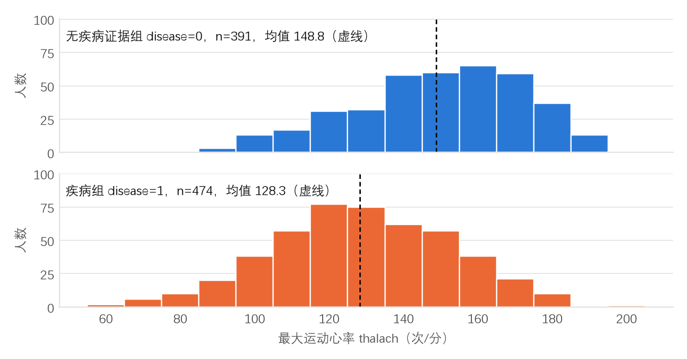

# 统计检验与假设设计学生答卷

这份作业我想回答一个问题：有心脏病证据的人，最大运动心率和没有的人一样吗？先把结论放在前面：疾病组平均低了约 20.5 次/分；把年龄、性别和中心考虑进去以后，差距缩小到约 12.2 次/分，但仍然存在。不过这是观察性资料，只能说两者有关联，不能说心脏病“导致”心率降低。

数据来源：hypothesis/data/heart-disease-hypothesis.csv；字段解释见同目录 README.md。

## 任务 1：把问题变成假设

题目里的“有关”太笼统，没法直接检验：均值不同、比例不同、分布不同，都可以叫“有关”。心率是连续变量，比较的又是两组人，所以我把“有关”落到最直观的一个量上，也就是两组平均心率的差 Δ。下面是我填的各项。

| 填写项 | 我的答案 |
| --- | --- |
| 研究问题 | 在这四个中心的资料里，有疾病证据和没有疾病证据的人，最大运动心率的总体平均值一样吗？ |
| 研究对象 | 这四个中心的受试者。主要分析只用测到了心率的人，所以结论不能直接推广到所有人群，也不能推到没测心率的人身上。 |
| 比较对象 | disease=1（num>0，有疾病证据）对比 disease=0（num=0）。我没把后者叫“健康组”：num=0 只说明没达到这个标签的疾病标准，不等于完全健康。 |
| 主要终点 | thalach，也就是最大运动心率，单位次/分。看结果之前就定好了，而且只定这一个。 |
| 分析单位 | 一行就是一名受试者。site 是数据来自哪个中心，不是随机分出来的组。 |
| H₀ | 设两组总体平均心率分别是 μ₁、μ₀，Δ=μ₁−μ₀（固定用疾病组减无疾病组）。H₀：Δ=0，也就是两组平均值一样。 |
| H₁ | H₁：Δ≠0。Δ 是负数就说明疾病组更低。 |
| α | 0.05，跑检验之前就定死。 |
| 单侧或双侧及理由 | 双侧。题目问的是“是否不同”，不是“是否更低”，反方向的差异也有意义。而且方向必须在看数据前定；看到结果再改成单侧，等于看了答案再改题目。 |
| 检验与纳入规则 | 用双侧 Welch 独立样本 t 检验。只排除分组或心率缺失的人；其他字段缺了不删，心率不填补，也不在看完结果后删“奇怪的点”。 |

这些选择是我跑检验之前写下的。需要说明：这只是课堂练习的分析约定，不是正式的预注册。

## 任务 2：错误类型与 power

**第一类错误：**两组平均心率其实一样，我却拒绝了 H₀，说“疾病组心率不同”。放到这道题里，就是团队把一个不存在的关联写进了结论。只要检验假设成立、规则事先定好，犯这类错误的概率就是 α=0.05。

**第二类错误：**两组其实不一样，我却没有拒绝 H₀，把真实的差异漏掉了。这个概率记作 β；power=1−β，也就是“差异真的存在时，我能把它查出来的概率”。

**影响 power 的因素：**样本越多、真实差距越大、测量噪声越小，power 就越高。光这样说不够直观，我用本数据的标准差（约 23.8 次/分）当规划值算了一下（双侧 α=0.05，目标 power 80%）：想查出 10 次/分的差距，每组大约要 91 人；差距只有 5 次/分时，每组要 358 人，差距减半，样本要翻 4 倍；如果测量噪声让标准差翻倍，查出 10 次/分同样要每组 358 人。

还要注意两点。第一，power 应该在设计研究时就算；拿这次观测到的差值去算“事后 power”，提供不了 p 值以外的新信息。第二，样本再大，也纠正不了混杂、选择偏倚或测量本身的系统偏差。

**未拒绝 H₀ 的边界：**没拒绝 H₀ 只说明现有证据不够，不代表两组一样，更不等于“接受 H₀”。如果真想说明“差距小到可以忽略”，得事先定一个可以接受的差距范围，再做等效性检验。

## 任务 3：选择方法

选方法时我不去死记“什么题配什么检验”，而是每次问自己三个问题：结局是连续变量还是分类变量？比较几组？数据是独立的还是配对的？这三个问题答完，方法基本就定了。下面五题只是选方法，真正做推断的只有预先定好的 thalach。

| 问题 | 首选方法 | 关键假设 | 备选方法 |
| --- | --- | --- | --- |
| 两独立疾病组的 thalach 是否不同 | Welch t 检验，比较两组平均值。 | 人与人之间相互独立。每组样本大，均值近似正态问题不大，但要看看有没有严重离群值。不要求两组方差相等。 | Mann–Whitney U 检验。注意它比的是“哪组的值更容易偏大”，不能直接说成中位数检验。 |
| 同一患者前后测量是否变化 | 配对 t 检验：先算每个人“后−前”的差，再检验这些差值。 | 前后要正确配对，不同患者之间独立；样本小时，差值要大致正态、没有严重离群。 | Wilcoxon 符号秩检验，要求差值分布大致对称；不对称时可以用符号检验。 |
| sex 与 disease 的比例是否有关 | 2×2 列联表 Pearson χ² 检验。 | 每人只落在一个格子里，观测独立，每格的期望频数够大。 | 格子频数太小时用 Fisher 精确检验。 |
| age 与 thalach 是否相关 | Pearson 相关，报告 r 和置信区间。 | 关系大致是一条直线，观测独立，没有一两个极端点左右结果。 | Spearman 秩相关，只要求单调，不要求直线。 |
| age、sex、thalach 能否预测 disease | Logistic 回归，以 disease 为结局，报告 OR 和 95% CI。 | 观测独立；连续变量和 log-odds 大致呈直线关系；没有完全分离和严重共线性；疾病例数相对变量数要够。 | 带惩罚的 Logistic 回归，可以加样条处理非线性。 |

### 放到本题里要注意什么

**为什么直接选 Welch：**很多人习惯先做方差齐性检验，再决定用哪种 t。但这种“两步走”会让整体错误率偏离 5%。Welch 在两组方差相等时和普通 t 几乎一样，没什么损失，所以我直接选它。

**配对题：**我本来想用数据实际算一下，结果发现 CSV 里每人只有一行，没有前后两次测量，所以这题只能选方法，没法算。

**相关题：**我会先画散点图。相关系数接近 0 不代表没关系，可能是 U 形；而且相关也不等于因果。

**预测题：**模型里系数显著，只说明有关联，不说明“预测得好”。要回答能不能预测，得把数据分成训练集和验证集，在模型没见过的数据上看 AUC、校准和 Brier 分数；换一个中心使用，还要在新中心重新验证。另外，这些变量和疾病标签是同时测的，只能说“区分当下有没有病”，不能说“预测将来会不会得病”。

任务 3 只要求选方法，我没有把五题都算一遍。如果都算，就成了到处找显著结果，这正是任务 5 要讨论的风险。

## 任务 4：报告一个主要结果

### 先看样本和分布

原始数据一共 920 人，disease 没有缺失；但心率缺了 55 人（5.98%），真正进入分析的是 865 人。我只按分组和心率筛选，别的字段缺了不删。这里有个容易踩的坑：报告每组 n 时要用实际分析的 474 和 391，不能用原始的 509 和 411。

| 项目 | 无疾病证据组 disease=0 | 疾病组 disease=1 |
| --- | --- | --- |
| 原始人数 | 411 | 509 |
| 心率缺失人数及比例 | 20（4.87%） | 35（6.88%） |
| 实际分析人数 n | 391 | 474 |
| 均值 ± 标准差，次/分 | 148.80 ± 23.61 | 128.26 ± 24.02 |
| 中位数［第 1，第 3 四分位数］ | 151.0［134.5，167.5］ | 128.0［112.0，145.0］ |
| 最小值至最大值，次/分 | 69 至 202 | 60 至 195 |
| 偏度 | −0.52 | −0.07 |

数据核查时还发现两件事。一是有 4 对记录（如 Hungary-102 和 Hungary-103，另 3 对在 VA Long Beach）所有临床字段一模一样，可能是重复录入，也可能只是巧合；我没法确认是同一个人，所以没删，但独立性需要找原始资料确认。二是有 172 条 chol=0（Switzerland 123 条全是 0，VA Long Beach 49 条）、1 条 trestbps=0，生理上不可能，应该是没测、用 0 占了位。它们不影响这次的心率分析，但如果有人拿 chol 直接算平均值，就会算错。

图 1　两组 thalach 分布（每格 10 次/分，两组纵轴刻度相同）

**分布检查：**跑 t 检验之前我先画了图。t 检验只告诉我均值差，图还能看出分布形状、有没有奇怪的点、两组重叠多少。两组都是单峰，疾病组整体往左移，但重叠很多。无疾病证据组略左偏（偏度 −0.52），疾病组基本对称（−0.07）。按 1.5×IQR 规则，两组分别有 2 个和 2 个离群点（69、80 和 60、195 次/分），都在生理上说得通的范围内，按事先规定不删。每组都有 390 多人，均值差近似正态，t 检验可以放心用；不过记录之间是否独立，图上是看不出来的。

### 主要结果

疾病组减无疾病证据组，均值差是 −20.54 次/分，95% CI 为 ［−23.73，−17.35］ 次/分。标准误 1.6258，Welch t=−12.633，自由度约 837.18，双侧 p=1.30×10⁻³³。p 值小到这个程度，精确数字依赖分布尾部的近似，正式报告写 p<0.001 就够了；这里保留精确值，是为了方便核对。

计算核对：为了确认软件给的方向和区间就是我想要的，我手算了一遍。标准误 = √(24.0242²/474 + 23.6087²/391) = 1.6258；t = −20.5389/1.6258 = −12.6333；95% CI = 均值差 ± t 临界值 × 标准误，临界值按 Welch 自由度取。

**效应量：**我先想到的是 Cohen’s d，算出来是 −0.862（小样本修正后的 Hedges’ g 是 −0.861），按惯例算“大效应”。但跟医生说“d 等于负 0.86”不好懂，说“平均低 20 次/分”马上就懂。所以主要效应量用原始单位的均值差，d 只作补充。

**H₀ 决策：**p<0.05，拒绝“两组平均值相等”的 H₀。这里有两个容易说错的地方。一是 p 值不是“H₀ 为真的概率”，而是假设 H₀ 和检验条件都成立时，得到至少这么极端的 t 值的概率。二是 95% CI 不是“真实 Δ 有 95% 的概率落在这个区间里”，而是说按同样方法反复抽样、构造区间，大约 95% 的区间会盖住真实值。这个区间整段都小于 0，说明疾病组平均心率更低。

### 统计关联、实际意义与因果边界

**统计关联：**在测到心率的这些人里，两组的平均最大心率确实不同，而且证据很强。这是“平均值”层面的结论。

**实际意义：**平均差 20.5 次/分不算小，但资料没给“差多少才有临床意义”的标准，光凭显著不能说它有临床价值。图上两组重叠很多，我想把重叠量化：Mann–Whitney 的 U 除以两组人数之积，就是“随机各抽一人，疾病组那个人心率更高的概率”，算出来约 27%（平局算一半）。也就是说，平均差了 20 次，仍有四分之一以上的配对是疾病组的人心率更高，所以不能拿一个人的心率去判断他有没有病。

**因果边界：**这是观察性的横断面资料，没有随机分组。我想到两个具体的替代解释：一是用药，β 受体阻滞剂这类药本身就会压低心率，而数据里没有用药信息；二是测量方式，thalach 是运动试验中达到的最大心率，如果疾病组的人因为胸痛等症状提前停了，测到的“最大”心率自然偏低。所以不能说“心脏病导致心率降低”，也不能说把心率提上去就能降低患病风险。

## 任务 5：风险与退出卡

### 混杂因素与调整分析

讲完主结果，我会问自己：这 20 次的差距，会不会是别的因素造成的？判断混杂因素我用一个标准：这个变量要同时和“分组”有关、又和“心率”有关。按这个标准，我挑了年龄、性别和来源中心。

**年龄：**常用的经验是最大心率约等于 220 减年龄，年龄越大心率越低；同时年龄越大，心脏病也越常见。数据里疾病组平均 55.55 岁，无疾病证据组 50.20 岁，差了 5 岁多。调整模型里年龄系数是每岁 −0.90 次/分，和“220 减年龄”的经验很接近。

**性别：**疾病组男性占 89.45%，无疾病证据组占 63.68%，构成差别很大。模型里性别系数不显著（p=0.28），但我没有把它删掉：协变量是事先按专业知识定的，不能看了 p 值再决定放不放。

**中心：**这是我看数据时才意识到的。四个中心的疾病比例差得很远：Cleveland 45.9%、Hungary 36.2%、Switzerland 93.4%、VA Long Beach 78.2%，瑞士几乎全是疾病组；调整后，其他三个中心的平均心率比 Cleveland 低 17–21 次/分。中心既和分组有关、又和心率有关，不调整就会混进组间比较。

于是我拟合了 thalach ~ disease + age + sex + C(site)。中心是名字不是数字，所以作为分类变量放进去；标准误用 HC3 稳健标准误，它不要求每个人的残差方差相同，和选 Welch 是同一个思路。865 人这些变量都齐全。结果疾病系数为 −12.17 次/分，95% CI ［−15.51，−8.84］，p=1.68×10⁻¹²。和未调整的 −20.54 相比缩小了约 41%，说明原来的差距里有相当一部分可以由年龄、性别和中心解释，但区间仍然不跨 0。调整后的数也不是因果效应，因为没测的因素（比如用药）模型调整不了。

| 来源中心 | n₀ / n₁ | 均值差，次/分 | 95% CI |
| --- | --- | --- | --- |
| Cleveland | 164 / 139 | −19.12 | ［−23.91，−14.33］ |
| Hungary | 187 / 106 | −16.24 | ［−21.62，−10.87］ |
| Switzerland | 8 / 114 | −16.12 | ［−37.87，5.62］ |
| VA Long Beach | 32 / 115 | −2.74 | ［−13.47，8.00］ |

我还把四个中心分开算了一遍（没做多重比较校正，只作探索），四个点估计都是负的。看到 Switzerland 和 VA Long Beach 的区间跨 0，很容易以为“这两个中心没关联”，但这里有两个坑。一是不显著不等于没关联：瑞士无疾病证据组只有 8 人，区间宽得说明不了什么。二是“有的显著、有的不显著”不能证明中心之间不一样，要回答这个问题得做交互检验。我事后补做了 disease×site 交互的联合检验（HC3），F=2.47，p=0.061，证据不足以下结论。不过 VA Long Beach 的点估计确实明显偏小，所以合并的调整估计更像是各中心“平均”出来的结果。

另外，Mann–Whitney U=49,781，双侧 p=9.03×10⁻³²，方向一致，但它比的是分布而不是均值。上面的模型假设各因素的作用可以相加、年龄是直线关系；HC3 也处理不了没测的混杂或中心内部的相关，所以敏感性分析不能证明偏倚已经排除。

### 缺失与选择风险

一开始我只是按中心例行数了一下心率缺失：Cleveland 0/303、Hungary 1/294、Switzerland 1/123、VA Long Beach 53/200（26.5%）。55 条缺失里有 53 条在 VA Long Beach，太集中了，我就追问：这些人为什么会缺？回去看同一行的其他字段，发现这 55 人的静息血压全都缺失，ST 压低也缺了 54 个。也就是说，不是单单漏记了心率，而是整次检查的数据都没有，可能是没做或没做完检查。所以不能想当然地认为缺失是完全随机的。

**比较已观测特征：**缺失者平均 59.4 岁、男性占 96.4%，纳入者是 53.1 岁、77.8%，差别主要是因为缺失几乎都来自 VA Long Beach。在 VA 中心内部比较更公平：缺失者的疾病比例是 64.2%，纳入者是 78.2%。缺失的人和纳入的人确实不一样，但看不出一个简单的方向。

**事后补充的敏感性分析：**这会不会动摇主结果？我把 VA Long Beach 整个拿掉重算，均值差是 −20.72 次/分，95% CI ［−24.16，−17.28］，和主结果几乎一样，说明主结果不是靠这个中心撑着的。但它回答不了“缺失的人如果有数据会怎样”。要真正解决，得先查清缺失原因，再在明确的假设下做多重插补和非随机缺失的情景分析，这次我没有做。

说明：缺失比较、去掉 VA Long Beach 的分析和交互检验，是我看完第一版结果后补的，在分析约定里单独列成“事后补充”。它们没有改变主要终点、假设和结论，只用来检查结果稳不稳。

### 只挑显著指标的风险

假设团队测了 20 个指标，其实都和疾病无关，每个都用 α=0.05。每个不出错的概率是 0.95，20 个都不出错是 0.95²⁰≈0.36，所以至少冒出一个“显著”的概率约 64.2%，平均会出 1 个假阳性。指标之间相关时这个数不精确，但风险还在。如果只挑那个显著的写进结论，读者看到的 p<0.05 就是误导，而且挑出来的效应往往还被高估了。

我的应对是：一开始就把 thalach 定为唯一主要终点，其他分析都标成敏感性或探索性，并且如实报告。如果事先就要同时确认 20 个结论，可以用 Bonferroni（每个检验的阈值降到 0.05/20=0.0025）或更高效的 Holm 法控制家族错误率；如果是探索性筛选，可以控制 FDR，筛出来的发现要在新数据里再验证。

### 退出卡四句话

**主张：**在这批四中心资料里，有疾病证据的人，平均最大运动心率更低。

**证据：**疾病组 474 人、无疾病证据组 391 人，均值差 −20.54 次/分，95% CI ［−23.73，−17.35］，p=1.30×10⁻³³；调整年龄、性别和中心后是 −12.17 次/分，95% CI ［−15.51，−8.84］。

**推理：**主要检验的区间不包含 0，调整分析和四个中心的点估计方向也一致，所以数据支持两者之间存在统计关联。

**边界：**这是没有随机分组的横断面观察资料，中心差异、集中缺失、用药和运动试验提前终止这些因素都没排除，所以不能说是因果，也不能说有临床价值，更不能用来给个人下诊断。
