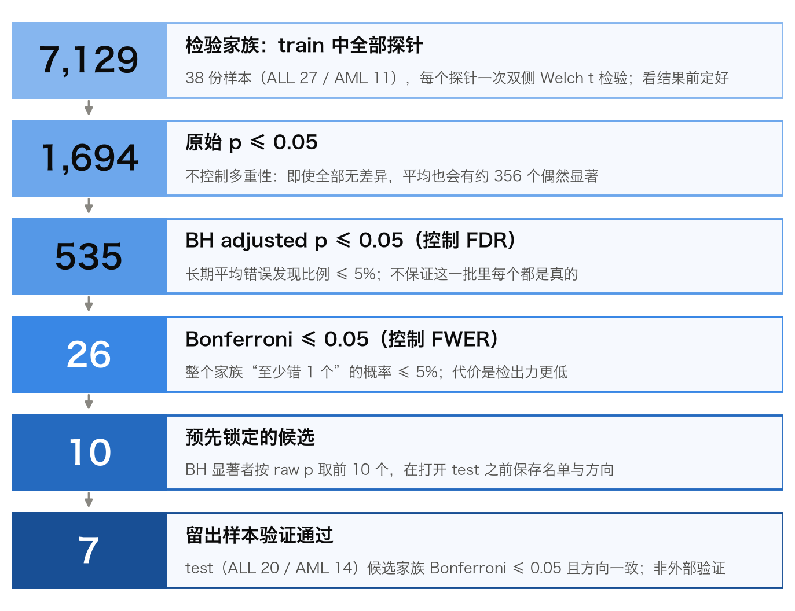
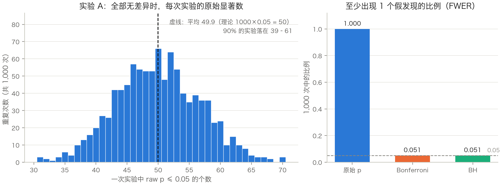
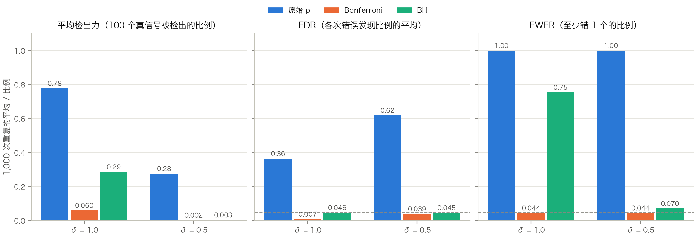
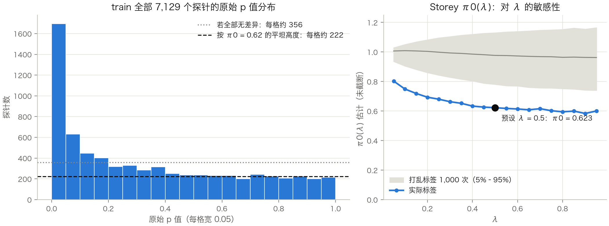
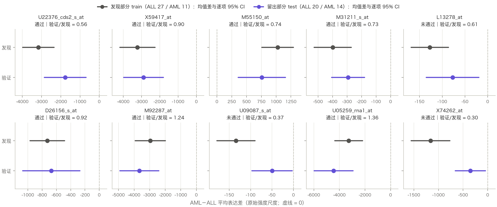
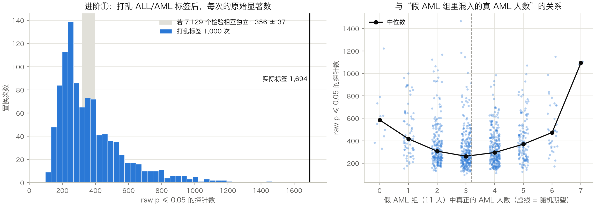

# 第五课作业｜7,129 个探针里，有多少差异是真的？

**——多重检验校正在 Golub 白血病表达数据上的应用**

---

## 0. 一页结论

**自选问题：** 在 7,129 个探针中，AML 与 ALL 的表达差异"大概有多少"是真的？其中哪几个探针可以被可靠地点名，值得进一步验证？

1. **数量。** train 中有 1,694 个探针的原始 p≤0.05。即使 ALL/AML 之间完全没有差异，也会有一部分探针偶然显著：按检验相互独立估算平均约 356 个；把标签打乱 1,000 次后，偶然显著数最多为 1,466。实际的 1,694 超过了全部 1,000 次打乱结果。Storey 方法估计约 38% 的探针（λ 取 0.2–0.8 时为 2,200–2,900 个）存在非零均值差。不过置换检验显示这个估计受探针间相关性影响较大，因此我只把它当作数量级来用。
2. **点名。** 在 FDR 5% 下，BH 给出 535 个候选。我按事先写好的规则锁定其中 10 个，之后才打开留出样本：7 个在候选家族内 Bonferroni≤0.05，且方向与发现时一致。
3. **边界。** 这 7 个结果的含义是"同一研究的留出样本中复现了探针水平的表达差异"。它们不是致病基因，也不是外部队列验证。10 个候选中有 8 个在验证时效应变小，说明发现阶段的效应量偏乐观。

**图 1 解读：** 这张图按顺序列出每一步保留的探针数，以及这一步能支持的主张。数量从 7,129 依次减少到 1,694、535、26、10、7，每一步的筛选标准都比上一步更严格。漏斗只表示证据逐级加强，不表示最后 7 个以外的探针没有差异：没被选中，不等于被证明无效应。

---

## 1. 数据与预先固定的分析协议

| 项目 | 内容 |
|---|---|
| 数据 | Golub 等 (1999) 白血病芯片数据，OpenML 1104 v1；72 个样本 × 7,129 个探针 |
| 文件校验 | `leukemia.csv` 的 SHA-256 为 `915bce00…45156f19`，脚本运行时自动核对 |
| 发现部分 train | ALL 27 / AML 11，用于全部筛选与候选锁定 |
| 留出部分 test | ALL 20 / AML 14，只在候选锁定后打开一次 |
| 表达尺度 | 原始芯片强度，28.7% 的值为负，未取对数 |

**协议（在运行真实数据 C1 之前写定）：**

- 研究问题：train 中 AML 与 ALL 的平均表达是否不同。
- 单个探针的零假设：两组均值相等。每个探针做一次双侧 Welch t 检验，差值方向统一记为 AML−ALL。
- 家族：train 中全部 7,129 个探针列，m=7,129。统一阈值为 0.05，同时报告 Bonferroni（控制 FWER）和 BH（控制 FDR）两种校正。
- 候选：从 BH≤0.05 的探针中，按 raw p 升序取前 10 个；raw p 相同时按探针名排序。锁定名单写入 `output/locked-candidates.csv`。脚本以"文件已存在就不覆盖、只比对"的方式写入，重跑时不会改动名单。
- 验证判据：在 test 中，10 个候选组成新的家族。要求候选家族内 Bonferroni≤0.05，并且差值方向与发现时一致。即使某个候选未通过，也不会换上新的候选。

**家族要按"实际有过的检验机会"来定义，而不是按"最后报告了多少"。** 下表是我对四种常见做法的判断：

| 分析行为 | 实际的检验 / 选择机会 | 应如何预先说明 |
|---|---|---|
| 比较 5 个临床指标 | 5 次检验 | 事先指定 1 个主要终点；其余作为次要终点，一并校正 |
| 分析 4 个亚组 | 至少 4 次（加上总体分析是 5 次） | 事先列出亚组，并报告全部亚组，包括不显著的 |
| 试 3 个模型，只报告最显著的 | 3 条分析路径，属于隐藏的多重性 | 事先固定一个模型，或者把 3 个都报告出来 |
| 看完 7,129 个 p 值后只报告前 20 个 | 7,129 次，不是 20 次 | 在完整家族上校正，见 4.2 节 |

---

## 2. 由定义推出的理论预期

下面这些结论直接从定义推出，用来和后面的实验结果对照：

- **全部为零效应时，原始显著数的期望。** 设 m 个检验的零假设都成立，单项阈值为 α。每个 p 值落在 α 以下的概率都是 α。由期望的线性性，E[R]=m·α。**这一步不需要假设检验相互独立。** 独立性影响的是 R 的波动大小：只有在独立时，R 才服从二项分布，标准差为 √(mα(1−α))。
  - 模拟实验 A（m=1,000）：预期 50 ± 6.9 个。
  - 真实数据（m=7,129）：如果检验独立，预期 356 ± 18.4 个。
- **Bonferroni。** 把阈值改为 α/m，由并集不等式可得 FWER≤α。这一结论同样不需要独立性。
- **BH。** 在检验独立或正相关（PRDS）的条件下，FDR≤π0·α，其中 π0 是真零假设所占的比例。因此当 π0<1 时，BH 实际上比名义水平更保守。例如在实验 B 中 π0=0.9，预期 FDR 约为 0.9×0.05=0.045。

---

## 3. 模拟实验：先在已知真相的数据上检查方法

**设计。** 沿用课程 notebook 的模拟设置：

- 每次生成 1,000 个相互独立的正态变量，两组样本量与 train 相同（AML 11、ALL 27），用等方差 t 检验。
- 重复 1,000 次，种子固定为 42。
- 实验 A：所有变量都没有差异。
- 实验 B：前 100 个变量在 AML 组加上 δ 个标准差，δ 分别取 1.0 和 0.5；两种 δ 使用同一套随机噪声。

这些模拟数据不是 Golub 的实测表达值，作用只是在"知道哪些变量真的有差异"的条件下检验方法本身。

### 3.1 实验 A：全部无差异

| 方法 | 第一次运行的 R | 1,000 次平均 R | R 的标准差 | R 的 5%–95% 区间 | FWER 估计（MCSE） |
|---|---:|---:|---:|---|---:|
| 原始 p | 42 | 49.944 | 6.76 | 39–61 | 1.000 |
| Bonferroni | 0 | 0.051 | 0.22 | 0–1 | 0.051（0.007） |
| BH | 0 | 0.052 | 0.23 | 0–1 | 0.051（0.007） |

**图 2 解读：** 左图是 1,000 次全零实验中原始显著数的分布，右图是三种方法"至少出现 1 个假发现"的比例。

- 原始 p 的平均值是 49.9，标准差 6.76，与独立条件下的理论值 50 和 6.89 吻合。但单次实验可以低到 39 或高到 61：我第一次运行只得到 42 个，并不说明方法有问题。
- Bonferroni 和 BH 的 FWER 都是 0.051，减去和加上两倍 MCSE 后的区间约为 0.037–0.065，包含 0.05。
- 这张图只覆盖"检验相互独立"的情形。真实探针之间相关时，波动会大得多，见第 5 节。

**一个细节：** 在全零情形下，每一次实验的 FDP 只可能是 0 或 1，所以 FDR 恰好等于 FWER（表中均为 0.051）。也就是说，BH 在全零时同样控制 FWER；一旦存在真信号，这一点就不再成立。

### 3.2 实验 B：100 个真信号 + 900 个零效应

| δ | 方法 | 平均 R | 平均 V | FWER | FDR | 平均检出力 |
|---|---|---:|---:|---:|---:|---:|
| 1.0 | 原始 p | 122.5 | 44.8 | 1.000 | 0.364 | 0.777 |
| 1.0 | Bonferroni | 6.0 | 0.044 | 0.044 | 0.007 | 0.060 |
| 1.0 | BH | 30.1 | 1.445 | 0.754 | 0.046 | 0.286 |
| 0.5 | 原始 p | 72.4 | 44.8 | 1.000 | 0.619 | 0.276 |
| 0.5 | Bonferroni | 0.27 | 0.044 | 0.044 | 0.039 | 0.002 |
| 0.5 | BH | 0.41 | 0.072 | 0.070 | 0.045 | 0.003 |

**图 3 解读：** 三个子图分别比较三种方法在两种信号强度下的检出力、FDR 和 FWER，虚线为 0.05。

- δ=1.0 时，BH 的检出力（0.286）约为 Bonferroni（0.060）的 5 倍，而 FDR 仍为 0.046。
- 这张图不能说明哪种方法"更好"，因为两者控制的是不同的错误。

**从这张表里我得到三点认识：**

1. **FWER 0.754 和 FDR 0.046 并不矛盾。** BH 允许出错，只保证错误平均只占发现的一小部分：平均每次约有 30 个发现，其中约 1.4 个是假的。因此"至少错 1 个"在 75% 的实验里都会发生，但错误比例的长期平均仍在 5% 以下。实测 FDR 0.046 和 0.045 也与第 2 节的预期 π0·α=0.045 吻合，说明 BH 因为隐含地假设 π0=1 而偏保守。这也是我在第 6 节尝试 Storey π0 的原因。
2. **平均 V 除以平均 R 不等于 FDR。** 以 δ=0.5 的 BH 为例：0.072/0.407=0.177，而真正的 FDR 是 0.045。原因有两个：FDR 是先在每次实验中计算 V/max(R,1)，再取平均；另外很多次实验 R=0，这些实验的 FDP 记为 0。直接用两个平均数相除，相当于给发现多的那几次实验更大的权重。
3. **信号变弱后，"没检出"不能当作"没效应"。** δ=0.5 时，两种校正方法的检出力只有 0.2%–0.3%。100 个真信号几乎都会被漏掉，但它们确实存在。

**核对：** 两种 δ 下原始 p 的平均 V 完全相同（都是 44.799，约等于 900×0.05），说明两种设置确实共用了同一套噪声。

---

## 4. 真实数据：证据逐步增加（C1–C4）

### 4.1 C1：对全部 7,129 个探针做发现

家族大小 m=7,129，Bonferroni 对应的原始 p 阈值为 0.05/7,129≈7.01×10⁻⁶。BH 中满足条件的最大排序位置是 k=535：p₍₅₃₅₎=0.003747，不超过阈值 535×0.05/7,129=0.003752。

| 方法 | 发现数 | 这一步能支持的主张 | 还不能说明的事 |
|---|---:|---|---|
| raw p≤0.05 | 1,694 | 显著数远多于全零时预期的约 356 个，说明 AML/ALL 之间存在大量差异 | 无法判断哪些是真的；按独立条件估计，可能有数百个是偶然 |
| BH≤0.05 | 535 | 若重复这一流程，假发现所占比例的长期平均不超过 5% | 不保证这一批中每一个都是真的；不能说某个探针"95% 为真" |
| Bonferroni≤0.05 | 26 | 整个家族出现任何一个假发现的概率不超过 5% | 漏掉的探针很多（参考实验 B 中 0.06 的检出力）；也不说明效应的大小 |

**补充观察：**

- **方向。** BH 显著的 535 个探针中，AML 更高的有 98 个，AML 更低的有 437 个。
- **控制探针。** 其中有 3 个是 AFFX 质控探针：AFFX-BioC-5_at、AFFX-CreX-5_st、AFFX-PheX-M_at，BH 值分别为 0.044、0.033、0.024。这些探针本来就不对应要研究的人类基因，它们出现在名单中提醒我：两组之间也可能存在技术或批次差异，统计显著不等于生物学差异。

**一种方法"算错了"吗？** 没有。三种方法用的是同一批原始 p 值，只是控制的错误不同，所以划出的线不同。真实数据中我们不知道哪些探针真的有差异，因此填不出 V 和真实检出力；这正是第 3 节要先用模拟数据检验方法的原因。

**图 4 左解读：** 这是 7,129 个原始 p 值的直方图，每格宽 0.05。

- 最左一格有 1,694 个，远高于"全部无差异"时每格约 356 的水平（点线）。
- 右侧的平坦部分每格约 222 个（虚线）。
- 这个形状能说明"有大量非零假设"，但从直方图本身无法看出是哪些探针。右图在第 6 节讨论。

### 4.2 C2：先挑前 20 个再校正，为什么不可靠

以 raw p 最小的 U22376_cds2_s_at 为例：

| 探针 | raw p | 完整家族 Bonferroni | 完整家族 BH | 错误流程（只校正前 20）Bonferroni / BH |
|---|---:|---:|---:|---:|
| U22376_cds2_s_at | 8.39×10⁻⁹ | 5.98×10⁻⁵ | 5.98×10⁻⁵ | 1.68×10⁻⁷ / 1.68×10⁻⁷ |

错误流程算出的校正 p 值比完整家族小 7,129/20≈356 倍。这次挑出的 20 个探针在两种流程下全部显著，所以发现的个数没有变化。变化的是这个数字背后的保证：

- 这 20 个是在看过全部 7,129 个 p 值之后才挑出来的，实际的检验机会仍是 7,129 次。
- 把家族缩小到 20，相当于假装另外 7,109 次检验没有做过，"FWER≤5%"的承诺因此不再成立。
- 如果这 20 个探针是在看数据**之前**、依据文献或独立数据事先指定的，那么以 20 为家族是合理的。

### 4.3 C3：先看效应量，再锁定候选

锁定时间为 2026-10-21 09:51:38，文件为 `output/locked-candidates.csv`。10 个候选在 train 中的结果如下：

| # | 探针 | 均值差 AML−ALL | 逐项 95% CI | Cohen d | raw p | Bonferroni | BH |
|---:|---|---:|---|---:|---:|---:|---:|
| 1 | U22376_cds2_s_at | −3,160.9 | [−3,977.8, −2,344.0] | −1.85 | 8.39×10⁻⁹ | 5.98×10⁻⁵ | 5.98×10⁻⁵ |
| 2 | X59417_at | −3,223.2 | [−4,187.5, −2,258.9] | −1.64 | 9.82×10⁻⁸ | 7.00×10⁻⁴ | 3.50×10⁻⁴ |
| 3 | M55150_at | +1,026.0 | [759.1, 1,292.8] | 2.98 | 2.47×10⁻⁷ | 1.76×10⁻³ | 4.64×10⁻⁴ |
| 4 | M31211_s_at | −398.8 | [−527.4, −270.3] | −1.59 | 2.92×10⁻⁷ | 2.08×10⁻³ | 4.64×10⁻⁴ |
| 5 | L13278_at | −127.4 | [−168.5, −86.2] | −1.57 | 3.25×10⁻⁷ | 2.32×10⁻³ | 4.64×10⁻⁴ |
| 6 | D26156_s_at | −727.2 | [−969.1, −485.3] | −1.59 | 5.18×10⁻⁷ | 3.70×10⁻³ | 6.16×10⁻⁴ |
| 7 | M92287_at | −2,955.8 | [−3,925.8, −1,985.9] | −1.47 | 6.83×10⁻⁷ | 4.87×10⁻³ | 6.61×10⁻⁴ |
| 8 | U09087_s_at | −134.0 | [−178.6, −89.4] | −1.47 | 7.41×10⁻⁷ | 5.28×10⁻³ | 6.61×10⁻⁴ |
| 9 | U05259_rna1_at | −3,274.7 | [−4,361.7, −2,187.8] | −1.41 | 1.31×10⁻⁶ | 9.37×10⁻³ | 1.03×10⁻³ |
| 10 | X74262_at | −1,161.2 | [−1,555.9, −766.6] | −1.40 | 1.49×10⁻⁶ | 1.06×10⁻² | 1.03×10⁻³ |

**一个候选的完整证据记录：U22376_cds2_s_at**

| 项目 | 内容 |
|---|---|
| 样本量 | AML 11 / ALL 27 |
| 组均值 | AML 702.4，ALL 3,863.3 |
| 均值差 AML−ALL | −3,160.9，逐项 95% CI [−3,977.8, −2,344.0] |
| Cohen d | −1.85 |
| raw p | 8.39×10⁻⁹ |
| 完整家族 Bonferroni / BH | 5.98×10⁻⁵ / 5.98×10⁻⁵ |

**怎么读这些数：**

- **负号的含义。** 负号表示在 train 中 AML 的平均强度低于 ALL。数值的单位是芯片原始强度，不是表达倍数：数据没有取对数，而且 28.7% 的值是负数，比值和 log 倍数在这里都没有定义。所以我只说"AML 低约 3,161 个强度单位"，不说"低 5.5 倍"。
- **p 值排序不等于效应排序。** M55150_at 的 |d|=2.98 是 10 个候选中最大的，但它的 p 值只排第 3。
- **逐项 CI 的覆盖范围。** 每个 95% CI 只针对它自己那个探针，既不覆盖整个家族，也没有对"先按 p 值挑出来"这一步做调整。被挑中的往往是"恰好偏大"的估计，4.4 节的验证结果印证了这一点。

### 4.4 C4：打开留出样本

验证家族为 10 个候选，判据是 Bonferroni≤0.05（等价于 raw p≤0.005），且方向与发现时一致。

| 探针 | 验证均值差 | 逐项 95% CI | raw p | 候选家族 Bonferroni | 方向一致 | 通过 | 验证/发现比值 |
|---|---:|---|---:|---:|:---:|:---:|---:|
| U22376_cds2_s_at | −1,766.7 | [−2,850.7, −682.7] | 0.0023 | 0.023 | 是 | **是** | 0.56 |
| X59417_at | −2,887.3 | [−3,974.6, −1,800.0] | 1.5×10⁻⁵ | 1.5×10⁻⁴ | 是 | **是** | 0.90 |
| M55150_at | +758.1 | [357.3, 1,159.0] | 0.0009 | 0.009 | 是 | **是** | 0.74 |
| M31211_s_at | −292.3 | [−406.2, −178.5] | 1.0×10⁻⁵ | 1.0×10⁻⁴ | 是 | **是** | 0.73 |
| L13278_at | −77.2 | [−135.1, −19.2] | 0.011 | 0.107 | 是 | 否 | 0.61 |
| D26156_s_at | −671.2 | [−1,071.8, −270.6] | 0.0020 | 0.020 | 是 | **是** | 0.92 |
| M92287_at | −3,661.5 | [−4,916.4, −2,406.5] | 5.4×10⁻⁶ | 5.4×10⁻⁵ | 是 | **是** | 1.24 |
| U09087_s_at | −49.8 | [−97.0, −2.7] | 0.039 | 0.390 | 是 | 否 | 0.37 |
| U05259_rna1_at | −4,460.9 | [−5,985.2, −2,936.7] | 5.7×10⁻⁶ | 5.7×10⁻⁵ | 是 | **是** | 1.36 |
| X74262_at | −352.2 | [−659.6, −44.9] | 0.026 | 0.260 | 是 | 否 | 0.30 |

**图 5 解读：** 每个小图对比同一探针在发现部分（灰）和验证部分（紫）的均值差及逐项 95% CI。

- 10 个候选的方向全部一致，其中 8 个在验证时效应变小，比值的中位数为 0.736。
- 只有 M92287_at 和 U05259_rna1_at 的效应变大，比值分别为 1.24 和 1.36。
- 各探针的强度尺度不同，所以每个小图的横轴是独立的，不能跨图比较效应的大小。

**C4 的三个问题：**

1. **哪条证据改变了我最初的判断？** 是效应缩小这件事。发现阶段 U22376_cds2_s_at 的 p 值小到 10⁻⁹，我原以为它的效应会原样复现。结果验证时它的差值只剩 56%，而且 10 个候选里有 8 个变小。这就是"赢家诅咒"：按 p 值挑选时，挑中的往往是真实效应加上一点偏大噪声的那些。未通过的 3 个比值是 0.30、0.37、0.61，都在最小的四个之内。
2. **未通过是否说明没有效应？** 不能这么说。这 3 个探针在 test 中方向一致，raw p 都小于 0.05，逐项 CI 也都不跨 0，只是没达到预先定好的候选家族判据（0.005）。另外，L13278_at 和 U09087_s_at 在 AML 组的平均强度分别只有 0.5 和 46.9，接近芯片的检测下限。对这类低强度探针，测量噪声本来就大。
3. **test 能否叫外部独立队列？** 不能。test 来自同一项研究的原始划分（`original_split` 列），使用同一芯片平台和相近的处理流程，只能算"留出验证"。要进一步确认，需要新的独立队列（最好来自不同中心、用不同平台，如 RNA-seq 或 qPCR）；如果想谈机制，还需要功能实验。

---

## 5. 进阶①：打乱 ALL/AML 标签的置换检验

**为什么做。** "356 ± 18.4"这个参照来自检验相互独立的假设。但芯片上的基因常常成组地共同调控，探针之间显然不独立。我想知道：在保留真实相关结构的前提下，"没有组别差异"时的显著数到底会波动多大？1,694 是否仍然远远超出？

**方法。**

- 保持 AML 11、ALL 27 的组大小不变，把 train 的标签随机打乱 1,000 次（种子 42）。
- 每次重新计算 7,129 个 Welch t 检验和两种校正。
- 同时记录"假 AML 组里混入了几个真 AML"，以下称为重叠数。随机情况下重叠数的期望是 11×11/38≈3.18。
- 打乱只改变样本的标签，每个样本的整条表达谱不动，所以探针之间的相关性被完整保留。

| 指标 | 独立参照 | 打乱标签 1,000 次 |
|---|---:|---:|
| raw p≤0.05 的个数：平均 ± 标准差 | 356 ± 18.4 | 370 ± 199 |
| raw 个数：中位数 / 5%–95% / 最大值 | — | 312 / 162–791 / 1,466 |
| 至少 1 个 Bonferroni 发现的比例 | 0.05（名义） | 0.075 |
| 至少 1 个 BH 发现的比例 | 0.05（名义） | 0.082 |
| 　其中重叠数 2–4（756 次） | — | Bonferroni 0.061 / BH 0.063 |
| 　其中重叠数 0–1 或 5–7（244 次） | — | Bonferroni 0.119 / BH 0.139 |

**图 6 解读：**

- **左图**是 1,000 次打乱后原始显著数的分布。灰带是独立参照的 ±2 个标准差，竖线是实际标签下的 1,694。打乱后的分布向右拖着一条长尾，最多到 1,466，但没有一次达到 1,694，置换 p=1/1,001≈0.001。0.001 是 1,000 次置换所能给出的最小 p 值，不代表真实 p 恰好等于它。
- **右图**按重叠数分组画出原始显著数。中位数在重叠数为 3 时最低，为 262；往两端升高，重叠数为 0 时是 585，为 7 时是 1,093，呈 U 形。重叠数为 7 的打乱只有 2 次，这一端的估计不稳定。

**我从中得到的四点：**

1. **期望不受相关性影响，波动受很大影响。** 打乱后的平均值 370 与独立参照的 356 接近，这和第 2 节"期望不需要独立性"一致。但标准差从 18.4 变成 199，大了约 11 倍。所以"按独立参照，1,694−356≈1,338 个是真的"这种减法并不可靠，因为偶然显著数本身就可能在 162 到 791 之间变化。
2. **相关性没能解释 1,694。** 即使把相关结构完整保留下来，打乱标签也从未产生这么多显著结果，"存在大量真实差异"这一点因此更有说服力。
3. **打乱后的标签并不完全"无信息"。** Bonferroni 和 BH 在 7.5%–8.2% 的打乱中至少出了 1 个发现，高于名义的 5%。按重叠数分层后可以看到，超出部分主要来自重叠数偏离 3 的打乱。比如重叠数为 0 时，11 个真 AML 全在"假 ALL"组里，打乱后的分组其实仍然与真实分组强相关，真信号由此漏了进来，也解释了右图的 U 形。重叠数接近随机期望（2–4）时，这一比例为 6.1%–6.3%，以 756 次估计的 MCSE 约为 0.009，与 5% 相差不大。两种指标的 Spearman 相关系数也说明了 U 形：重叠数本身与显著数的相关只有 0.017，而"重叠数离 3.18 有多远"与显著数的相关为 0.27。
4. **有一个我没能解释的离群点。** 编号为 11 的那次打乱（`adv1-permutation-null.csv` 中 perm=11）重叠数正好是 3，却得到 1,466 个原始显著、2 个 Bonferroni 发现和 7 个 BH 发现。我推测可能和样本中某种未知的分组结构有关，但没有证据，所以只把它记录下来，不做解释。

**边界：** 只有 38 个样本时，打乱方式有限，而且无法让每次打乱都与真实标签完全无关。如果按重叠数做分层（受限）置换，可以得到更干净的零分布，我没有做这一步。

---

## 6. 进阶②：Storey π0 与 q-value

**为什么做。** 实验 B 显示，BH 实际的 FDR 约为 π0·α。真实数据中，如果大量探针确实有差异，π0 明显小于 1，BH 就偏保守。另外，π0 本身正好回答我的问题"大概有多少是真的"：非零假设的个数约为 m×(1−π0)。

**方法。**

- **原理：** 零假设下的 p 值服从 0 到 1 的均匀分布；真有差异的探针，p 值大多集中在 0 附近。因此 p>λ 的那一段基本都来自零假设。
- **π0 的估计：** π0(λ)=#{p>λ}/[m(1−λ)]，事先固定 λ=0.5。
- **q 值：** q=min(1, π0×BH 校正前的 m·p₍ᵢ₎/i)，再从后往前取累积最小值。等价地，q≤0.05 相当于"BH 校正后 p≤0.05/π0"。

**结果。**

| 指标 | 数值 |
|---|---|
| π0（λ=0.5） | 0.6225，即非零假设约 2,691 个（37.7%） |
| λ 取 0.2–0.8 时的 π0 | 0.595–0.693，对应约 2,185–2,889 个 |
| λ=0.05 时的 π0 | 0.80（小 p 值区混进了大量信号，估计偏高） |
| q≤0.05 的个数 | 773（BH 为 535，且 535 个全部包含在这 773 个之中） |
| 打乱标签后的 π0 | 中位数 0.977，5% 分位数 0.781，最小值 0.617 |

**图 4 右解读：** 蓝线是实际标签下 π0 随 λ 的变化，灰带是 1,000 次打乱的 5%–95% 范围。

- 实际的 π0=0.623，远低于打乱后的中位数 0.977。λ 在 0.4 以上时蓝线基本是平的，说明估计对 λ 不太敏感。
- 但在 1,000 次打乱里，确实有一次（即第 5 节提到的 perm=11）π0 降到了 0.617，与实际值相当。所以在探针相关的情况下，π0 的估计误差可能很大，不能当作精确的数字使用。
- 左图同样印证了这个估计：右侧平坦部分每格约 222 个，正好等于 0.6225×356。

---

## 7. 两项进阶如何改变我的主结论

| 结论 | 只看主线时 | 加入两项进阶后 |
|---|---|---|
| 存在大量真实差异 | 1,694 远大于独立参照 356 | **得到加强**：与保留相关结构的置换零分布（最多 1,466）比较，1,694 仍然超出全部 1,000 次 |
| 真实差异有多少 | 容易算成 1,694−356≈1,338 | **被修正**：置换检验表明这种减法不可靠；Storey 给出约 2,200–2,900 个，但置换检验又表明 π0 的估计可能偏差很大，所以只说"以千计，大约三分之一"，不报精确数字 |
| BH / Bonferroni 在真实数据上仍然有效 | 只有理论保证 | **基本成立但有保留**：打乱较充分时，至少 1 个发现的比例约为 6%；分组未被充分打乱时，比例偏高 |
| 应该点名哪些探针 | BH 535 → 锁定 10 个 → 7 个通过 | **不改变**：q 值会把名单扩大到 773 个，但 q 依赖 π0 的估计，而置换检验显示这个估计不够稳定。用于后续验证的名单仍然是事先锁定的 10 个 |

总结一下：两项进阶都没有推翻主线，作用主要是给"有多少"这个问题加上了误差范围。在点名候选这一步，我选择更稳健的做法：不依赖 π0，名单在看验证数据之前就已锁定。

---

## 8. 概念自检

### 8.1 三个核心概念

| 概念 | 我的定义 | 本作业中的例子 | 一个常见的错误理解 |
|---|---|---|---|
| p-value | 假设零假设成立且模型假设满足，得到"至少和观测结果一样极端"的统计量的概率 | U22376_cds2_s_at 的 raw p=8.39×10⁻⁹ | "这个探针有 99.999999% 的概率真有差异"。p 值是在零假设成立的前提下算出的概率，不是零假设为真的概率 |
| adjusted p-value | 在**指定的家族和校正方法**下，这个检验刚好能被拒绝时对应的最小整体阈值 | 同一探针在完整家族下 BH 为 5.98×10⁻⁵，只校正前 20 个时为 1.68×10⁻⁷ | "校正后 p 是这个探针单独的属性"。实际上换一个家族定义，数值就变了 |
| FDR | E[V/max(R,1)]：在多次重复中，假发现占全部发现的比例的平均值 | 实验 B（δ=1.0）中 BH 的 FDR 为 0.046，FWER 却是 0.754 | "BH≤0.05 的 535 个里最多只有 27 个是假的"。FDR 是长期平均，不是对这一批的保证 |

**FWER 与 FDR 的区别：** FWER 控制的是"至少错 1 个"的概率，FDR 控制的是"发现中错的比例"的平均值。当所有零假设都成立时，两者相等（实验 A 中都是 0.051）。

**BH 校正后的 p 值或 q 值，为什么不是单个探针为真的概率？** 它描述的是"以此为阈值时，整批发现的平均错误比例"，是对一批发现的整体陈述。要估计单个探针为假的概率，需要 local FDR 等其他工具。

### 8.2 1,000 个全零检验为什么会有约 50 个显著？是否要求独立？

每个零假设检验的 p 值落在 0.05 以下的概率是 0.05。期望可以逐项相加，所以 1,000 个检验平均约有 50 个显著。这一步不需要独立性。独立性决定的是波动有多大：

- 在实验 A 的独立模拟中，标准差为 6.76。
- 在保留真实相关结构的置换中（m=7,129），标准差是独立参照的约 11 倍（199 对 18.4），但平均值几乎不变（370 对 356）。

### 8.3 BH 校正后的 p 值与 Storey q 值的区别

BH 相当于假设 π0=1，也就是最坏情况。Storey 先从 p 值分布中估计 π0，再把 BH 的结果乘以 π0。当 π0 明显小于 1 时，Storey 方法检出更多：本例中 773 对 535。代价是结果依赖 π0 的估计；在探针强相关时，这个估计可能不稳定（打乱标签后最低为 0.617）。

### 8.4 如何选择控制目标

- **探索性的组学筛选：** 比如本作业中从 7,129 个探针里找候选，后面还有验证环节。可以接受少量假阳性，更怕漏掉，所以选 **FDR（BH）**。
- **确证性的临床终点：** 比如一项Ⅲ期试验同时检验两个主要终点，任何一个假阳性都可能导致无效的药物获批。这时应该选 **FWER**（Bonferroni 或 Holm）。
- 本作业两者都用到了：发现阶段用 BH 生成候选，验证阶段在 10 个候选中用 Bonferroni 做确认。

**为什么还需要效应量、CI、机制和独立验证？** 校正只解决"偶然显著"的问题，回答不了下面这些：

- **效应大不大。** L13278_at 的 p=3.25×10⁻⁷，但差值只有 127 个强度单位，AML 组的均值仅为 0.5。
- **估计是否偏乐观。** 10 个候选中有 8 个在验证时效应变小。
- **为什么不同。** 两组的差异还可能来自技术或批次因素，比如有 3 个 AFFX 质控探针也进入了 BH 名单。

**一条校正不能证明的结论：** "U22376_cds2_s_at 低表达是 AML 发生的原因，可以单独用于诊断 AML。"

### 8.5 用自己的数字纠正常见误解

| 常见误解 | 用本作业的数字反驳 |
|---|---|
| 原始显著的 1,694 个都是差异基因 | 全零时平均也有约 356 个，置换零分布可达 162–791 个 |
| BH 535 和 Bonferroni 26 差这么多，总有一个算错了 | 两者控制的错误不同；实验 B 中两者的错误率都控制在各自的目标以内 |
| 只校正最后报告的 20 个就行 | C2 中校正 p 值因此小了 356 倍，家族定义是错的 |
| p 越小，效应越大 | M55150_at 的 \|d\| 最大（2.98），但 p 值只排第 3 |
| 验证没通过就是没效应 | 未通过的 3 个方向全都一致，逐项 CI 也不跨 0 |
| BH 的 FWER 是 0.754，说明 BH 失控了 | BH 本来就不控制 FWER；它控制的 FDR 为 0.046 |

### 8.6 手算示例（教学 p 值，并非真实探针）

p=[0.001, 0.009, 0.020, 0.040, 0.200]，m=5，阈值 0.05。

| 排序 i | p₍ᵢ₎ | Bonferroni 校正 p=min(1,5p) | BH 阈值 i×0.05/5 | p₍ᵢ₎ ≤ 阈值？ | BH 校正 p |
|---:|---:|---:|---:|:---:|---:|
| 1 | 0.001 | 0.005 | 0.01 | 是 | 0.005 |
| 2 | 0.009 | 0.045 | 0.02 | 是 | 0.0225 |
| 3 | 0.020 | 0.10 | 0.03 | 是 | 0.0333 |
| 4 | 0.040 | 0.20 | 0.04 | 是（恰好相等） | 0.05 |
| 5 | 0.200 | 1.00 | 0.05 | 否 | 0.20 |

- **Bonferroni：** 发现 2 个。
- **BH：** 满足条件的最大位置是 k=4，因此发现前 4 个。
- **注意：** 第 4 个的 p 值恰好等于阈值，按"≤"规则计入。编程时要注意浮点误差可能把它判成"不等于"。
- **差异的原因：** BH 的阈值随排序位置逐级放宽，所以比 Bonferroni 多检出了第 3、4 个。

---

## 9. 结论：主张—证据—推理—边界

**整体问题**

- **主张：** AML 与 ALL 在 train 中存在大规模的探针表达差异，约有数千个、大约三分之一的探针。其中可以可靠点名的，是 7 个在留出样本中复现的探针。
- **证据：**
  - 原始显著 1,694 个，超过全部 1,000 次打乱标签的结果。
  - Storey π0=0.62，对应约 2,700 个非零假设；λ 取 0.2–0.8 时为 2,200–2,900 个。
  - BH 给出 535 个；锁定 10 个后，test 中 7 个通过候选家族 Bonferroni，且 10 个方向全部一致。
- **推理：**
  - 置换零分布保留了探针间的相关性，用它作参照比独立参照更可信。
  - 发现与验证使用不同的样本，候选名单和验证判据都事先写定，验证结果不受挑选过程影响。
- **边界：**
  - "约三分之一"依赖 π0 的估计，而置换检验显示这个估计不稳定。
  - 非零差异不等于生物学上重要的差异，也可能来自技术或批次因素。
  - 探针不等于基因：我没有做探针注释。
  - test 不是外部队列。
  - 效应量在验证中普遍缩小，发现阶段的数值不能直接引用。

**单个候选（U22376_cds2_s_at）**

- **主张：** 该探针在 AML 中的平均强度低于 ALL。
- **证据：** train 中差值为 −3,161（95% CI −3,978 至 −2,344），完整家族 BH 为 6.0×10⁻⁵；锁定后，test 中差值为 −1,767，候选家族 Bonferroni 为 0.023，方向一致。
- **推理：** 判据事先写定，验证用的是独立的样本。
- **边界：** 效应缩小了约 44%；这仍是同一研究内的探针级关联，不说明因果，也不能单独用于诊断。

---

## 10. 可复现性与 AI 使用声明

**可复现性**

| 项目 | 内容 |
|---|---|
| 代码 | `analysis.py`（单个脚本，从头到尾运行一次即可得到全部表格和图） |
| 环境 | conda 环境 `mtest`：Python 3.13.16，numpy 2.5.4，pandas 3.0.6，scipy 1.18.1，matplotlib 3.11.2 |
| 随机设置 | 种子 42；模拟重复 1,000 次；置换 1,000 次；λ=0.5；α=0.05 |
| 数据校验 | SHA-256 `915bce00295ac470f6bd970a4032730a170a080642a5da53ab0bcb0545156f19` |
| 输出 | `outputs/homework/results.json`（报告中所有数字的来源）、各步骤的 CSV、`figures/` 下的 6 张图 |
| 运行 | `python analysis.py`，约 6 秒 |

**AI 使用声明**

本作业使用了 Claude（Anthropic，Claude Code 桌面版）。具体用途如下：

1. 和我讨论报告结构、自选问题的表述方式，以及两项进阶内容的选择。
2. 编写 `analysis.py`。其中模拟实验与 C1–C4 的函数直接取自课程 notebook；置换检验、Storey π0 / q 值和全部作图代码是新写的。
3. 在我的 conda 环境中运行脚本，并起草本报告的文字。

**本人完成的核对：**

- 手算了 8.6 节的示例：Bonferroni 发现 2 个，BH 发现 4 个，与表中结果一致。
- 用 scipy 单独对 U22376_cds2_s_at 做了 Welch t 检验，得到 raw p=8.39×10⁻⁹，与 C1 的结果一致。
- 阅读了 `storey_pi0` 和 `storey_q` 的实现。q 值相当于在 BH 校正后的 p 值上再乘以 π0，所以 q≤0.05 的探针（773 个）比 BH 的（535 个）多。

报告其余文字由 AI 起草，我逐节通读后保留。结论与边界由我确认，文责自负。

---

## 附录：进阶内容申报

| 加分项 | 我做了什么 | 证据位置 | 对主问题的作用 |
|---|---|---|---|
| 自选问题 | "7,129 个探针里有多少差异是真的，能可靠点名哪几个"，把"数量估计"和"点名验证"分开回答 | 第 0、7、9 节 | 全文围绕这个问题组织 |
| 进阶①：置换检验 | 打乱 train 的 ALL/AML 标签 1,000 次，保留探针间的相关结构，得到原始显著数和两种校正的零分布，并按重叠数分层 | 第 5 节，图 6，`output/adv1-permutation-null.csv` | 加强了"存在大量真实差异"；否定了"1,694−356"的减法；检查了 BH 和 Bonferroni 在相关数据上的表现 |
| 进阶②：Storey π0 / q 值 | 估计 π0 并做 λ 敏感性分析，计算 q 值，并与置换零分布下的 π0 比较 | 第 6 节，图 4 右，`C1-discovery-all-probes.csv` 的 `storey_q` 列 | 回答了"大概有多少"（约三分之一）；同时用进阶①说明这个估计不稳定，因此不据此扩大候选名单 |

**参考文献**

1. Golub TR, et al. Molecular classification of cancer: class discovery and class prediction by gene expression monitoring. *Science*. 1999;286:531–537.
2. Benjamini Y, Hochberg Y. Controlling the false discovery rate: a practical and powerful approach to multiple testing. *J R Stat Soc B*. 1995;57:289–300.
3. Benjamini Y, Yekutieli D. The control of the false discovery rate in multiple testing under dependency. *Ann Stat*. 2001;29:1165–1188.
4. Storey JD. A direct approach to false discovery rates. *J R Stat Soc B*. 2002;64:479–498.
5. Storey JD, Tibshirani R. Statistical significance for genomewide studies. *PNAS*. 2003;100:9440–9445.
