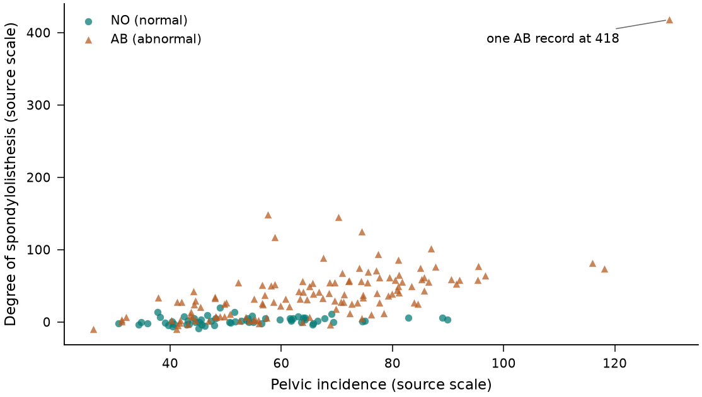
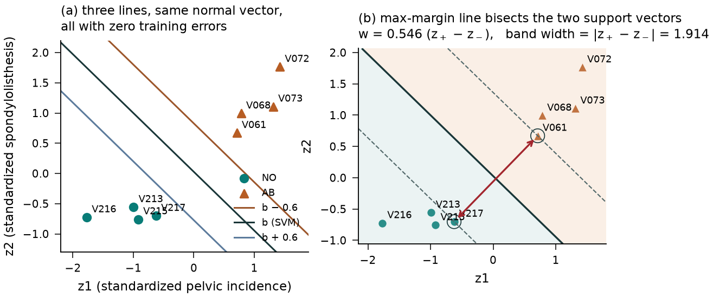
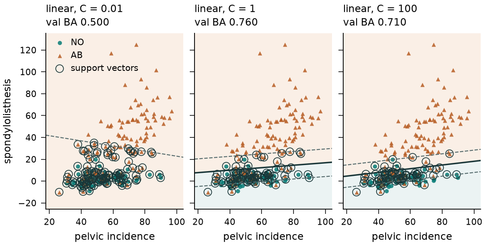
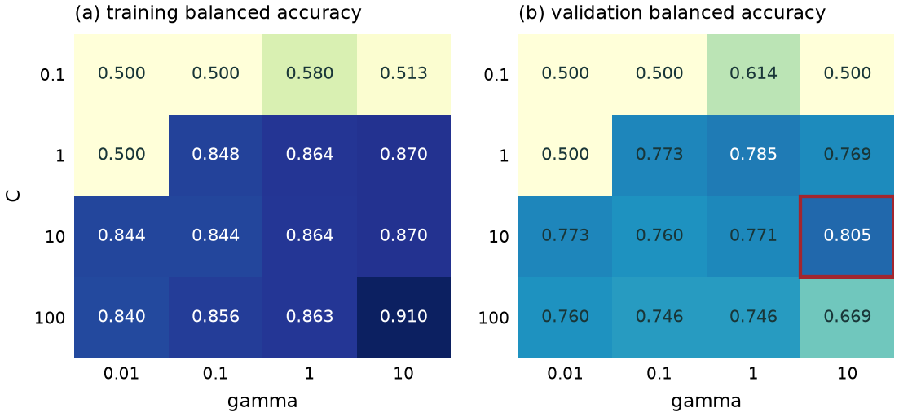
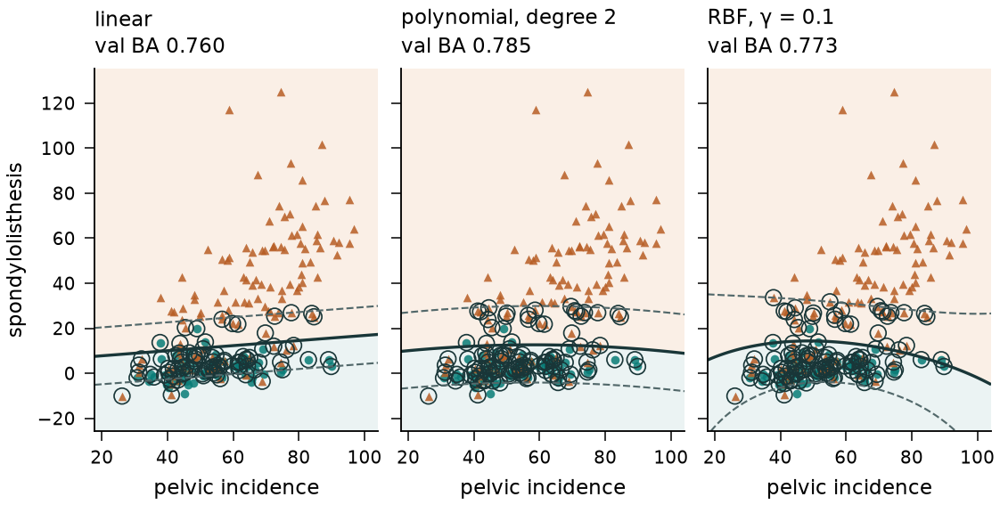
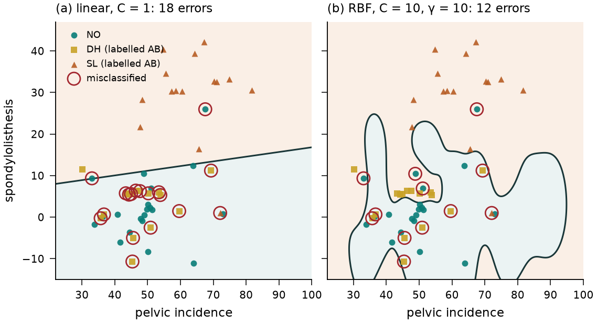

**先说结论。** SVM 比“把两类分对”多做了两件事：能分开的时候，在所有分对的线里选离最近的点最远的那条；分不开的时候，用 hinge 和 C 给违例定价。边界只由少数几个支持向量决定，八个点的例子里 w 就是两个支持向量的连线乘以 0.546。核和 gamma 改的是“谁和谁算相似”，输入的单位不统一时这个相似度会失真。在这份数据上最硬的限制不在算法本身：AB 里的椎间盘突出患者在两个输入上和正常人重叠，线性模型在验证集 16 个里只判对 1 个，RBF 在验证集上多对的那几个到测试集又掉了回去。

老师课上留下的核心问题是：多条线都能把样本分开的时候，SVM 凭什么选其中一条？数据重叠以后，margin、支持向量、C 和 kernel 是怎么一起起作用的？

这份作业我按 Notebook 的顺序把 A 到 G 都跑了一遍，写的时候没有照工作单的题号逐条填，而是按自己理解的顺序来：边界怎么选，边界由谁定，分不开怎么办，参数在调什么，最后是“放到新数据上靠不靠谱”。每个实验都先写了预测再运行，猜错的地方保留了下来。PPT 上还有三处老师留的提问：decision score 跟概率什么关系，软间隔目标有什么用，kernel 跟对 x 做变换什么关系。这三个问题分别在第八、五、六节回答。

所有数字来自 `svm-lab.ipynb` 的实际运行结果（Python 3.12.16，scikit-learn 1.8.0），另加一个补充脚本做对偶系数核对、亚型核对和测试集评价。需要手算的地方都单独列了出来。

# 一、先搞清楚在预测什么

数据是 UCI 的 Vertebral Column：310 条真实患者记录，每条是六个骨盆和腰椎的生物力学测量，没有缺失。标签 NO（正常）100 条，AB（异常）210 条。有个细节我一开始没在意，后来发现相当重要：AB 不是一种病，而是两种病合起来的，椎间盘突出 60 条加脊椎滑脱 150 条。

本课只用两个输入，骨盆入射角 pelvic_incidence 和滑脱程度 degree_spondylolisthesis。选这两个不是因为它们最好，是因为两个输入能画成平面图，几何看得见。sample_id 是按原文件行号编的 V001 到 V310，和病情没有任何关系，放进模型只会让它去学“编号规律”。abnormal=1 也不能读成“患病概率”或“病情严重程度”，它只是合并后的 0/1 标签。

划分是固定的：训练 186（NO 60 / AB 126），验证 62（20 / 42），测试 62（20 / 42），分层抽样，seed 9。三个集合各管一件事：训练集拟合 scaler 和 SVM；验证集比较参数、选配置；测试集在配置记录完之后只评一次。

{width=13cm}

从图 1 能看出两件事。一是 NO 几乎都挤在滑脱程度 0 附近，而 AB 分成两团：一团滑脱程度很大，另一团和 NO 混在一起。二是右上角有一条 AB 记录的滑脱程度到了 418，远远甩开其他点。这个点能不能删？不能仅仅因为画图不方便就删，它是真实测量，除非能查到录入错误。数据说明里也写了 UCI 没给单位和测量误差资料，“degree” 在这里不应直接当成角度。

后面几何实验用的“八点子集”是从训练集按固定规则挑的：NO 里滑脱程度小于 5 的、AB 里大于 30 的，各按 ID 取前四条。它是有意挑成可分的，只用来看清几何，不能拿它的零错误去说整体性能。真正的参数实验全部回到 186 条。

# 二、三条线都分对了，凭什么选中间那条

{width=14.5cm}

图 2(a) 里三条线训练错误都是 0，只看训练错误选不出唯一的线。我运行前的预测是中间那条最好，理由是“离两边都远”。可是“远”怎么量化？

线性决策函数和点到边界的距离是

$$f(z) = w^\top z + b, \qquad d(z) = \frac{|f(z)|}{\lVert w \rVert}$$

z 是经过训练 scaler 标准化后的两个输入，f = 0 是边界，f 的符号给出类别。按工作单给的近似值手算 V061：

```
w = (0.7287, 0.7492)   b = −0.0200   z(V061) = (0.7108, 0.6700)

w₁z₁ = 0.7287 × 0.7108 = 0.51796
w₂z₂ = 0.7492 × 0.6700 = 0.50196
f = 0.51796 + 0.50196 − 0.0200 = 0.99992 ≈ 1.00      f > 0，预测 AB

‖w‖ = √(0.7287² + 0.7492²) = √(0.53100 + 0.56130) = √1.09230 = 1.0451
到边界的距离 = |f| / ‖w‖ = 0.99992 / 1.0451 = 0.957
```

Notebook 核对：f = 1.000000，距离 0.956807。V061 正好压在 f = 1 这条线上。

这个 f = 1 能不能写成“100% 风险”之类的百分比？不能。1 这个数是 SVM 自己的约定，最近的点被规范化到 y·f = 1，它只说明这个点在参考带的边上。f 和概率到底什么关系，第八节用验证集的数据回答。

为什么要除以 ‖w‖？把 w 和 b 同乘 3，f 变成 3 倍，‖w‖ 也变成 3 倍，边界 f = 0 的位置和每个点的预测完全不变，距离 3f / 3‖w‖ 也不变。同一条线可以有无数组 (w, b) 来表示，|f| 的大小依赖于选了哪一组。刘建平的博客把 f 叫函数间隔、f / ‖w‖ 叫几何间隔，同乘 3 正是函数间隔变了而几何间隔没变。

有了几何间隔，三条线就能打分了。带标签的距离是 y·f / ‖w‖，分错时为负；对每条线取所有点里的最小值：

| b 相对基准的偏移 | 训练错误 | 最小带符号距离 | 最近的点 |
|---:|---:|---:|---|
| −0.6 | 0 | 0.3827 | V217（NO） |
| 0 | 0 | 0.9568 | V217 和 V061 同时 |
| +0.6 | 0 | 0.3827 | V061（AB） |

Table: 表 1　三条候选线的训练错误与最小带符号距离

有一个关系可以手算验证：截距挪 0.6，线沿法向平移 0.6 / ‖w‖ = 0.6 / 1.0451 = 0.574，而 0.957 − 0.574 = 0.383，和表里一致。中间那条线的“好”是有数的：它离最近的点 0.957，另外两条只有 0.383。

为什么看最小距离而不是所有点距离之和？因为和会被远的点撑大。把线贴到某个近点上，只要另一边的点够远，总和照样很大。margin 是一个“最坏情况”量，决定它的是最近的点，远的点再远也不加分。

SVM 把这个最坏情况规范化：令所有点满足 yᵢf(zᵢ) ≥ 1，最近的点恰好等于 1。于是 f = +1 和 f = −1 两条平行线之间的距离是 2 / ‖w‖ = 2 / 1.0451 = 1.9136。这个宽度是标准化空间里的，不是原始单位。最大化这个宽度等价于最小化 ‖w‖，这就是可分情形下的 SVM：在所有能分对的线里，选给最近的点留出最大安全带的那条。

这个想法在几个讲 SVM 的地方各有各的说法。MIT 公开课里 Patrick Winston 把它叫“最宽的街”：边界是街的中线，f = ±1 是两边的路肩。林轩田《机器学习技法》第一讲叫它“胖的边界”，三条都分对的线里挑最胖的那条，因为它最经得起测量误差。安全带到底保护了什么，第九节用扰动实验回来算。

工作单有一句提醒我也记下来：Notebook 是用 C = 10000 的线性 SVC 近似硬间隔，并检查了最小 y·f 与 1 的差小于 10⁻⁵，不是专门的硬间隔求解器。

# 三、这条边界其实是谁定的

表 1 里有两个点的 y·f 恰好等于 1：V217 和 V061，它们就是支持向量。严格定义是当前 SVM 解里对偶权重 αᵢ > 0 的训练样本。

删点实验之前我的预测是：删掉 V072（离边界最远的 AB），边界变化应该很小；删掉 V061（支持向量），变化会大。结果如下：

| 删除操作 | ID | w 的变化 | b 的变化 | 原八点分数最大变化 |
|---|---|---:|---:|---:|
| 非支持向量 | V072 | 0.000000 | 0.000000 | 0.000000 |
| 支持向量 | V061 | 0.156617 | 0.127752 | 0.427454 |

Table: 表 2　冻结 scaler 后分别删除一个非支持向量和一个支持向量

我预测的是“很小”，实际是精确的零，小数点后六位全是 0。为什么是精确的零，我当时说不清楚，后来在这八个点上把它算明白了。

**w 就是这两个点连出来的。** 老师 PPT 里有一页写了

$$w = \sum_i \alpha_i y_i z_i, \qquad \sum_i \alpha_i y_i = 0$$

八个点里只有 V217（y = −1）和 V061（y = +1）两个支持向量。第二个式子说它们的 α 相等，于是 w = α·(z₊ − z₋)，就是从 V217 指向 V061 的那个箭头乘一个系数。两个点分别压在 f = −1 和 f = +1 上，两式相减得 wᵀ(z₊ − z₋) = 2，所以 α = 2 / ‖z₊ − z₋‖²。手算：

```
z₊ − z₋ = (0.7108 − (−0.6233), 0.6700 − (−0.7018)) = (1.3342, 1.3718)
‖z₊ − z₋‖² = 1.3342² + 1.3718² = 3.6619        ‖z₊ − z₋‖ = 1.9136
α = 2 / 3.6619 = 0.5462
w = α (z₊ − z₋) = 0.5462 × (1.3342, 1.3718) = (0.7287, 0.7493)
b = 1 − w·z₊ = 1 − 1.0199 ≈ −0.020
```

Notebook 核对：模型里读出的 α 是 0.546162，w = (0.728685, 0.749228)，b = −0.020003。手算第二个分量末位差 0.0001，是四位小数的舍入。

这样第二节的几个数就都有了来历。带宽 2 / ‖w‖ = ‖z₊ − z₋‖ = 1.9136，就是两个支持向量之间的距离；边界过它们的中点，是这条连线的垂直平分线，见图 2(b)。其余六个点的 α 为什么是零？对偶推导里有一条互补松弛条件 αᵢ·(yᵢfᵢ − 1) = 0：一个点要么正好压在带上，要么 α 为零。V072 的 y·f 是 2.34，离带很远，α 只能是零，它根本不出现在 w 里，所以删掉它什么都不变。完整的推导我是跟着 shuhuai008 的白板推导看的，这里只是把结论在自己的数据上验了一遍。

删掉 V061 之后发生了什么也能说清了：顶上来的是 V068，新的支持向量是 V217 和 V068，α 变成 0.413，带宽从 1.914 变成 2.201。少了一个约束，街只会变宽，不会变窄。

实验为什么要冻结 scaler？如果删一个点后重新算均值和标准差，所有点的坐标都会挪一下，边界变了也分不清是“删点”导致的还是“换坐标”导致的。一次只改一个因素，这是整个 Notebook 反复强调的。

有两处容易推过头。一是这次删 V061 边界变了，不代表删任何支持向量边界都必变：如果三个点同时压在带上，删掉一个，另外两个可能仍然撑住同一条线。二是支持向量不是“最典型的病人”，也不是“最严重的病人”，它们只是在这两个特征、这个 C、这些训练点之下，几何上最靠边界的点。换一组特征，支持向量就换一批。

# 四、分不开怎么办：矛盾点、hinge 和软间隔

工作单设计了一个人工反事实：把 V061 复制一份，坐标完全不变，标签改成 NO，原始数据不动。

现在要求每个点都满足 y·f ≥ 1。原来的 V061 要 f ≥ 1，复制的那个要 f ≤ −1。同一个 z 上 f(z) 只能有一个值，这两个不等式不可能同时成立，硬间隔在这里无解。换非线性 kernel 能不能救？不能。kernel 只是换一种特征表示，f 仍然是 z 的函数，一个输入对应一个输出。这个构造证明的是“硬约束可能无解”，不是“原数据有错标”。

软间隔的办法是允许违例，但每个违例付出代价，代价用 hinge loss 算：ℓ = max(0, 1 − y·f)。用矛盾数据实际拟合：

| C | 训练错误 | 总 hinge | 支持向量数 |
|---:|---:|---:|---:|
| 0.01 | 4 | 7.29 | 8 |
| 1 | 1 | 2.00 | 4 |
| 100 | 1 | 2.00 | 4 |

Table: 表 3　含一对矛盾点的九点数据，软间隔拟合结果

两个矛盾点加起来的 hinge 有个下界：它们的 y·f 互为相反数，(1 − t) + (1 + t) = 2，不管 f 怎么选，这两点至少贡献 2。C = 1 和 100 都压到了这个下界。零训练错误在这里根本不可能，所以“要求零错误”不是一个总是合理的要求。

hinge 的手算：

| y·f | −0.5 | 0.4 | 1 | 1.8 |
|---|---:|---:|---:|---:|
| hinge = max(0, 1 − y·f) | 1.5 | 0.6 | 0 | 0 |
| 是否分错 | 是 | 否 | 否 | 否 |
| 是否在参考带内 | 是，且在错误侧 | 是 | 恰在带上 | 否 |

Table: 表 4　四个 y·f 取值对应的 hinge loss

y·f = 0.4 这一列是关键：预测正确，但 hinge = 0.6。分对了不等于没违例。“分类错误”是 0/1 计数，“间隔违例”是连续量，两个不是一回事。李宏毅讲 hinge loss 时打过一个比方：它像期末考，所有科目及格就行，不追求某一科考满分。y·f 过了 1 就没有奖励了，所以带外的点对 w 没有贡献，这和第三节 α = 0 是同一件事。

这也改变了我对支持向量的印象。硬间隔的图里支持向量都贴在带上，软间隔不是这样。软间隔的 α 多了一个上限 C，林轩田的课件把点分成三类：α = 0 的非支持向量在带外；0 < α < C 的“自由支持向量”恰好在带上，b 由它们定；α = C 的“有界支持向量”在带内或错误侧。我把 linear C = 1 在 186 条训练集上的 α 读出来核对：97 个是 0；3 个在 0 和 1 之间，分别是 0.193、0.003、0.196，它们的 y·f 正好是 1.000；86 个等于 1，其中 37 个被分错，49 个分对但在带内。所以软间隔下支持向量是“y·f ≤ 1 的点”，不是“在间隔线上的点”，很多入门图画的是硬间隔。

# 五、C 到底在调什么

线性软间隔的目标是

$$\min_{w,\,b}\ \ \frac{1}{2}\lVert w\rVert^2 + C\sum_i \max(0,\ 1 - y_i f_i)$$

第一项偏好小的 ‖w‖，也就是宽的参考带；第二项罚训练违例；C 是两项的相对权重，既不是噪声比例，也不是概率阈值。

PPT 这一页老师问“这个有什么用”。我的理解有三点。一是它把第四节那个无解的问题变成了有解的权衡，C 取很大就回到硬间隔。二是它和前面学过的逻辑回归是同一个模板，损失加正则。李宏毅在课上说得很直接：损失用 hinge 就是线性 SVM，换成交叉熵就是逻辑回归。½‖w‖² 是 L2 正则，C 相当于正则强度的倒数。三是它让“调 C 会发生什么”有一部分可以事先证明，下面会用到。

运行前我的预测：C 越大，违例越贵，总 hinge 会降，带会变窄；验证表现不一定跟着变。实际结果（186 条训练，训练集标准化，验证 62 条）：

| linear C | 带宽 | 平均 hinge | 违例数 | 训练错误 | SV 数 | 验证敏感度 | 验证特异度 | 验证平衡准确率 |
|---:|---:|---:|---:|---:|---:|---:|---:|---:|
| 0.01 | 12.41 | 0.631 | 119 | 60 | 121 | 1.00 | 0.00 | 0.500 |
| 0.1 | 1.24 | 0.506 | 119 | 40 | 121 | 0.62 | 0.85 | 0.735 |
| 1 | 0.605 | 0.406 | 86 | 37 | 89 | 0.62 | 0.90 | 0.760 |
| 10 | 0.491 | 0.399 | 74 | 36 | 77 | 0.62 | 0.80 | 0.710 |
| 100 | 0.489 | 0.399 | 74 | 35 | 76 | 0.62 | 0.80 | 0.710 |

Table: 表 5　只改变 linear C，其余不变。带宽为标准化空间中 f = ±1 的间距

{width=15.5cm}

预测的方向对了：hinge 从 0.631 降到 0.399，带宽从 12.4 降到 0.49。验证平衡准确率先升后降，C = 1 最高。

但 C = 0.01 这一行推翻了我课上的一个直觉。我原来以为“C 小、间隔大、泛化好”。这一行带宽 12.4，看起来间隔最大，可训练错误是 60，正好等于训练集里 NO 的总数，验证特异度为 0。它把所有人都判成了 AB，根本没在区分。图 3 左边那幅里，f = ±1 的虚线已经跑到了图外。原因是 C 太小时违例几乎不要钱，优化器就把 w 压到接近 0：‖w‖ 小等于带宽大，但 f 几乎成了常数 b，偏向多数类。“宽”这个量孤立看毫无意义，必须和违例放在一起看。

**哪些变化是有保证的，哪些只是这次碰巧。** 设 R = ½‖w‖²，H 是总 hinge，C₁ < C₂ 时各自的最优解记作 1 和 2。解 1 在 C₁ 下最优，所以 R₁ + C₁H₁ ≤ R₂ + C₁H₂；解 2 在 C₂ 下最优，所以 R₂ + C₂H₂ ≤ R₁ + C₂H₁。两式相加，R 消掉，得到 (C₂ − C₁)(H₂ − H₁) ≤ 0，也就是 H₂ ≤ H₁；再代回第一式得 R₁ ≤ R₂。所以 C 增大时总 hinge 不会增加，‖w‖ 不会减小，带不会变宽，这两条是定理。实验里五个 C 的总 hinge 依次是 117.4、94.0、75.5、74.2、74.2，‖w‖ 依次是 0.16、1.61、3.30、4.07、4.09，都对得上。训练错误数、支持向量数和验证表现没有这种保证：C 从 1 到 10，训练错误从 37 降到 36，训练集的平衡准确率却从 0.8401 降到 0.8397，验证从 0.760 降到 0.710。

还有几点是跑完才想明白的。

训练错误数和 hinge 不是一个量。C 从 0.01 到 0.1，hinge 从 0.631 降到 0.506，违例数却都是 119。违例数是计数，hinge 是每个违例深浅之和，深浅变了计数可以不变。

不能跨 C 比较目标函数值。C = 0.01 的目标值是 1.19，C = 100 是 7424，这不说明前者更优，两个目标函数里第二项的权重差了一万倍，比的不是同一个东西。

五个 C 的验证 ROC-AUC 几乎一样，都在 0.83 附近。AUC 只看分数排序，这五条线法向量方向接近，排序差不多，差的是边界位置。AUC 和平衡准确率回答的是不同的问题。

# 六、直线不够弯：kernel 和 gamma

kernel 是某个特征空间里的内积。老师 PPT 里的一维例子我觉得最清楚：正类在 ±2，负类在 ±1，一个阈值分不开；令 φ(x) = x²，正类变成 4、负类变成 1，阈值 2.5 就分开了。知乎上流传很广的“魔鬼与大侠”说的也是这件事：桌上两种颜色的球用一根棍分不开，大侠一拍桌子，球飞到空中，用一张纸就分开了。拍桌子是映射 φ，纸是高维空间里的超平面。

**核和“对 x 做变换”到底什么关系。** 这是 PPT 上的另一个提问。课程用的二次核是 K(z, u) = (0.1·zᵀu + 1)²。把平方展开，它正好等于两个六维向量的内积，对应的变换是

$$\varphi(z) = \left(1,\ \ \sqrt{0.2}\,z_1,\ \ \sqrt{0.2}\,z_2,\ \ 0.1\,z_1^2,\ \ 0.1\sqrt{2}\,z_1 z_2,\ \ 0.1\,z_2^2\right)$$

拿 V061 和 V217 两个点验一下：

```
z = (0.7108, 0.6700)   u = (−0.6233, −0.7018)   zᵀu = −0.44304 − 0.47021 = −0.91325

核函数一步：    K = (0.1 × (−0.91325) + 1)² = 0.90868² = 0.82569
先变换再内积：  φ(z)·φ(u) = 1 − 0.08861 − 0.09404 + 0.00196 + 0.00417 + 0.00221 = 0.82569
```

两边一样。核函数没有另外发明什么，它就是变换之后的内积，只是不用把六个坐标真的算出来。StatQuest 讲多项式核那一期强调的正是这一点。两个输入变六维还看不出省事，RBF 对应的变换是无限维的，那就只能走核函数这条路。

**为什么 SVM 恰好能用核。** 把第三节的 w = Σ αᵢyᵢzᵢ 代进 f：

$$f(z) = \sum_{i \in SV} \alpha_i y_i\, z_i^\top z + b \quad\longrightarrow\quad f(z) = \sum_{i \in SV} \alpha_i y_i\, K(z_i, z) + b$$

数据只以内积的形式出现，把内积换成 K 就是核 SVM。预测一个新点，就是拿它和每个支持向量算相似度，再按 α 加权投票。我用后面冻结的 RBF 模型验了一下：取出 108 个支持向量、α 和 b，按右边的式子自己算 62 个验证点的分数，和 Notebook 的 decision_function 最大只差 3 × 10⁻¹⁴。

三种核：linear 是 zᵀu；polynomial 是 (gamma·zᵀu + coef0)^degree^，包含特征的乘积组合；RBF 是 exp(−gamma‖z − u‖²)，按距离衰减的相似度。RBF 相似度的手算：

| 两点距离 | gamma = 0.1 | gamma = 1 |
|---:|---:|---:|
| 1 | exp(−0.1) = 0.905 | exp(−1) = 0.368 |
| 2 | exp(−0.4) = 0.670 | exp(−4) = 0.018 |

Table: 表 6　两种 gamma 下的 RBF 相似度

gamma 大，相似度随距离掉得快，每个支持向量只影响身边一小块。gamma 是作用范围，C 是违例代价，两个参数管的不是一件事。有个量帮我把 gamma 换算成距离：相似度降到 e⁻¹ ≈ 0.37 的距离是 1 / √gamma。标准化以后训练点两两距离的中位数是 1.30。gamma = 0.01 时这个距离是 10，比绝大多数点对都远，九成点对的相似度在 0.90 到 1.00 之间；gamma = 10 时是 0.32，一半点对的相似度几乎是 0，超过 0.5 的只有 5%。

**固定 C = 1 看 gamma。** 预测是 gamma = 0.01 边界平滑、接近直线，gamma = 10 弯得厉害。

| C = 1 | 训练平衡准确率 | 验证平衡准确率 | SV 数 |
|---|---:|---:|---:|
| gamma = 0.01 | 0.500 | 0.500 | 121 |
| gamma = 0.1 | 0.848 | 0.773 | 116 |
| gamma = 1 | 0.864 | 0.785 | 99 |
| gamma = 10 | 0.870 | 0.769 | 128 |

Table: 表 7　RBF，固定 C = 1 改变 gamma

gamma = 0.01 不是“接近直线”，是根本没有边界，全部判成 AB。这一点我预测错了，只想到“平滑”，没想到“平滑到没有”。

后来我发现它和第五节 C = 0.01 的失败是同一件事。gamma 很小时 exp(−gamma·d²) ≈ 1 − gamma·d²，把 d² = ‖z‖² + ‖u‖² − 2zᵀu 展开，常数项和只含单个点的项，因为 Σ αᵢyᵢ = 0，不是消掉就是并进了 b，真正起作用的只剩 2·gamma·zᵀu。所以小 gamma 的 RBF 近似一个缩小了 2·gamma 倍的线性核，等价于把 C 换成 2·gamma·C 的线性 SVM。gamma = 0.01、C = 1 相当于 linear C = 0.02。我另外拟合了一个 linear C = 0.02 来对照：62 个验证点的预测和这个 RBF 完全一致，分数的相关系数 0.9995，两个都把所有人判成 AB。C = 10 那一格相当于 linear C = 0.2，预测也完全一致，验证平衡准确率都是 0.773；C = 100 相当于 linear C = 2，62 个点里有 2 个预测不同，近似开始变粗。

另一头，gamma = 10 训练最高，验证反而比 gamma = 1 低，图 4 第一行右边那幅里边界已经开始绕着个别点画圈。

**固定 gamma = 10 看 C。**

| gamma = 10 | 训练平衡准确率 | 验证平衡准确率 | 验证特异度 |
|---|---:|---:|---:|
| C = 1 | 0.870 | 0.769 | 0.80 |
| C = 10 | 0.870 | 0.805 | 0.80 |
| C = 100 | 0.910 | 0.669 | 0.60 |

Table: 表 8　RBF，固定 gamma = 10 改变 C

{width=15cm}

C = 100 训练上去了，验证掉下来，特异度掉到 0.6。gamma = 10 时一个验证点通常只和 108 个支持向量里的 25 个左右有超过 0.01 的相似度，每一小块区域各自为政；再加上严厉的违例惩罚，等于允许模型在每个训练点周围单独画圈，图 4 右下那幅边界已经碎成好几块。林轩田在软间隔那一讲的末尾专门写了一句警告：SVM 仍然会过拟合，高斯核要仔细选 gamma 和 C。但这不能说成“RBF 会过拟合”，是 (C = 100, gamma = 10) 这个组合在这 186 个点上过拟合了。

{width=14cm}

为什么不能同时改 C 和 gamma？两个因素混在一起，就解释不了变化是谁造成的。图 5 把 16 组配置的训练和验证并排放着：左边训练几乎一路变深，右边验证没有跟上，右下角训练 0.910、验证 0.669 是差距最大的一格。同一个 gamma 好不好还取决于配哪个 C，gamma = 0.01 那一列在 C = 1 时是 0.5，到 C = 10 就有 0.773。所以要先固定一个看另一个，再看联合表。

**三种核并排。**

{width=15.5cm}

linear 只能画直线；degree 2 的 polynomial 能画一条二次曲线，弯一次；RBF 可以在局部弯。这个数据上 polynomial 和 RBF 的边界差别不大，验证分别是 0.785 和 0.773，因为两类的主要分界在滑脱程度这个轴上本来就近似是一条直线，弯不弯影响有限。

一个容易误读的地方：RBF 图上 f = ±1 两条线不能当成原平面上到边界的等距线。RBF 的 margin 在特征空间里，投回二维平面以后等值线的间距随位置变化，所以不能拿它和 linear 的 2 / ‖w‖ 比宽窄。

# 七、换个单位，同样的信息，结果为什么变了

把 x₁ 乘 100，信息没变，只是数字写大了。固定 RBF C = 1、gamma = 0.1，交叉比较“原单位 / 换单位”和“不标准化 / 训练集标准化”。

我的预测：标准化那一对应该几乎不变，不标准化那一对会变。

| 是否标准化 | 单位 | 验证平衡准确率 | SV 数 |
|---|---|---:|---:|
| 否 | 原单位 | 0.705 | 171 |
| 否 | x₁ × 100 | 0.488 | 186 |
| 是 | 原单位 | 0.773 | 116 |
| 是 | x₁ × 100 | 0.773 | 116 |

Table: 表 9　尺度交叉对照，RBF C = 1、gamma = 0.1

验证集 decision score 的最大差：不标准化 1.538，标准化 1.8 × 10⁻¹⁴，后者就是浮点误差。

不标准化那一行的变化比我预想的还大：186 个训练点全部成了支持向量。原因在 RBF 的距离公式里，‖z − u‖² 的 x₁ 分量乘了 10000，同一个 gamma = 0.1 对应的作用范围相对数据变得极小，每个点只和自己相似，模型退化成了记忆训练点。标准化为什么能抵消？换单位以后 x₁ 的均值和标准差也都乘了 100，(100x − 100μ) / (100s) 还是原来的 z。

这不说明标准化能解决所有数据问题，也不说明标准化后分数一定更高。它只说明一件事：SVM 的核建立在距离上，距离依赖单位，尺度敏感不是一句口号，是公式的直接后果。

scaler 能不能在全部 310 条上拟合？不能。验证和测试的均值方差会进入训练流程，即使没用标签也是信息泄漏。要做交叉验证的话，scaler 得在每一折的训练部分重新拟合，所以 Notebook 把 scaler 和 SVC 放进了同一个 Pipeline。

# 八、它在新数据上到底行不行：验证、冻结、测试

先算一个基线。验证集里始终预测 AB：accuracy = 42 / 62 = 0.677，平衡准确率 = (1 + 0) / 2 = 0.5。accuracy 被多数类撑到了三分之二，对 NO 的识别却是零。这个数据 AB 占三分之二，所以全课用平衡准确率。

按预先定好的规则，两个家族各按验证平衡准确率选一组，平分取较小 C 再取较小 gamma。输入是那两个特征，scaler 只在 186 条训练记录上拟合，阈值是 0。

| 冻结配置（验证集） | TN | FP | FN | TP | 平衡准确率 | 敏感度 | 特异度 | ROC-AUC |
|---|---:|---:|---:|---:|---:|---:|---:|---:|
| linear C = 1 | 18 | 2 | 16 | 26 | 0.760 | 0.619 | 0.90 | 0.830 |
| RBF C = 10, gamma = 10 | 16 | 4 | 8 | 34 | 0.805 | 0.810 | 0.80 | 0.781 |

Table: 表 10　按验证规则冻结的两组配置在验证集上的表现

RBF 的平衡准确率高 0.045，AUC 却低 0.05。固定阈值下分得对不对，和整体排序排得好不好，是两个问题。

**错的是谁。** 这一步我是看完测试结果以后才想到去做的，但它只需要验证集，所以放在这里讲。线性模型漏掉了 16 个 AB，把它们的特征列出来，滑脱程度几乎都在 12 以下，和 NO 的分布完全重叠。这让我回头去想第一节的那个细节：AB 是椎间盘突出和脊椎滑脱合并的。数据说明里给了 UCI 的链接，那边有三分类版本 column_3C.dat，310 行特征和二分类版逐行一致，能按行号对上 ID。三分类标签只用来解释错误，没有进入任何训练、选参或阈值。

| 训练集亚型 | 条数 | 滑脱程度中位数 | 四分位范围 |
|---|---:|---:|---|
| NO 正常 | 60 | 1.56 | −1.20 到 5.03 |
| DH 椎间盘突出 | 31 | 2.65 | −0.06 到 6.46 |
| SL 脊椎滑脱 | 95 | 42.89 | 29.40 到 58.85 |

Table: 表 11　训练集按原始三分类拆开后的滑脱程度分布

| 验证集判对数 | NO（20 条） | DH（16 条） | SL（26 条） |
|---|---:|---:|---:|
| linear C = 1 | 18 | 1 | 25 |
| RBF C = 10, gamma = 10 | 16 | 9 | 25 |

Table: 表 12　两个冻结模型在验证集上按亚型的判对数

{width=14.5cm}

DH 的滑脱程度分布和 NO 几乎一模一样，图 7 里黄色方块整个埋在绿色圆点中间。线性模型漏掉的 16 个 AB 里 15 个是椎间盘突出，剩下 1 个是滑脱程度只有 1.0 的滑脱患者 V069。它学到的其实是“滑脱程度大就是滑脱症”，对椎间盘突出基本是瞎的。RBF 多对的 8 个全是 DH，图 7(b) 能看到它靠的是 gamma = 10 圈出来的几块局部小岛，代价是多错了 2 个 NO。

**顺便回答 decision score 和概率的关系。** 把线性模型在验证集上的分数分成四段，看每段里真实 AB 的比例：

| 分数 f 的范围 | 人数 | 其中 AB | AB 比例 | 组成 |
|---|---:|---:|---:|---|
| f < −1 | 9 | 4 | 44% | NO 5，DH 3，SL 1 |
| −1 ≤ f < 0 | 25 | 12 | 48% | NO 13，DH 12 |
| 0 ≤ f < 1 | 4 | 3 | 75% | NO 1，DH 1，SL 2 |
| f ≥ 1 | 24 | 23 | 96% | NO 1，SL 23 |

Table: 表 13　linear C = 1 在验证集上的分数分段与真实 AB 比例

如果 f 是概率的某种刻度，f 越负 AB 应该越少。实际上 f 小于 −1 的 9 个人里有 4 个 AB，和 −1 到 0 那一段的比例差不多。分数只说明这个点在模型眼里离边界多远，不说明把握有多大。原因在 hinge：y·f 一旦过了 1 就没有任何奖励，模型没有动力让分数的大小反映把握；逻辑回归的对数损失永远降不到 0，所以它的 wᵀx + b 才是对数几率。f 能用的是排序，AUC 可以直接拿它算。真要概率，得另拿一份数据在 f 上拟合一个 S 形函数，也就是 Platt scaling，scikit-learn 里对应 CalibratedClassifierCV；本课按规定不启用 probability=True。

**打开测试集（工作单 F6）。** 配置已经在上面冻结。打开两个开关评一次，训练仍是原来的 186 条，没有把验证并进去：

| 冻结配置（测试集） | TN | FP | FN | TP | 平衡准确率 | 敏感度 | 特异度 | ROC-AUC |
|---|---:|---:|---:|---:|---:|---:|---:|---:|
| linear C = 1 | 19 | 1 | 12 | 30 | 0.832 | 0.714 | 0.95 | 0.824 |
| RBF C = 10, gamma = 10 | 19 | 1 | 11 | 31 | 0.844 | 0.738 | 0.95 | 0.814 |

Table: 表 14　锁定测试集（62 条）上的一次评价

两个模型只差一个 FN，AUC 的排序还反过来了。按亚型看，SL 29 条全对，NO 20 条对 19 条，DH 13 条里 linear 对 1 条、RBF 对 2 条。RBF 在验证集上对了 9 / 16 个 DH，到这里只剩 2 / 13，那几块小岛没有包住新的病人，验证上 0.045 的差距在 62 条数据上不值得当真。唯一的 FP 是 V223，标签 NO 但滑脱程度 31.17，落在 SL 的典型区域里，两个模型都判了 AB。

这就是为什么测试结果仍然不足以确认“在新医院的表现”。它是同源数据、一次留出、62 条；对 DH 这一亚型基本靠猜；换一家医院，DH 的比例不同，整体数字就会变。测试完也不能再去调参数或换特征，否则测试集就变成了第二个验证集，表 14 里的 0.83 就不再是对未见记录的估计。

# 九、扩展：冻结模型，输入抖一抖

模型和 scaler 都冻结，给验证输入加独立高斯噪声，强度按训练集标准差的 5%、10%、20%，每个强度重复 100 次，不改标签。

我的预测：离边界近的点容易翻，远的不会。

| 噪声强度 | linear 翻转率 | linear 按距离算的翻转率 | linear 平衡准确率 | RBF 翻转率 | RBF 平衡准确率 |
|---:|---:|---:|---:|---:|---:|
| 0 | 0 | 0 | 0.760 | 0 | 0.805 |
| 5% | 3.0% | 2.8% | 0.750 | 7.0% | 0.746 |
| 10% | 5.4% | 5.4% | 0.752 | 13.8% | 0.720 |
| 20% | 12.1% | 11.5% | 0.730 | 22.0% | 0.683 |

Table: 表 15　冻结模型下的输入扰动，100 次重复的平均。噪声强度为训练标准差的比例

对线性模型，这个预测可以直接算出来。噪声在标准化空间里每个方向的标准差都是 σ，只有沿法向 w 的那一份能把点推过边界，所以距离边界 d 的点翻转的概率是 Φ(−d / σ)，Φ 是标准正态的分布函数。把 62 个验证点各自的 d 代进去取平均，得到 2.8%、5.4%、11.5%，和实验的 3.0%、5.4%、12.1% 基本对上，就是表 15 的第三列。

这就是第二节那条“安全带”的实际含义：距离 d 的点扛得住沿法向不超过 d 的扰动。不过它保护的只是“预测不变”，不是“预测正确”，一个本来分错的点翻过去反而对了；它也只管已有的点，不保证新来的点落在哪一侧。这 62 个点到边界的距离中位数是 0.31，和带的半宽 0.30 差不多，一半的点本来就站在带里面。

RBF 的翻转率是 linear 的两倍左右，噪声到 20% 时它的平衡准确率已经掉到 linear 以下。gamma = 10 的边界弯弯曲曲，没有上面那样的公式，但道理相通：边界绕来绕去，贴着边界的点就多。

这是人工高斯噪声，不是真实仪器误差，也不是外部人群的稳定性，不能直接外推。课程不要求选冠军，但如果非要在两个里挑一个交给研究组，我会倾向 linear：测试表现几乎相同，更稳，而且系数能解释。

# 十、回到核心问题：我现在怎么理解 SVM

**SVM 学的是什么。** 一个决策函数 f(z) = wᵀz + b，用核的时候写成 f(z) = Σ αᵢyᵢK(zᵢ, z) + b。它的目标不是“分对”，而是 min ½‖w‖² + C·Σ hinge：第一项要安全带宽，第二项罚违例。比“零训练错误”多出来的原则有两条：在所有分对的线里选安全带最宽的那条；分不开的时候明确给违例定价，而不是假装能分开。

**原题：为什么 SVM 不是简单找一条“刚好分开两类”的线。** 因为“刚好分开”的线有无数条，而且它们对扰动最脆弱。第二节三条线训练错误都是 0，最近点距离却有 0.38 和 0.96 的差别，0.38 那条只要最近的点挪一点就分错了。SVM 选的是给最近的点留最大余地的那条。而真实数据根本分不开，这时“刚好分开”的线不存在，SVM 用 hinge 和 C 把“允许多少违例换多宽的带”这个权衡写进了目标函数。

**几个概念怎么连起来。** 边界由支持向量决定：八个点里 w = 0.546 × (z₊ − z₋)，删非支持向量的变化是精确的零（第三节）。C 调的是违例的代价：总 hinge 不增、‖w‖ 不减是定理，验证表现不是，C = 0.01 带最宽却失去区分（第五节）。kernel 是变换后的内积，SVM 能用核是因为 f 只通过内积依赖数据；gamma 是相似度的作用范围，太小时退化成一个 C 很小的线性 SVM，太大时每小块各自为政（第六节）。尺度敏感是距离公式的直接后果（第七节）。间隔保护的是已有的点不被小扰动翻转，线性模型的翻转率能从距离算出来（第九节）。

**一个优势和它的条件。** 优势是目标明确、几何可解释，186 条两个特征的小数据上就能工作，用核可以表达非线性关系而不用显式升维。条件是特征必须标准化，C 和 gamma 必须用独立的验证数据选，不能在测试上调。

**一个局限和它发生的条件。** 这次实验里最硬的局限不在 SVM 本身，而是它补不了特征里没有的信息。DH 患者的两个特征和正常人分布重叠，线性模型在验证集 16 个里对 1 个，测试集 13 个里对 1 个；RBF 在验证集多对的 8 个，到测试集没有保住。这个局限在“标签合并了特征区分不了的亚型”时一定发生。SVM 自己的局限还有：对尺度和参数敏感；核 SVM 要算 n × n 的核矩阵，样本上万时代价很高；decision score 不是概率，要概率得另做校准；RBF 这种局部核对输入扰动更敏感。

**拿到一个新任务，我会先问什么。** 样本量多大，核矩阵算不算得动，验证集够不够稳（62 条的波动已经有 0.05）。输入的单位和尺度是否统一，标准化是必做的。在这些特征上欧氏距离有没有意义，RBF 的“相似”是不是医学上的相似。标签有没有重叠或合并的类别，像这次的 AB。下游需不需要概率输出。有没有真正独立的验证和测试数据，而不是同一家医院的再抽样。这些问题的答案才决定用不用 SVM、用什么核、怎么选 C 和 gamma，单一分数替代不了这些理由。

最后说一句自己的位置。July 那篇流传最广的《支持向量机通俗导论》把理解 SVM 分成三层：了解、深入、证明。间隔、支持向量、C 和核，这次是自己算出来、画出来的。对偶问题我没有从头推，只是跟着白板推导看懂了 w = Σ αᵢyᵢzᵢ 和互补松弛，再在八个点上验了一遍，算是摸到了第二层的门。软间隔下 0 ≤ α ≤ C 是怎么从 KKT 条件里出来的，我能复述，还不能自己推出来。

# 参考资料

除课程包里的工作单、Notebook 和数据说明外，做作业时看过下面这些材料，正文里引用过的已注明。

1. July. 支持向量机通俗导论（理解 SVM 的三层境界）. CSDN 博客, 2012. https://blog.csdn.net/v_JULY_v/article/details/7624837
2. 刘建平Pinard. 支持向量机原理（一）线性支持向量机；（二）线性支持向量机的软间隔最大化模型. 博客园, 2016. https://www.cnblogs.com/pinard/p/6097604.html ；https://www.cnblogs.com/pinard/p/6100722.html
3. shuhuai008. 机器学习-白板推导系列（六）支持向量机 SVM. 哔哩哔哩. https://www.bilibili.com/video/BV1Hs411w7ci
4. 林轩田. 機器學習技法, Lecture 1 Linear Support Vector Machine; Lecture 4 Soft-Margin Support Vector Machine. 台湾大学. https://www.csie.ntu.edu.tw/~htlin/ （B 站有搬运）
5. 李宏毅. ML Lecture 20: Support Vector Machine (SVM). 台湾大学, 2016. https://www.youtube.com/watch?v=QSEPStBgwRQ （B 站有搬运）
6. Patrick H. Winston. MIT 6.034 Artificial Intelligence, Lecture 16: Learning: Support Vector Machines. MIT OpenCourseWare, 2010. https://ocw.mit.edu/courses/6-034-artificial-intelligence-fall-2010/resources/lecture-16-learning-support-vector-machines
7. Josh Starmer. StatQuest: Support Vector Machines, Part 1 Main Ideas; Part 2 The Polynomial Kernel. 2019. https://www.youtube.com/watch?v=efR1C6CvhmE ；https://www.youtube.com/watch?v=Toet3EiSFcM （B 站有中文字幕搬运）
8. 知乎专栏. 支持向量机原理篇之手撕线性 SVM（含“魔鬼与大侠”的比喻）. 2017. https://zhuanlan.zhihu.com/p/29604517
9. James, Witten, Hastie, Tibshirani. An Introduction to Statistical Learning, Chapter 9: Support Vector Machines.
10. 周志华. 机器学习. 第 6 章 支持向量机；李航. 统计学习方法. 第 7 章 支持向量机.
11. scikit-learn 文档. Support Vector Machines；Probability calibration. https://scikit-learn.org/stable/modules/svm.html ；https://scikit-learn.org/stable/modules/calibration.html

# 附：复现说明

环境为 conda 环境 svm-lab：Python 3.12.16，numpy 2.5.4，pandas 3.1.1，scipy 1.18.1，scikit-learn 1.8.0，matplotlib 3.11.2。数据划分 seed 9，训练 scaler 与 SVC 组成 Pipeline，所有实验可用 `svm-lab.ipynb` 离线复现。对偶系数取自拟合模型的 dual_coef_；第八节的测试集评价在冻结配置后用 Notebook 的两个开关打开一次；亚型核对使用 UCI 公开的 column_3C.dat 按行号对齐。图 1 到图 7 由 Notebook 中的模型重新绘制，数值与 Notebook 输出一致。
