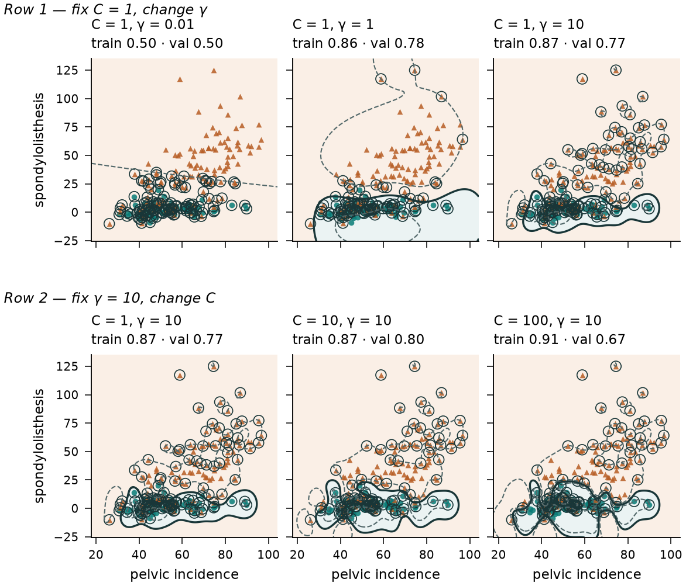

老师课上留下的核心问题是：多条线都能把样本分开的时候，SVM 凭什么选其中一条？数据重叠以后，margin、支持向量、C 和 kernel 是怎么一起起作用的？

这份作业我按 Notebook 的顺序把 A 到 G 都跑了一遍，但写的时候没有照工作单的题号逐条填，而是按自己理解的顺序来：先把“边界”这个词说清楚，再看边界由谁决定，分不开的时候怎么办，参数到底在调什么，最后回到“这个模型放到新数据上靠不靠谱”。每个实验都先写了预测再运行，猜错的地方保留下来，因为猜错的地方正好是概念没想透的地方。

所有数字来自 `svm-lab.ipynb` 的实际运行结果（Python 3.12.16，scikit-learn 1.8.0），另加一个补充脚本做测试集评价和一项亚型核对。需要手算的地方都单独列了出来。

# 一、先搞清楚在预测什么

数据是 UCI 的 Vertebral Column：310 条真实患者记录，每条是六个骨盆和腰椎的生物力学测量，没有缺失。标签 NO（正常）100 条，AB（异常）210 条。有个细节我一开始没在意，后来发现相当重要：AB 不是一种病，而是两种病合起来的，椎间盘突出 60 条加脊椎滑脱 150 条。

本课只用两个输入，骨盆入射角 pelvic_incidence 和滑脱程度 degree_spondylolisthesis。选这两个不是因为它们最好，是因为两个输入能画成平面图，几何看得见。sample_id 是按原文件行号编的 V001 到 V310，和病情没有任何关系，放进模型只会让它去学“编号规律”。abnormal=1 也不能读成“患病概率”或“病情严重程度”，它只是合并后的 0/1 标签，后面所有的 f 值都不是概率。

划分是固定的：训练 186（NO 60 / AB 126），验证 62（20 / 42），测试 62（20 / 42），分层抽样，seed 9。三个集合各管一件事：训练集拟合 scaler 和 SVM；验证集比较参数、选配置；测试集在配置记录完之后只评一次。

{width=13cm}

从图 1 能看出两件事。一是 NO 几乎都挤在滑脱程度 0 附近，而 AB 分成两团：一团滑脱程度很大，另一团和 NO 混在一起。二是右上角有一条 AB 记录的滑脱程度到了 418，远远甩开其他点。这个点能不能删？不能仅仅因为画图不方便就删，它是真实测量，除非能查到录入错误。数据说明里也写了 UCI 没给单位和测量误差资料，“degree” 在这里不应直接当成角度。

后面几何实验用的“八点子集”是从训练集按固定规则挑的：NO 里滑脱程度小于 5 的、AB 里大于 30 的，各按 ID 取前四条。它是有意挑成可分的，只用来看清几何，不能拿它的零错误去说整体性能。真正的参数实验全部回到 186 条。

# 二、三条线都分对了，凭什么选中间那条

{width=14cm}

图 2(a) 里三条线训练错误都是 0，只看训练错误选不出唯一的线。我运行前的预测是中间那条最好，理由是“离两边都远”。可是“远”怎么量化？

线性决策函数是 f(z) = wᵀz + b，z 是经过训练 scaler 标准化后的两个输入，f = 0 是边界，f 的符号给出类别。按工作单给的近似值手算 V061：

```
w = (0.7287, 0.7492)   b = −0.0200   z(V061) = (0.7108, 0.6700)

w₁z₁ = 0.7287 × 0.7108 = 0.51796
w₂z₂ = 0.7492 × 0.6700 = 0.50196
f = 0.51796 + 0.50196 − 0.0200 = 0.99992 ≈ 1.00      f > 0，预测 AB

‖w‖ = √(0.7287² + 0.7492²) = √(0.53100 + 0.56130) = √1.09230 = 1.0451
到边界的距离 = |f| / ‖w‖ = 0.99992 / 1.0451 = 0.957
```

Notebook 核对：f = 1.000000，距离 0.956807。V061 正好压在 f = 1 这条线上。

这个 f = 1 能不能写成“100% 风险”之类的百分比？不能。1 这个数是 SVM 自己的约定，最近的点被规范化到 y·f = 1，它只说明这个点在参考带的边上，不说明概率。

还有一个更根本的理由。把 w 和 b 同乘 3，f 变成 3 倍，‖w‖ 也变成 3 倍，边界 f = 0 的位置和每个点的预测完全不变，距离 3f / 3‖w‖ 也不变。同一条线可以有无数组 (w, b) 来表示，|f| 的大小依赖于选了哪一组。所以比较两条线不能只看 |f|，要除以 ‖w‖，这就是“归一化距离”的意思。

有了归一化距离，三条线就能打分了。带标签的距离是 y·f / ‖w‖，分错时为负；对每条线取所有点里的最小值：

| b 相对基准的偏移 | 训练错误 | 最小带符号距离 | 最近的点 |
|---:|---:|---:|---|
| −0.6 | 0 | 0.3827 | V217（NO） |
| 0 | 0 | 0.9568 | V217 和 V061 同时 |
| +0.6 | 0 | 0.3827 | V061（AB） |

Table: 表 1　三条候选线的训练错误与最小带符号距离

有一个关系可以手算验证：截距挪 0.6，线沿法向平移 0.6 / ‖w‖ = 0.6 / 1.0451 = 0.574，而 0.957 − 0.574 = 0.383，和表里一致。中间那条线的“好”是有数的：它离最近的点 0.957，另外两条只有 0.383。

为什么看最小距离而不是所有点距离之和？因为和会被远的点撑大。把线贴到某个近点上，只要另一边的点够远，总和照样很大。margin 是一个“最坏情况”量，决定它的是最近的点，远的点再远也不加分。

SVM 把这个最坏情况规范化：令所有点满足 yᵢ f(zᵢ) ≥ 1，最近的点恰好等于 1。于是 f = +1 和 f = −1 两条平行线之间的距离是 2 / ‖w‖ = 2 / 1.0451 = 1.9136。这个宽度是标准化空间里的，不是原始单位；它正好是“最近点到中线距离”0.9568 的两倍，1 / ‖w‖ 是半宽。

到这里可分情形下的 SVM 原则就清楚了：在所有能分对的线里，选让最近的点离边界最远的那条，等价于最大化 2 / ‖w‖，也等价于最小化 ‖w‖。比“分对”多出来的那条原则，就是留出最大的安全带。

这个想法在几个讲 SVM 的地方各有各的说法。MIT 公开课里 Patrick Winston 把它叫“最宽的街”（the widest street）：边界是街的中线，f = ±1 是两边的路肩，SVM 要修的是能修的最宽的那条街。林轩田《机器学习技法》第一讲叫它“胖的边界”（fat boundary），三条都分对的线里挑最胖的那条，因为它最经得起测量误差。刘建平的博客把 f 叫函数间隔、f / ‖w‖ 叫几何间隔，上面同乘 3 的例子正是函数间隔会变而几何间隔不变。

工作单有一句提醒我也记下来：Notebook 是用 C = 10000 的线性 SVC 近似硬间隔，并检查了最小 y·f 与 1 的差小于 10⁻⁵，不是专门的硬间隔求解器。

# 三、这条边界其实是谁定的

表 1 里有两个点的 y·f 恰好等于 1：V217 和 V061，它们就是支持向量。严格定义是当前 SVM 解里对偶权重 αᵢ > 0 的训练样本。老师 PPT 里有一页写了 w = Σ αᵢ yᵢ zᵢ，非支持向量的 α = 0，对 w 没有任何贡献。

删点实验之前我的预测是：删掉 V072（离边界最远的 AB），边界变化应该很小；删掉 V061（支持向量），变化会大。结果如下：

| 删除操作 | ID | w 的变化 | b 的变化 | 原八点分数最大变化 |
|---|---|---:|---:|---:|
| 非支持向量 | V072 | 0.000000 | 0.000000 | 0.000000 |
| 支持向量 | V061 | 0.156617 | 0.127752 | 0.427454 |

Table: 表 2　冻结 scaler 后分别删除一个非支持向量和一个支持向量

我预测的是“很小”，实际是精确的零，小数点后六位全是 0。这和 α = 0 是一回事：V072 根本不出现在解里，删不删对优化问题没有影响。删 V061 之后边界转了一下，原来八个点的分数最多变了 0.43。

实验为什么要冻结 scaler？如果删一个点后重新算均值和标准差，所有点的坐标都会挪一下，边界变了也分不清是“删点”导致的还是“换坐标”导致的。一次只改一个因素，这是整个 Notebook 反复强调的。

有两处容易推过头。一是这次删 V061 边界变了，不代表删任何支持向量边界都必变：如果三个点同时压在带上，删掉一个，另外两个可能仍然撑住同一条线。二是支持向量不是“最典型的病人”，也不是“最严重的病人”，它们只是在这两个特征、这个 C、这些训练点之下，几何上最靠边界的点。换一组特征，支持向量就换一批。

# 四、分不开怎么办：矛盾点、hinge 和软间隔

工作单设计了一个人工反事实：把 V061 复制一份，坐标完全不变，标签改成 NO，原始数据不动。

现在要求每个点都满足 y·f ≥ 1。原来的 V061 要 f ≥ 1，复制的那个要 f ≤ −1。同一个 z 上 f(z) 只能有一个值，这两个不等式不可能同时成立，硬间隔在这里无解。换非线性 kernel 能不能救？不能。kernel 只是换一种特征表示，f 仍然是 z 的函数，一个输入对应一个输出。任何确定性模型都不能给同一个输入同时分出两个类别。这个构造证明的是“硬约束可能无解”，不是“原数据有错标”。

软间隔的办法是允许违例，但每个违例付出代价，代价用 hinge loss 算：ℓ = max(0, 1 − y·f)。用矛盾数据实际拟合：

| C | 训练错误 | 总 hinge | 支持向量数 |
|---:|---:|---:|---:|
| 0.01 | 4 | 7.29 | 8 |
| 1 | 1 | 2.00 | 4 |
| 100 | 1 | 2.00 | 4 |

Table: 表 3　含一对矛盾点的九点数据，软间隔拟合结果

两个矛盾点加起来的 hinge 有个下界：它们的 y·f 互为相反数，(1 − t) + (1 + t) = 2，不管 f 怎么选，这两点至少贡献 2。C = 1 和 100 都压到了这个下界。零训练错误在这里根本不可能，所以“要求零错误”不是一个总是合理的要求。

hinge 的手算：

| y·f | −0.5 | 0.4 | 1 | 1.8 |
|---|---:|---:|---:|---:|
| hinge = max(0, 1 − y·f) | 1.5 | 0.6 | 0 | 0 |
| 是否分错 | 是 | 否 | 否 | 否 |
| 是否在参考带内 | 是，且在错误侧 | 是 | 恰在带上 | 否 |

Table: 表 4　四个 y·f 取值对应的 hinge loss

y·f = 0.4 这一列是关键：预测正确，但 hinge = 0.6。分对了不等于没违例。“分类错误”是 0/1 计数，“间隔违例”是连续量，两个不是一回事。

这也改变了我对支持向量的印象。硬间隔的图里支持向量都贴在带上，软间隔不是这样。我统计了 linear C = 1 在全部 186 条训练集上的解：89 个支持向量里 37 个被分错，49 个在带内但分对，只有 3 个恰好压在带上；而非支持向量的 y·f 最小是 1.012，全在带外。软间隔下支持向量的正确定义是“y·f ≤ 1 的点”，不是“在间隔线上的点”。

林轩田的课件把这三类点分得很清楚：α = 0 的非支持向量在带外；0 < α < C 的“自由支持向量”恰好在带上，b 就是由它们定的；α = C 的“有界支持向量”在带内或错误侧。我数出来的 97、3、86 正好对应这三类。李宏毅讲 hinge loss 时打过一个比方：它像期末考，所有科目及格就行，不追求某一科考满分。y·f 过了 1 就没有奖励了，所以带外的点对 w 没有贡献，这和第三节删 V072 变化为零是同一件事。

# 五、C 到底在调什么

线性软间隔的目标是

```
min  ½‖w‖²  +  C · Σᵢ max(0, 1 − yᵢ fᵢ)
```

第一项偏好小的 ‖w‖，也就是宽的参考带；第二项罚训练违例；C 是两项的相对权重。它既不是噪声比例，也不是概率阈值。

运行前我的预测：C 越大，违例越贵，总 hinge 会降，带会变窄；验证表现不一定跟着变。实际结果（186 条训练，训练集标准化，验证 62 条）：

| linear C | 带宽 | 平均 hinge | 违例数 | 训练错误 | SV 数 | 验证敏感度 | 验证特异度 | 验证平衡准确率 |
|---:|---:|---:|---:|---:|---:|---:|---:|---:|
| 0.01 | 12.41 | 0.631 | 119 | 60 | 121 | 1.00 | 0.00 | 0.500 |
| 0.1 | 1.24 | 0.506 | 119 | 40 | 121 | 0.62 | 0.85 | 0.735 |
| 1 | 0.605 | 0.406 | 86 | 37 | 89 | 0.62 | 0.90 | 0.760 |
| 10 | 0.491 | 0.399 | 74 | 36 | 77 | 0.62 | 0.80 | 0.710 |
| 100 | 0.489 | 0.399 | 74 | 35 | 76 | 0.62 | 0.80 | 0.710 |

Table: 表 5　只改变 linear C，其余不变。带宽为标准化空间中 f = ±1 的间距

{width=15.5cm}

预测的方向对了：hinge 从 0.631 单调降到 0.399，带宽从 12.4 降到 0.49，训练错误从 60 降到 35，支持向量从 121 降到 76。验证平衡准确率先升后降，C = 1 最高。

但 C = 0.01 这一行推翻了我课上的一个直觉。我原来以为“C 小、间隔大、泛化好”。这一行带宽 12.4，看起来间隔最大，可训练错误是 60，正好等于训练集里 NO 的总数，验证特异度为 0。它把所有人都判成了 AB，根本没在区分。图 3 左边那幅里，f = ±1 的虚线已经跑到了图外。原因是 C 太小时违例几乎不要钱，优化器就把 w 压到接近 0：‖w‖ 小等于带宽大，但 f 几乎成了常数 b，偏向多数类。“宽”这个量孤立看毫无意义，必须和违例放在一起看。

还有几点是跑完才想明白的。

训练错误数和 hinge 不是一个量。C 从 0.01 到 0.1，hinge 从 0.631 降到 0.506，违例数却都是 119。违例数是计数，hinge 是每个违例深浅之和，深浅变了计数可以不变。

不能跨 C 比较目标函数值。C = 0.01 的目标值是 1.19，C = 100 是 7424，这不说明前者更优，两个目标函数里第二项的权重差了一万倍，比的不是同一个东西。

f = ±1 之间当然可以有点。C = 1 的解里有 86 个点在带内或错误侧。

另外我注意到五个 C 的验证 ROC-AUC 几乎一样，都在 0.83 附近。AUC 只看分数排序，这五条线法向量方向接近，排序差不多，差的是边界位置和分数尺度。AUC 和平衡准确率回答的是不同的问题。

宽间隔是不是自动保证新样本表现？从表 5 看显然不是。它是控制模型复杂度的一种思路，但要看验证。

# 六、直线不够弯：kernel 和 gamma

kernel 是某个特征空间里的内积。它让 SVM 使用更丰富的特征关系，而不用把新坐标显式算出来。老师 PPT 里的一维例子我觉得最清楚：正类在 ±2，负类在 ±1，一个阈值分不开；令 φ(x) = x²，正类变成 4、负类变成 1，阈值 2.5 就分开了。kernel 直接给出 φ(x)ᵀφ(u)，不用显式写 φ。

知乎上流传很广的那个“魔鬼与大侠”的比方说的也是这件事：桌上两种颜色的球用一根棍分不开，大侠一拍桌子，球飞到空中，用一张纸就分开了。球是数据，棍是线性边界，拍桌子是映射 φ，纸是高维空间里的超平面。StatQuest 讲多项式核的那一期强调的是另一半：核函数算的是高维空间里的点积，并不真的把高维坐标算出来。这正是工作单问的“二次核为什么不必显式升维”。

三种核：linear 是 zᵀu；polynomial 是 (gamma·zᵀu + coef0)^degree，包含特征的乘积组合；RBF 是 exp(−gamma‖z − u‖²)，按距离衰减的相似度。

RBF 相似度的手算：

| 两点距离 | gamma = 0.1 | gamma = 1 |
|---:|---:|---:|
| 1 | exp(−0.1) = 0.905 | exp(−1) = 0.368 |
| 2 | exp(−0.4) = 0.670 | exp(−4) = 0.018 |

Table: 表 6　两种 gamma 下的 RBF 相似度

gamma 大，相似度随距离掉得快，每个支持向量只影响身边一小块，边界更“局部”。gamma 是作用范围，C 是违例代价，两个参数管的不是一件事。

**固定 C = 1 看 gamma。** 预测是 gamma = 0.01 边界平滑、接近直线，gamma = 10 弯得厉害。

| C = 1 | 训练平衡准确率 | 验证平衡准确率 | SV 数 |
|---|---:|---:|---:|
| gamma = 0.01 | 0.500 | 0.500 | 121 |
| gamma = 0.1 | 0.848 | 0.773 | 116 |
| gamma = 1 | 0.864 | 0.785 | 99 |
| gamma = 10 | 0.870 | 0.769 | 128 |

Table: 表 7　RBF，固定 C = 1 改变 gamma

gamma = 0.01 不是“接近直线”，是根本没有边界，全部判成 AB。gamma 太小，所有点两两之间相似度都接近 1，核矩阵几乎是常数矩阵，模型没有区分能力。这一点我预测错了，只想到“平滑”，没想到“平滑到没有”。gamma = 10 训练最高，验证反而比 gamma = 1 低，图 4 第一行右边那幅里边界已经开始绕着个别点画圈。

**固定 gamma = 10 看 C。**

| gamma = 10 | 训练平衡准确率 | 验证平衡准确率 | 验证特异度 |
|---|---:|---:|---:|
| C = 1 | 0.870 | 0.769 | 0.80 |
| C = 10 | 0.870 | 0.805 | 0.80 |
| C = 100 | 0.910 | 0.669 | 0.60 |

Table: 表 8　RBF，固定 gamma = 10 改变 C

{width=15cm}

C = 100 训练上去了，验证掉下来，特异度掉到 0.6。局部的核加上严厉的违例惩罚，等于允许模型在每个训练点周围单独画圈，图 4 右下那幅边界已经碎成好几块。但这不能说成“RBF 会过拟合”或“gamma 大必然过拟合”，是 (C = 100, gamma = 10) 这个组合在这 186 个点上过拟合了。

林轩田在软间隔那一讲的末尾专门写了一句警告：SVM 仍然会过拟合，高斯核的软间隔 SVM 需要仔细选 (γ, C)。这一行就是那句话的实例。

为什么不能同时改 C 和 gamma？两个因素的作用混在一起，就解释不了变化是谁造成的。完整网格也显示它们有交互：C = 0.1 那一行除了 gamma = 1 勉强到 0.614，其余全是 0.5；gamma = 0.01 那一列在 C = 1 时是 0.5，到 C = 10 却有 0.773。同一个 gamma 好不好，取决于配的是哪个 C。先固定一个看另一个，再看联合表。

**三种核并排。**

{width=15.5cm}

linear 只能画直线；degree 2 的 polynomial 能画一条二次曲线，弯一次；RBF 可以在局部弯。这个数据上 polynomial 和 RBF 的边界差别不大，验证分别是 0.785 和 0.773，因为两类的主要分界在滑脱程度这个轴上本来就近似是一条直线，弯不弯影响有限。两种非线性边界不是必须明显不同。

一个容易误读的地方：RBF 图上 f = ±1 两条线不能当成原平面上到边界的等距线。RBF 的 margin 在特征空间里（RBF 对应的特征空间是无限维的），投回二维平面以后等值线的间距随位置变化。所以不能拿 RBF 图上两条虚线的间距和 linear 的 2 / ‖w‖ 比宽窄。

# 七、换个单位，同样的信息，结果为什么变了

把 x₁ 乘 100，信息没变，只是数字写大了。固定 RBF C = 1、gamma = 0.1，交叉比较“原单位 / 换单位”和“不标准化 / 训练集标准化”。

我的预测：标准化那一对应该几乎不变，不标准化那一对会变。

| 是否标准化 | 单位 | 验证平衡准确率 | SV 数 |
|---|---|---:|---:|
| 否 | 原单位 | 0.705 | 171 |
| 否 | x₁ × 100 | 0.488 | 186 |
| 是 | 原单位 | 0.773 | 116 |
| 是 | x₁ × 100 | 0.773 | 116 |

Table: 表 9　尺度交叉对照，RBF C = 1、gamma = 0.1

验证集 decision score 的最大差：不标准化 1.538，标准化 1.8 × 10⁻¹⁴，后者就是浮点误差。

不标准化那一行的变化比我预想的还大：186 个训练点全部成了支持向量。原因在 RBF 的距离公式里，‖z − u‖² 的 x₁ 分量乘了 10000，gamma = 0.1 对应的“作用范围”相对数据尺度变得极小，每个点只和自己相似，模型退化成了记忆训练点。StandardScaler 用训练集的均值和标准差把每一列缩成无量纲量，×100 正好被 ×100 的标准差抵消，所以两边完全一样。

这不说明标准化能解决所有数据问题，也不说明标准化后分数一定更高。它只说明一件事：SVM 的核建立在距离上，距离依赖单位，尺度敏感不是一句口号，是公式的直接后果。

scaler 能不能在全部 310 条上拟合？不能。验证和测试的均值方差会进入训练流程，即使没用标签也是信息泄漏。要做交叉验证的话，scaler 得在每一折的训练部分重新拟合，所以 Notebook 把 scaler 和 SVC 放进了同一个 Pipeline。

# 八、它在新数据上到底行不行：验证、冻结、测试

先算一个基线。验证集里始终预测 AB：accuracy = 42 / 62 = 0.677，平衡准确率 = (1 + 0) / 2 = 0.5。accuracy 被多数类撑到了三分之二，对 NO 的识别却是零。这个数据 AB 占三分之二，所以全课用平衡准确率。

按预先定好的规则，两个家族各按验证平衡准确率选一组，平分取较小 C 再取较小 gamma：

| 家族 | 输入与 scaler | 配置 | 验证平衡准确率 | 敏感度 / 特异度 | 测试前想核对的问题 |
|---|---|---|---:|---|---|
| linear | 两个输入，scaler 只拟合 186 条训练 | C = 1 | 0.760 | 0.62 / 0.90 | 漏掉的 16 个 AB 是哪类人？ |
| RBF | 同上 | C = 10，gamma = 10 | 0.805 | 0.81 / 0.80 | 比 linear 高出的 0.045 在 62 条上是不是运气？ |

Table: 表 10　按验证规则冻结的两组配置

配置记录完，打开两个开关，测试集评一次。训练仍是原来的 186 条，没把验证并进去：

| 冻结配置 | TN | FP | FN | TP | accuracy | 平衡准确率 | 敏感度 | 特异度 | ROC-AUC |
|---|---:|---:|---:|---:|---:|---:|---:|---:|---:|
| linear C = 1 | 19 | 1 | 12 | 30 | 0.790 | 0.832 | 0.714 | 0.95 | 0.824 |
| RBF C = 10, gamma = 10 | 19 | 1 | 11 | 31 | 0.806 | 0.844 | 0.738 | 0.95 | 0.814 |

Table: 表 11　锁定测试集（62 条）上的一次评价

两个模型只差一个 FN，AUC 的排序还反过来了。测试比验证都高了 0.04 到 0.07，说明 62 条的验证集本身波动就不小，验证上 0.045 的差距不值得当真。

**错误是怎么来的。** FP 只有一个：V223，标签 NO 但滑脱程度 31.17，落在 AB 的典型区域里，两个模型都判了 AB。FN 有 11 到 12 个，把它们的特征列出来看，滑脱程度全在 −8 到 5 之间，和 NO 的分布完全重叠。

这让我回头去想第一节提到的那个细节：AB 是椎间盘突出和脊椎滑脱合并的。数据说明里给了 UCI 的链接，那边有三分类版本 column_3C.dat，310 行特征和二分类版逐行一致，能按行号对上 ID。对上以后：

| 训练集亚型 | 条数 | 滑脱程度中位数 | 四分位范围 |
|---|---:|---:|---|
| NO 正常 | 60 | 1.56 | −1.20 到 5.03 |
| DH 椎间盘突出 | 31 | 2.65 | −0.06 到 6.46 |
| SL 脊椎滑脱 | 95 | 42.89 | 29.40 到 58.85 |

Table: 表 12　训练集按原始三分类拆开后的滑脱程度分布

{width=13.5cm}

DH 的滑脱程度分布和 NO 几乎一模一样，图 6 看得更直观：黄色方块（DH）整个埋在绿色圆点（NO）里面，边界把它们一起划到了下方。训练集 AB 里滑脱程度小于 20 的 36 条中，31 条是 DH。再看测试集按亚型的判对数：SL 29 / 29 全对，NO 19 / 20，DH 只对了 1 / 13（linear）和 2 / 13（RBF）。

也就是说这两个模型学到的其实是“滑脱程度大就是滑脱症”，对椎间盘突出基本是瞎的。这也顺便解释了 RBF 在验证集上的优势为什么没保住：验证集上 RBF 判对了 9 / 16 个 DH，到测试集只剩 2 / 13。那 9 个更像是局部弯曲碰巧包住了几个点，不是学到了什么规律。

这就是为什么测试结果仍然不足以确认“在新医院的表现”。它是同源数据、一次留出、62 条；对 DH 这一亚型基本靠猜；换一家医院，DH 的比例不同，整体数字就会变。测试完也不能再去调参数或换特征，否则测试集就变成了第二个验证集，表 11 里的 0.83 就不再是对未见记录的估计。

# 九、扩展：冻结模型，输入抖一抖

模型和 scaler 都冻结，给验证输入加独立高斯噪声，强度按训练集标准差的 5%、10%、20%，每个强度重复 100 次，不改标签。

我的预测：离边界近的点容易翻，远的不会。

| 噪声强度（训练 SD 的比例） | linear 翻转率 | linear 平衡准确率 | RBF 翻转率 | RBF 平衡准确率 |
|---:|---:|---:|---:|---:|
| 0 | 0 | 0.760 | 0 | 0.805 |
| 5% | 3.0% | 0.750 | 7.0% | 0.746 |
| 10% | 5.4% | 0.752 | 13.8% | 0.720 |
| 20% | 12.1% | 0.730 | 22.0% | 0.683 |

Table: 表 13　冻结模型下的输入扰动，100 次重复的平均

RBF 的翻转率是 linear 的两倍左右，噪声到 20% 时它的平衡准确率已经掉到 linear 以下。gamma = 10 的边界弯弯曲曲，边界附近的“面积”大，点稍微动一下就跨过去；一条直线只有带内那些点有风险。

这是人工高斯噪声，不是真实仪器误差，也不是外部人群的稳定性，不能直接外推。但它提醒我一件事：验证集上高出 0.045 的那个模型，对输入扰动敏感一倍。课程不要求选冠军，但如果非要在两个里挑一个交给研究组，我会倾向 linear：测试表现几乎相同，更稳，而且系数能解释。

# 十、回到核心问题：我现在怎么理解 SVM

**SVM 学的是什么。** 一个决策函数 f(z) = wᵀz + b，用核的时候写成 f(z) = Σ αᵢ yᵢ K(zᵢ, z) + b。它的目标不是“分对”，而是 min ½‖w‖² + C·Σ hinge：第一项要安全带宽，第二项罚违例。可分的时候退化成“最大化最近点的归一化距离”。比“零训练错误”多出来的原则有两条：在所有分对的线里选安全带最宽的那条；分不开的时候明确给违例定价，而不是假装能分开。

**原题：为什么 SVM 不是简单找一条“刚好分开两类”的线。** 因为“刚好分开”的线有无数条，而且它们对扰动最脆弱。第二节三条线训练错误都是 0，最近点距离却有 0.38 和 0.96 的差别，0.38 那条只要最近的点挪一点就分错了。SVM 选的是给最近的点留最大余地的那条。而真实数据根本分不开，这时“刚好分开”的线不存在，SVM 用 hinge 和 C 把“允许多少违例换多宽的带”这个权衡写进了目标函数。

**几个概念怎么连起来。** 边界由支持向量决定，删非支持向量的变化是精确的零（第三节）。C 调的是违例的代价，C = 0.01 带宽最大却失去区分，C = 1 验证最好，C = 100 训练错误最少但验证不升（第五节）。kernel 换的是相似度的定义，gamma 换的是 RBF 的作用范围，gamma = 0.01 退化成常数，(C = 100, gamma = 10) 训练 0.91 验证 0.67（第六节）。尺度敏感是距离公式的直接后果，换单位后不标准化的分数差 1.54，标准化后 10⁻¹⁴（第七节）。

**一个优势和它的条件。** 优势是目标明确、几何可解释，186 条两个特征的小数据上就能工作，用核可以表达非线性关系而不用显式升维。条件是特征必须标准化，C 和 gamma 必须用独立的验证数据选，不能在测试上调。

**一个局限和它发生的条件。** 这次实验里最硬的局限不在 SVM 本身，而是它补不了特征里没有的信息。DH 患者的两个特征和正常人分布重叠，换 linear、polynomial、RBF 都是 13 个里对 1 到 2 个。这个局限在“标签合并了特征区分不了的亚型”时一定发生。SVM 自己的局限还有：对尺度和参数敏感；核 SVM 要算 n × n 的核矩阵，样本上万时代价很高；decision score 不是概率，要概率得另做校准；RBF 这种局部核对输入扰动更敏感（第九节）。

**拿到一个新任务，我会先问什么。** 样本量多大，核矩阵算不算得动，验证集够不够稳（62 条的波动已经有 0.05）。输入的单位和尺度是否统一，有没有像 ×100 这样的量纲差异，标准化是必做的。在这些特征上欧氏距离有没有意义，RBF 的“相似”是不是医学上的相似。标签有没有重叠或合并的类别，像这次的 AB。下游需不需要概率输出。有没有真正独立的验证和测试数据，而不是同一家医院的再抽样。这些问题的答案才决定用不用 SVM、用什么核、怎么选 C 和 gamma，单一分数替代不了这些理由。

最后说一句自己的位置。July 那篇流传最广的《支持向量机通俗导论》把理解 SVM 分成三层：了解、深入、证明。这次作业大概做到了第一层半：间隔、支持向量、C 和核是自己算出来、画出来的，对偶问题和 KKT 条件我只在 shuhuai008 的白板推导里看懂了结论，为什么非支持向量的 α 恰好是零，还得回去补。

# 参考资料

除课程包里的工作单、Notebook 和数据说明外，做作业时看过下面这些材料，正文里引用过的已注明。

1. July. 支持向量机通俗导论（理解 SVM 的三层境界）. CSDN 博客, 2012. https://blog.csdn.net/v_JULY_v/article/details/7624837
2. 刘建平Pinard. 支持向量机原理（一）线性支持向量机；（二）线性支持向量机的软间隔最大化模型. 博客园, 2016. https://www.cnblogs.com/pinard/p/6097604.html ；https://www.cnblogs.com/pinard/p/6100722.html
3. shuhuai008. 机器学习-白板推导系列（六）支持向量机 SVM. 哔哩哔哩. https://www.bilibili.com/video/BV1Hs411w7ci
4. 林轩田. 機器學習技法, Lecture 1 Linear Support Vector Machine; Lecture 4 Soft-Margin Support Vector Machine. 台湾大学. https://www.csie.ntu.edu.tw/~htlin/ （B 站有搬运）
5. 李宏毅. ML Lecture 20: Support Vector Machine (SVM). 台湾大学, 2016. https://www.youtube.com/watch?v=QSEPStBgwRQ （B 站有搬运）
6. Patrick H. Winston. MIT 6.034 Artificial Intelligence, Lecture 16: Learning: Support Vector Machines. MIT OpenCourseWare, 2010. https://ocw.mit.edu/courses/6-034-artificial-intelligence-fall-2010/resources/lecture-16-learning-support-vector-machines
7. Josh Starmer. StatQuest: Support Vector Machines, Part 1 Main Ideas; Part 2 The Polynomial Kernel. 2019. https://www.youtube.com/watch?v=efR1C6CvhmE ；https://www.youtube.com/watch?v=Toet3EiSFcM （B 站有中文字幕搬运）
8. 知乎专栏. 支持向量机原理篇之手撕线性 SVM（含“魔鬼与大侠”的比喻）. 2017. https://zhuanlan.zhihu.com/p/29604517
9. James, Witten, Hastie, Tibshirani. An Introduction to Statistical Learning, Chapter 9: Support Vector Machines. （课程定向阅读指南指定章节）
10. 周志华. 机器学习. 第 6 章 支持向量机；李航. 统计学习方法. 第 7 章 支持向量机.

# 附：复现说明

环境为 conda 环境 svm-lab：Python 3.12.16，numpy 2.5.4，pandas 3.1.1，scikit-learn 1.8.0，matplotlib 3.11.2。数据划分 seed 9，训练 scaler 与 SVC 组成 Pipeline，所有实验可用 `svm-lab.ipynb` 离线复现。第八节的测试集评价在冻结配置后用 Notebook 的两个开关打开一次；亚型核对使用 UCI 公开的 column_3C.dat 按行号对齐。图 1 到图 6 由 Notebook 中的模型重新绘制，数值与 Notebook 输出一致。
