# 第 10 讲作业：集成学习与 Bootstrapping —— 用 CTG 胎心监护数据重新走一遍

姓名：________　小组：________　日期：2026-11-18

> **关于本报告的说明**
> - 数据：方案 B，UCI Cardiotocography（`data/ctg/`）。课件和示例用的是 WDBC，我想换一套数据从头做一遍，检验自己是否真的理解了。
> - 只用了 `data/ctg/student/` 里的 train 与 validation（合称“开发集”，1703 段）。**锁定测试集没有打开**：测试标签在 `teacher/` 文件夹，按 README 要求留给老师安排的最后一步。
> - 本报告的分析是在 AI 助手（Claude）协助下完成的：研究主线、对比方案的取舍、对中间结论的质疑由我提出；代码编写、实验运行和文字起草由 AI 协助完成。报告里的所有数字都来自 `src/` 下可复现的脚本（见附录）。
> - 过程中有不少地方一开始做错了或说过头了，我没有把它们藏起来：各篇正文里写明了是怎么发现的，第 9 节再集中汇总一遍。

---

## 0. 一页纸看完这份报告

**研究问题**：多个弱模型怎样组合成更稳定的模型？在 CTG 数据和同一个验证协议下，集成方法到底降的是什么、带来了多少收益、结论能推广到哪里？

**分析主线**：我没有按工作单 A–H 的顺序做，而是按“问题驱动的因果链”组织成四篇。每一篇只改变一个变量，用对比来说明一种机制。

```
第一篇 问题：单棵树         第二篇 Bagging 路线           第三篇 Boosting 路线          第四篇 实战与边界
浅树偏差大、深树方差大  ──►  并行平均去掉方差；        ──►  顺序叠加去掉偏差；         ──►  公平比较、评价协议、
不稳定集中在病理片段          随机森林再压低树间相关 ρ        轮数过多会过拟合                阈值取舍、特征重要性
```

**主要结论**（详细证据见各篇）：
1. 单棵树无法同时兼顾偏差和方差。树越深，偏差²越小（0.056 → 0.015），但方差在误差中的占比从约 1/10 升到约 2/5，而且不稳定集中在最关键的病理片段上。
2. Bagging 去掉了深树约 3/4 的方差，但几乎去不掉偏差。随机森林通过“每个节点随机挑特征”把树之间的相关 ρ 从 0.23 压到 0.04；代价是每棵树变弱，所以 max_features 在 4–10 之间达到平衡。
3. 同样用 100 个树桩，并行平均几乎不降偏差，顺序叠加（boosting）则把偏差降了约 70%。随机森林预测更稳，梯度提升偏差更小；加模型时，随机森林加多了只是变慢，梯度提升加多了会让概率过度自信，而光看 PR-AUC 看不出来。
4. 在按录音分组、嵌套选参的公平协议下，梯度提升和随机森林同属第一梯队（25 折里两者打平），都在约 2/3 的折上小幅优于逻辑回归（PR-AUC 约 +0.02），并大幅优于单棵树。如果按行随机划分来评价，分数会虚高，**还会选错冠军**。
5. 阈值是“漏判与误报的代价比”的问题，不是统计问题。用 balanced accuracy 配合病理比例阈值，等于默认“1 次漏判 ≈ 11 次误报”。**选哪个模型和定什么阈值必须一起决定。**

---

## 1. 集成学习的框架与基础定义

### 1.1 框架图

```
                              集成学习（把多个模型的结果组合起来）
                                           │
       ┌──────────────────────┬────────────┴────────────┬──────────────────────┐
  Bagging 路线             Boosting 路线              Stacking（堆叠）         级联（Cascade）
  并行 · 平均 · 主要降方差   顺序 · 纠错 · 主要降偏差     元模型学“该听谁的”       逐级筛选，有把握就提前判定
       │                        │                     （本课未展开）            （本课未展开）
  ┌────┴─────┐            ┌─────┴───────────┐
 Bagging   随机森林        AdaBoost       梯度提升 Gradient Boosting
 bootstrap  bagging +       调高分错样本     下一棵树拟合负梯度（二分类 log-loss 下为 y − p）
 抽样本     每个节点随机     的权重                    │
            挑部分特征                         XGBoost / LightGBM：仍是梯度提升树，
                                               加树复杂度正则、二阶导信息，速度更快

  基学习器：通常是决策树（Bagging 用深树：偏差低、方差高；Boosting 用浅树或树桩：偏差高、方差低）
  Bootstrap：一种独立的统计重抽样方法，不是模型。有两种用途：
             ① 给 Bagging 制造多份不同的训练集；② 衡量模型的稳定性和不确定性
```

我一开始把集成方式理解成“四类”：bagging、boosting、堆叠、级联。后来意识到这四类不是按同一个标准分的：bagging 和 boosting 区分的是**怎么产生多个模型**（独立并行，还是前后依赖）；stacking 区分的是**怎么组合**；级联则是**逐级筛选**。本课只要求掌握 bagging 和 boosting。

### 1.2 基础定义

| 概念 | 我的理解（尽量用一句话） |
|---|---|
| **偏差 / 方差** | 用打靶来比喻：偏差大，是子弹总打偏到同一侧（模型太简单，学不到规律）；方差大，是子弹东一枪西一枪（模型太敏感，换一份数据结果就变）。后面所有方法，都是在想办法压低其中一个。 |
| **决策树** | 用一连串“是 / 否”问题做判断。每个节点选择让 Gini 不纯度（1 − Σp²，即随机抽两个样本类别不同的概率）下降最多的特征和阈值；叶节点里各类的比例就是预测概率。树只比较“是否 ≤ 阈值”，所以不需要标准化。 |
| **Bootstrap** | 从 n 个样本里**有放回**地抽 n 次，得到一份新数据。有的样本被抽到好几次，平均约 36.8% 的样本一次都没被抽到，叫“袋外”（OOB）样本。 |
| **集成** | 把多个模型的预测组合起来。硬投票数类别票数，软投票平均概率。 |
| **Bagging** | Bootstrap + aggregating：抽出许多份训练集，每份训练一棵深树，再取平均。树之间互不依赖，可以并行训练。**标准 bagging 只抽样本（行），不抽特征。** |
| **OOB 误差** | 每个样本只交给“没抽到它的那些树”来预测，汇总后就是不另留验证集的一种评价方式。 |
| **随机森林** | Bagging 再加一条：**每个节点分裂时**只从随机挑出的一部分特征里选（`max_features`），让树和树之间更不一样。 |
| **Boosting** | 按顺序训练，后一个模型专门修补前面模型的不足，像“接力补漏”。AdaBoost 调高分错样本的权重（最终是加权投票）；梯度提升让新树去拟合“还差多少”，也就是 y − p（最终是把各轮结果累加：初始值 + η×树₁ + η×树₂ + …，单独拿出某一棵树是没有意义的）。 |
| **XGBoost / LightGBM** | 本质仍是梯度提升树，多了树复杂度正则、二阶导信息、直方图加速，并能直接处理缺失值。本课不要求运行，我也没有跑。 |

**两个小验证**（对应工作单 B、C）：

- **硬投票和软投票**（工作单 B 的表）：样本 B 的真值是 0，三棵树的票是 0、1、1，硬投票判 1，判错了；三个概率的平均是 (0.20 + 0.60 + 0.65) / 3 = 0.48，判 0，判对了。这就是“多数票错了，但概率均值是对的”。A、C、D 三个样本两种投票都判对。
- **Bootstrap 抽样**：对索引 [1,2,3,4,5] 抽一次，得到 [2,2,5,1,2]：2 重复了 3 次，3 和 4 是袋外样本。重复抽 1000 次，n = 5 时不同样本的占比平均为 0.675（单次在 0.2–1.0 之间波动）；n = 1279（本数据的 train）时平均为 0.6325（单次在 0.604–0.659 之间），和理论值 1 − (1 − 1/n)ⁿ ≈ 0.632 一致。这是平均规律，不是每次都固定的比例。

### 1.3 集成为什么有效：“好而不同”

我用考试来理解：有的学生擅长数学，有的擅长英语。集成最理想的状态是每个人擅长的不一样，或者说看问题的角度不同；如果大家都差不多、都擅长数学，凑在一起也不会有提升。

课件里的公式把这件事写得更精确：

> **平均后的方差 = ρσ² + (1 − ρ)σ²/B**（σ²：单个模型的方差；ρ：模型之间的相关；B：模型个数）

- 模型越多，第二项越小，但第一项 ρσ² 降不下去，它是下限。所以关键在于降低 ρ，也就是让模型**彼此不同**。
- 平均只降方差，不降偏差。所以 bagging 要配深树（偏差低、方差高），对本来就很稳的逻辑回归做 bagging 几乎没用。

在这个基础上，我又补了两点认识：
1. **光“不同”还不够，每个人还得及格。** 三个人互相独立地投票：每人答对率 70% 时，投票后答对率约 78%；每人答对率 40% 时，投票后反而降到约 35%。这就是“好而不同”。
2. **我们并不知道谁擅长什么，能做的就是尽量随机、尽量换不同的角度。** Bagging 和随机森林里的树并没有分工，它们的错误是**零散地**分布在不同样本上，平均时互相抵消。真正“有意识地分工”的是 boosting（后一个专门攻前一个的错题）和 stacking（元模型学“哪类题该听谁的”）。随机也有代价：太随机，每棵树都会变弱（“好”不够）。第二篇的实验正好量化了这个权衡。

### 1.4 我最初理解中的偏差，以及后来的修正

| 我最初的理解 | 修正后的理解 |
|---|---|
| Bagging 是从 N 个样本、D 个特征里抽 n×d 的子集 | 标准 bagging 只抽样本（行），特征全部保留。抽特征是随机森林**额外加的**，而且是**每个节点**重新抽，不是每棵树抽一次（后者叫“随机子空间法”）。 |
| Bagging 对异常值不敏感，会“忽略”异常值 | 是“稀释”，不是“忽略”。特征上的极端值，对所有树模型影响都不大；被标错的样本，每棵深树都会记住它，但它只出现在约 63% 的树里，平均之后影响被冲淡。AdaBoost 反而会不断放大这类样本。另外，CTG 里的病理片段是**少数类，不是异常值**。 |
| 树的深度、树的数量对随机森林影响很大 | 随机森林加树不会过拟合，很快就进入平台期（第三篇已验证）；深度一般让树长满。真正对轮数、深度敏感的是 boosting。 |
| Boosting 就是“增加错误样本的权重” | 那只是 AdaBoost 的做法。梯度提升不改权重，而是拟合残差 y − p。 |
| Boosting 合并时给不同模型不同的权重 | AdaBoost 是加权投票；梯度提升是逐轮累加修正量。 |
| Bagging 不容易过拟合 | 准确的说法是“加树不会过拟合”。单棵深树本身仍然是过拟合的，随机森林在训练集上的表现几乎是满分，这个数字没有参考价值。 |
| Boosting 的上限比较高 | 这是经验上的倾向，不是必然。在本数据上，按公平协议调参后，梯度提升和随机森林打平（第四篇）。 |

---

## 2. 数据：CTG 胎心监护

我坚持先把数据弄明白，再做实验。

### 2.1 数据是什么

胎心监护同时记录**胎心率**和**宫缩**两条曲线。医生读图时主要看四件事：基线（正常 110–160 次/分）、变异（正常的小幅波动说明神经调节良好）、加速（一般是好信号）、减速（时间长、程度重的减速是警示）。这份数据中，SisPorto 软件先把每段曲线自动换算成 21 个特征，再由三位产科专家给出判读（正常 / 可疑 / 病理）。课程标签是 `pathologic = 1`，即专家判读为病理（NSP = 3），正常和可疑都记为 0。

| 特征组 | 特征 | 正常+可疑 vs 病理（开发集，中位数或比例） |
|---|---|---|
| 基线 | LB | 134 vs 130：**几乎没有差别** |
| 加速 | AC | 有加速的片段：64% vs **16%** |
| 减速 | DL、DS、DP | 有延长减速（DP > 0）的片段：3.8% vs **47%** |
| 变异 | ASTV、MSTV、ALTV、MLTV | ASTV 46 vs **66.5**；MLTV 7.9 vs **3.1** |
| 宫缩、胎动 | UC、FM | UC 的方向和直觉不一定一致，我只描述，不强行解释 |
| 直方图 | Mode、Mean、Median、Min、Max、Width、Variance、Nmax、Nzeros、Tendency | Mode 141 vs **119**；Min 94 vs **69**；Tendency = −1（直方图左偏）5.8% vs **31%** |

**一个有意思的发现**：基线几乎一样，但病理组的直方图众数和最小值明显更低；基线低于 110（心动过缓）的片段只占 0.4%。我的解读是：频繁的延长减速把整段心率的分布拖出了一条左尾。这是一个和数据相符的解释，不是诊断结论。

单个特征的区分度（只用一个特征的 AUC；方向相反的按 1 − AUC 计）：ASTV 0.85，Mode、Median、MLTV 约 0.80，AC 0.77，DP 0.72；ALTV 只有 0.57。后面会看到，ALTV 单独看很弱，在模型里却最关键。

### 2.2 数据结构：一行是片段，不是人

- 开发集 1703 段，来自 **282 个录音**。每个录音中位数 4 段，最多 33 段。正式划分是 train 1279 段（209 个录音）、validation 424 段（73 个录音），两者没有共同的录音。
- **同一录音里的片段几乎是复印件**：基线 LB 的整体标准差是 9.82，同一录音内部只有 0.27；ASTV 分别是 17.46 和 3.06。有 14 行特征完全相同，全部来自同一录音内的重叠片段。
- **阳性样本比看起来少得多**：142 个病理片段只来自 41 个录音（12 个全是病理，29 个病理和非病理混合）；病理最多的两个录音就贡献了 32 段，占 22.5%。真正独立的阳性信息更接近 41 个录音，而不是 142 条。

这和之前作业里“多中心”数据的情况类似：组和组之间差异明显，组内的样本高度相似。

### 2.3 数据的几个“脾气”

- README 说 21 个特征“都是连续变量”，其实不完全是：Tendency 只取 −1、0、1；Nmax、Nzeros 是计数；DS 有 99.6% 为 0，几乎是常数。
- 零值很多：DP 有 92.5% 是 0，FM 61%，ALTV 59%，DL 57%，AC 40%。分布严重偏斜，比如 FM 的偏度是 7.3。
- 尺度相差悬殊：AC 的范围是 0–0.019，Variance 是 0–269。
- 两个强相关簇：“位置”簇（Mode、Mean、Median 两两相关 0.90–0.94，LB 和它们相关 0.7–0.8），“宽度”簇（Width 与 Min 相关 −0.90，与 Max、Nmax、Variance 也相关）。

### 2.4 这些特点决定了后面怎么分析

| 数据特点 | 对分析的要求 |
|---|---|
| 同一录音的片段几乎是复印件 | 必须**按录音分组**划分和做交叉验证，否则等于提前看了答案（第四篇 ② 有实测）。 |
| 阳性少，而且集中在 41 个录音 | 准确率没有意义（全判阴性也有 91.7%），要用 PR-AUC 和 balanced accuracy；单个验证集只有 34 个病理片段，噪声很大。 |
| 零值多、偏斜、尺度不一，存在阈值型规律 | 树模型天然适合；LR 和 SVM 要在每折内部做标准化。 |
| 两个强相关簇 | 特征重要性会被簇内的特征分摊，解读时要结合相关性。 |

---

## 3. 统一的实验协议（每一篇都用同一套口径）

这些规则大多是在做的过程中，因为发现了问题才一步步定下来的，括号里注明了来源。

| 规则 | 内容 |
|---|---|
| 每次只改一个变量 | 数据、划分、种子、指标全部固定，差异才能归到某个机制上。 |
| 表现 | 开发集按录音分组的 5 折交叉验证（`StratifiedGroupKFold`，种子 1010），所有篇章用同一组折。 |
| 比较的标尺 | **逐折配对差值 + 胜出折数**，不拿差值去和折间标准差比（第一篇我发现前后矛盾后改的）。 |
| 稳定性 | 对 train **按录音分层重抽样** 30 次（含病理录音、不含病理录音各自有放回地抽同样多个；这是我提出的分层方式），固定 424 个验证片段，看 **Brier = 偏差² + 方差** 和**病理片段翻转率**；不用整体翻转率，因为它会被大量容易判断的阴性片段稀释。 |
| ρ 的测法 | 两层设计：外层 30 次重抽样（代表“换一批训练录音”），内层在每份数据上训练 100 棵树的集成。ρ = 平均也去不掉的方差 ÷ 单棵树的方差（第二篇）。 |
| 判类阈值 | balanced accuracy、敏感度、特异度、翻转率**主用“训练折的病理比例”作阈值**，0.5 只作参考（第二篇我指出矛盾后改的）。 |
| 概率 | 不输出可靠概率的模型（AdaBoost、SVM），只在训练数据内部按录音分组做 Platt 校准后再用（第三、四篇）。 |
| 调参 | 不能偷看评价数据，但这不等于不调参：在每个外层训练折内部，按录音分组做嵌套选参，用 log-loss 选，所有模型一视同仁（第三篇我追问后改的）。 |
| 测试集 | 不打开。 |

---

## 4. 第一篇　问题：单棵决策树

**问题**：一棵树怎样预测？为什么集成需要从它出发？
**只改变的变量**：`max_depth`（1、2、3、4、5、6、8、10、不限）。
**预期**：浅树在训练集和验证集上都一般（偏差大）；深树训练集接近满分，但换一份数据就变（方差大）。

### 4.1 先看一棵深度 2 的树（用全部 train 训练）

```
Mode ≤ 106 ─┬─ Max ≤ 234  → 病理 54 / 其余 3      判病理
            └─ Max > 234  → 病理 0  / 其余 2      判其余   ← 这次切分只用来分开 2 个样本
Mode > 106 ─┬─ ALTV ≤ 68.5 → 病理 29 / 其余 1164  判其余   ← 29 个病理片段被漏掉
            └─ ALTV > 68.5 → 病理 25 / 其余 2     判病理
```

这棵小树已经同时有两个问题：偏差（29 个病理片段被归进“其余”）和拟合噪声（一次切分只用来分开 2 个样本）。

### 4.2 实验 1：树越深，训练和验证差多远

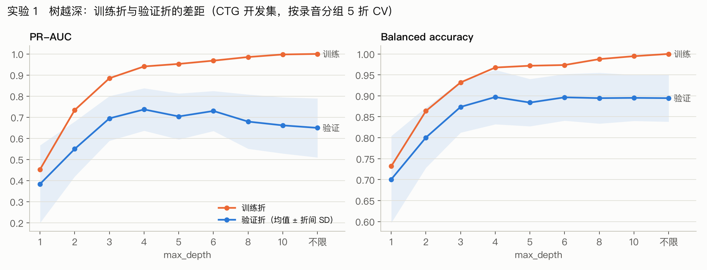

| max_depth | 叶节点数 | 训练 PR-AUC | 验证 PR-AUC（± 折间标准差） | 验证 balanced acc |
|---|---|---|---|---|
| 1 | 2 | 0.45 | 0.38 ± 0.18 | 0.70 |
| 2 | 4 | 0.73 | 0.55 ± 0.13 | 0.80 |
| 3 | 7 | 0.89 | 0.70 ± 0.11 | 0.87 |
| 4 | 11 | 0.94 | 0.74 ± 0.10 | 0.90 |
| 6 | 14 | 0.97 | 0.73 ± 0.10 | 0.90 |
| 不限 | 23 | 1.00 | 0.65 ± 0.14 | 0.89 |

深度 4 单树的分组交叉验证 AUC 是 0.866 ± 0.114，和教师参考一致，说明代码没有问题。

> **我的追问**：报告里一边说“最佳深度定不下来”，一边又说“深度 4 是表现最好的单树”，这两句话怎么同时成立？

确实不能同时成立。改用逐折配对比较后，结论更清楚了：

| 对比（PR-AUC） | 平均差值 | 深度 4 胜出的折数 |
|---|---|---|
| 4 vs 3 | +0.042 | 4/5（另 1 折持平） |
| 4 vs 5 | +0.033 | 3/5 |
| 4 vs 6 | +0.007 | **2/5** |
| 4 vs 不限 | **+0.087** | **5/5** |

- **深度 4、5、6 是一个平台**，分不出高下，深度 4 只是这个平台上的一个代表。深度 ≤ 3 稳定地更差，这一侧是偏差问题。
- 不限深度的树在 PR-AUC 上 5 折全输给深度 4，但在 balanced accuracy 上差不多。原因是叶节点全纯时，树输出的“概率”只有 0 和 1，没法给样本排序。
- 我之前拿差值去和折间标准差（约 ±0.10）比，这个标尺太粗：折间波动的大头是各折本身的难易，这部分对所有深度是共同的，应该扣掉。从这以后，所有比较都改用逐折配对。

### 4.3 实验 2：换一份训练数据，树会变多少

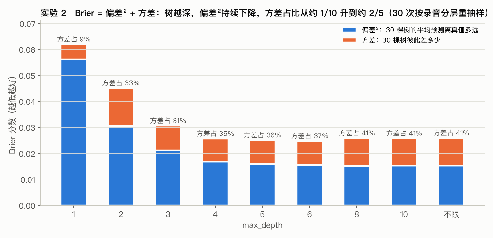

| max_depth | Brier | 偏差² | 方差 | 方差占比 |
|---|---|---|---|---|
| 1 | 0.062 | 0.056 | 0.006 | 9% |
| 2 | 0.045 | 0.030 | 0.015 | 33% |
| 4 | 0.026 | 0.017 | 0.009 | 35% |
| 不限 | 0.026 | 0.015 | 0.011 | 41% |

（30 次按录音分层重抽样，424 个验证片段。偏差²这一项里也包含数据本身的噪声。）

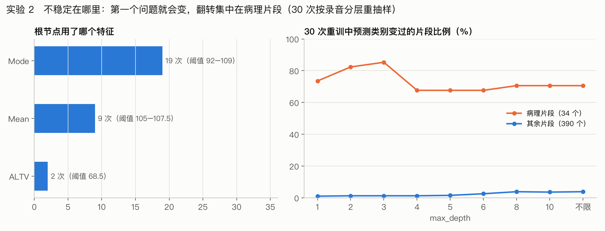

- **第一个问题就会变**：30 次重训中，根节点 19 次用 Mode（阈值在 92–109 之间漂移），9 次用 Mean，2 次用 ALTV。
- **不稳定集中在病理片段**：各深度下，病理片段的翻转率是 68–85%，其余片段只有 1–4%。

> **我的追问 1**：你说深度 2 的方差凸起是“只装 2 个样本的 Max ≤ 234 叶节点”造成的，真是这样吗？

我们去核查了，**原来的解释是错的**：验证集里同时满足 Mode ≤ 106 且 Max > 234 的片段是 0 个。真正的原因是**两个特征在抢同一个切分位置**：右支在深度 2 时只剩一次切分机会，30 棵树里 ALTV 被选了 15 次，ASTV 被选了 11 次，两者几乎一样好。验证集里有一块片段（Mode > 106、ALTV > 68.5、ASTV ≤ 79.5，共 13 个，**全部是病理**，来自 6 个录音）：树选 ALTV 时，它们的预测概率约 0.98；选 ASTV 时约 0.02。这 13 个片段贡献了深度 2 总方差的 46%。到了深度 4，两次切分都能用上，其中 9 个片段的方差从 0.22 降到 0.001。由此也修正了一个说法：方差**不是**随深度单调上升，准确的说法是“偏差²持续下降，方差占比从约 1/10 升到约 2/5”。

> **我的追问 2（建议）**：重抽样按录音来抽，但要按“含病理 / 不含病理”分层。

照这个建议改了之后，主要结论没变。但出现了一个新发现：分层的效果比预想的小。每次重抽样得到的病理片段数，不分层时是 60–189（标准差 27），分层后是 62–159（标准差 23），按行抽是 84–122（标准差 10）。原因是 train 里 29 个含病理录音的病理片段数极不均匀（16、16、8、8、6、5、……，有 6 个录音各只有 1 段），两个录音就占了 30%。分层固定的是“抽几个含病理录音”，固定不了“抽到的是哪几个”。**CTG 的不稳定，很大程度上来自病理类被少数几个录音主导。**

### 4.4 第一篇小结

单棵树无法兼顾偏差和方差：浅了学不会，深了不稳定，而且不稳定主要落在病理片段上。还有一个可以直接读出的事实：偏差²这一项，正好就是把 30 棵树的预测平均之后的 Brier。30 棵深树平均后，Brier 从 0.026 降到 0.015；30 个树桩平均后，只从 0.062 降到 0.056。这其实已经是一个简易的 bagging，也就是第二篇要正式验证的内容。

---

## 5. 第二篇　Bagging 路线：平均能降什么？随机森林多了什么？

两个对比都用同一个手写实现：按行抽和按录音抽只差抽样单位，树的设置和平均方式完全一样。核对：手写 bagging 的分组交叉验证 PR-AUC 是 0.892，随机森林的 ROC-AUC 是 0.994，都和教师参考吻合。

### 5.1 对比 2-1：平均到底能降什么

**只改变的变量**：基学习器的深度（树桩、深度 4、不限），每种都比较单树、按行 bagging、按录音分层 bagging（各 100 棵）。

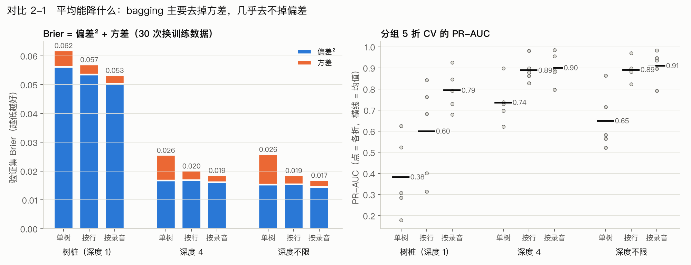

| 基学习器 | 单树 | 按行 bagging | 按录音 bagging |
|---|---|---|---|
| 树桩：Brier = 偏差² + 方差 | 0.062 = 0.056 + 0.006 | 0.057 = 0.054 + 0.004 | 0.053 = 0.050 + 0.003 |
| 深度 4 | 0.026 = 0.017 + 0.009 | 0.020 = 0.017 + 0.003 | 0.019 = 0.016 + 0.003 |
| 深度不限 | 0.026 = 0.015 + **0.011** | 0.019 = 0.016 + **0.003** | **0.017** = 0.015 + **0.002** |

- **成立**：bagging 去掉了深树约 70–80% 的方差，偏差²几乎不变；深树做 bagging 的 Brier 最低。和深度 4 单树逐折配对：深树 bagging 的 PR-AUC 高约 0.16，5 折全胜。
- **意外**：对树桩做 bagging，PR-AUC 从 0.38 涨到 0.60（按行）和 0.79（按录音）。单个树桩只有两种输出值，没法排序；100 个阈值各不相同的树桩平均后，得分变成连续的，排序能力大增。这是“把粗糙的分数变平滑”带来的收益，和降方差是两回事。树桩的偏差²也降了一点（0.056 → 0.050），说明“平均不降偏差”只是近似：许多树桩的平均已经不再是一个树桩。

> **我的追问 3**：第一篇刚得出“按行重抽样几乎没改变训练数据”，第二篇的 bagging 为什么又按行抽？按行抽时，同一录音的兄弟片段几乎总有一部分留在袋里，100 棵树看到的数据其实差不多，ρ 会偏高，bagging 的收益会被低估。所以至少要加一组“按录音抽的 bagging”作对照。

当时的回答是拿第一篇的数据来反驳：两种抽法下，单棵树的方差 σ² 差不多（深树 0.013 对 0.014）。**这个反驳是错的。** σ² 只说明每棵树各自晃动多少，ρ 衡量的是同一个集成里的树是否“一起晃”。用两层设计实测 ρ：

| ρ | 树桩 | 深度 4 | 深度不限 |
|---|---|---|---|
| 按行抽 | 0.45 | 0.27 | 0.23 |
| 按录音分层抽 | **0.28** | **0.21** | **0.17** |

**我的假设成立。** 按行抽时，每棵树都见过几乎所有录音，大家跟着同一份数据走，平均也去不掉的方差更大（深树集成：0.0031 对 0.0024）。对表现的影响小，但方向一致：深树 bagging 按录音抽比按行抽的 PR-AUC 高 0.019，5 折胜 4 折。同时也修正了第一篇的一句话：**“按行重抽样几乎没改变训练数据”只对浅树成立。**

### 5.2 对比 2-2：随机森林多了什么（“好而不同”的权衡）

**只改变的变量**：`max_features`（21 = bagging、10、4 = 默认、2、1）。CTG 有 21 个特征，sqrt(21) 和 log2(21) 取整后都是 4，所以这两个常用默认值在本数据上没有区别。

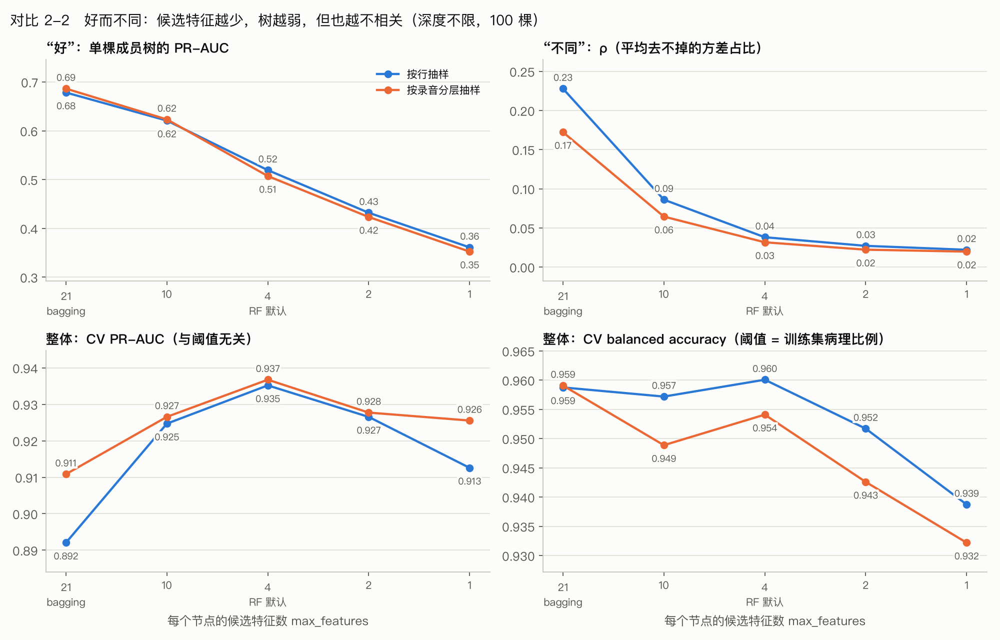

| max_features（按行抽样） | 21（bagging） | 10 | 4（RF 默认） | 2 | 1 |
|---|---|---|---|---|---|
| “好”：单棵树的 PR-AUC | 0.68 | 0.62 | 0.52 | 0.43 | 0.36 |
| “不同”：ρ | 0.23 | 0.09 | 0.04 | 0.03 | 0.02 |
| 集成的 偏差² / 方差 | 0.016 / 0.003 | 0.016 / 0.002 | 0.018 / 0.001 | 0.022 / 0.001 | 0.027 / 0.001 |
| 交叉验证 PR-AUC | 0.892 | 0.925 | **0.935** | 0.927 | 0.913 |
| 交叉验证 balanced acc（阈值 = 病理比例） | 0.959 | 0.957 | **0.960** | 0.952 | 0.939 |

- “好”和“不同”此消彼长；随机森林（max_features=4）的 PR-AUC 比 bagging 高 0.043，5 折胜 4 折。
- 随机化过头之后，ρ 已经降不下去，方差也到了底（约 0.0013），但每棵树还在继续变弱，偏差²从 0.016 涨到 0.027。
- 这和第一篇的发现呼应：深度 2 的方差凸起，来自 ASTV 和 ALTV 争一个切分位置；随机森林让每个节点轮流只看部分特征，把“选谁看运气”变成了“大家轮流选，再平均”。

> **我的追问 4**：既然按录音抽样更好，2-2 为什么又改回按行抽？另外，决定沿用 max_features=4，却把 0.5 阈值的问题推到第四篇，这是不是矛盾？

两处矛盾都成立，我们当场做了修正：

1. **2-2 补跑了按录音抽的版本。** 结果在随机森林里，抽样单位基本不再起作用：ρ 只从 0.038 降到 0.032，PR-AUC 0.935 对 0.937（只胜 1/5 折）。原因是按录音抽和随机挑特征**都在降低 ρ，两者作用重叠**，而随机挑特征的力度大得多（0.23 → 0.04，按录音抽只是 0.23 → 0.17）。所以修正后的结论是：**按录音抽对 bagging 有小幅帮助，对随机森林几乎没有影响。**后面沿用按行抽、max_features=4 的随机森林，现在有了证据支撑。
2. **阈值问题不能推迟。** balanced accuracy 和 0.5 阈值本身就不匹配：概率可靠时，让 balanced accuracy 最大的阈值是病理比例（约 0.083），而集成的概率经过平均会被拉向中间。改用“训练折的病理比例”作阈值后，三个怪现象都消失了：
   - 在 0.5 阈值下，max_features=10 在 balanced accuracy 上“5 折全胜”4；换阈值后两者是 0.957 对 0.960，分不出高下。
   - 树桩 bagging 的 balanced accuracy 从 0.62 回到 0.87，max_features=1 从 0.80 回到 0.94。
   - 深树集成（深树 bagging 和各种随机森林）的病理片段翻转率，从 0.38–0.65 降到 0.12–0.21，而单棵深树仍是 0.71。也就是说，0.5 阈值把深树集成的稳定性收益低估了。（树桩 bagging 是例外：换阈值后它的翻转率反而从 0.74 升到 0.91，因为它的概率都挤在新阈值附近。）

### 5.3 第二篇小结

Bagging 去掉了深树约 3/4 的方差，但去不掉偏差。随机森林通过随机挑特征把 ρ 从 0.23 压到 0.04，又去掉一半多剩余方差，代价是每棵树变弱，最好的平衡点在 max_features 4–10 之间。对于按录音分组的数据，按录音抽样能进一步降低 ρ，对 bagging 有小幅帮助，在随机森林里几乎看不出来。

---

## 6. 第三篇　Boosting 路线：顺序叠加能降什么？模型越多越好吗？

### 6.1 对比 3-1：同样 100 个树桩，并行平均还是顺序叠加

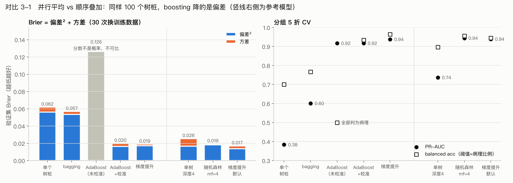

| | 单个树桩 | bagging（并行） | AdaBoost + 校准（顺序） | 梯度提升（顺序） |
|---|---|---|---|---|
| Brier = 偏差² + 方差 | 0.062 = 0.056 + 0.006 | 0.057 = **0.054** + 0.004 | 0.020 = **0.016** + 0.004 | 0.019 = **0.017** + 0.002 |
| 交叉验证 PR-AUC | 0.38 | 0.60 | 0.92 | 0.94 |
| 交叉验证 balanced acc（阈值 = 病理比例） | 0.70 | 0.77 | 0.93 | 0.96 |

- **和 2-1 正好互为镜像**：同样 100 个树桩，并行平均后偏差²只从 0.056 降到 0.054，顺序叠加后降到 0.016–0.017，降了约 70%。
- **AdaBoost 的 `predict_proba` 不是概率**：它只落在 0.25–0.62 之间，是加权投票被压缩后的分数。直接用病理比例阈值，会把所有片段都判成病理（balanced accuracy 0.50）。只在训练数据内部按录音分组做 sigmoid 校准后，balanced accuracy 升到 0.934；PR-AUC 校准前后都是 0.917，因为校准不改变排序。
- **AdaBoost 把注意力集中在少数录音上**：病理片段只占 8.4%，第 1 轮之后就占了总权重的 48%，第 100 轮时 54%；权重最高的 1% 片段占了总权重的 36%，209 个录音里有 8 个占了 44%（REC-231 一个就占 12%，它有 4 段：3 段病理、1 段非病理）。第 20 轮的树桩不加权时会把 92% 的片段判错：它几乎全判病理，只为了抓住权重集中的那几个难样本。这正是“后一个模型盯着前一个模型的错误”。代价是 AdaBoost 的方差（0.0037）比梯度提升（0.0019）高。这里只能说这些样本“难判”，不能说它们的标签是错的。

**两条路线在完整模型上的不同特点**：

| | 随机森林（max_features=4） | 梯度提升（默认：深度 3，100 轮） |
|---|---|---|
| 偏差² / 方差 | 0.018 / **0.0012** | **0.014** / 0.0033 |
| 病理片段翻转率 | **0.12** | 0.38 |
| 交叉验证 PR-AUC / balanced acc | 0.944 / 0.955 | 0.939 / 0.945 |

表现打平，特点相反：随机森林预测稳，梯度提升偏差小，正好对应“bagging 降方差、boosting 降偏差”。

### 6.2 对比 3-2：模型越多越好吗

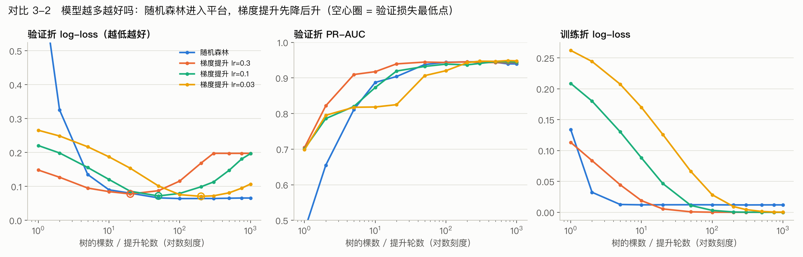

| | 验证集 log-loss 最低点 | 最低值 | 1000 棵（轮）时 |
|---|---|---|---|
| 随机森林 | 100–300 棵 | 0.064 | 0.066（平台期） |
| 梯度提升，学习率 0.3 | 20 轮 | 0.078 | 0.198 |
| 梯度提升，学习率 0.1 | 50 轮 | 0.072 | 0.197 |
| 梯度提升，学习率 0.03 | 200 轮 | 0.071 | 0.107 |

- 随机森林加树只会变慢；梯度提升的训练集 log-loss 降到 0，验证集先降后升。学习率越小，最低点来得越晚，之后上升得也越慢。
- **最值得注意的一点**：验证集 log-loss 涨到原来的两倍多时，PR-AUC 几乎没变（学习率 0.1 时，100 轮 0.939，1000 轮 0.945）。boosting 的过拟合首先表现为概率过度自信，只看 PR-AUC 发现不了。

> **我的追问 5**：既然树桩梯度提升表现不差，而且默认的 100 轮已经越过最低点了，第四篇为什么还要硬用默认设置？

之前的回答把“不能偷看评价数据”和“不能调参”混为一谈了。正确的做法是**嵌套选参**：在每个外层训练折内部，再按录音分组划出 4 个内层折，用内层的 log-loss 来选深度（1 或 3）和轮数（1–1000）；外层折只用来评价。

| 设置 | PR-AUC | balanced acc | log-loss |
|---|---|---|---|
| 默认（深度 3，100 轮） | 0.939 | 0.945 | 0.079 |
| 嵌套：深度固定 3，只选轮数（每折 32–45 轮） | 0.931 | 0.953 | 0.074 |
| 偷看外层曲线（深度 3，50 轮） | 0.932 | 0.953 | 0.072 |
| **嵌套：深度和轮数都选**（5 折**都选了树桩**，166–427 轮） | **0.953** | **0.963** | **0.058** |

- 默认设置确实不合适，而且问题主要出在**深度**，不在轮数：只调轮数，log-loss 降一点，PR-AUC 没有提升；改用树桩加约 200 轮后，各项都更好（PR-AUC 和 log-loss 都是 4/5 折更好）。
- 在这份数据上，偷看带来的乐观偏差很小，因为深度 3 时每折的最佳轮数都很稳定。但只有嵌套的数字才是诚实的估计。
- 由此得到一条规则：如果给梯度提升调参，所有模型都必须按同样的流程调参，否则比较就偏向了它。

---

## 7. 第四篇　实战与边界

范围（我选定的）：① 公平比较；② 评价协议与 OOB；③ 阈值与校准；④ 特征重要性。⑤ 锁定测试集评估**不做**。

### 7.1 ① 公平比较：五个模型都在训练折内部嵌套选参

事先声明的网格：单树深度 {2…6}；逻辑回归 C ∈ {0.01, 0.1, 1, 10, 100}；RBF-SVM C ∈ {0.1, 1, 10, 100} × γ ∈ {scale, 0.01, 0.1}；随机森林 max_features ∈ {2, 4, 10}（300 棵）；梯度提升深度 ∈ {1, 3} × 轮数。统一用内层 log-loss 来选。SVM 不能用 `SVC(probability=True)`，因为它内部按行做交叉验证，同一录音的片段会泄漏，所以改为按录音分组做 Platt 校准。

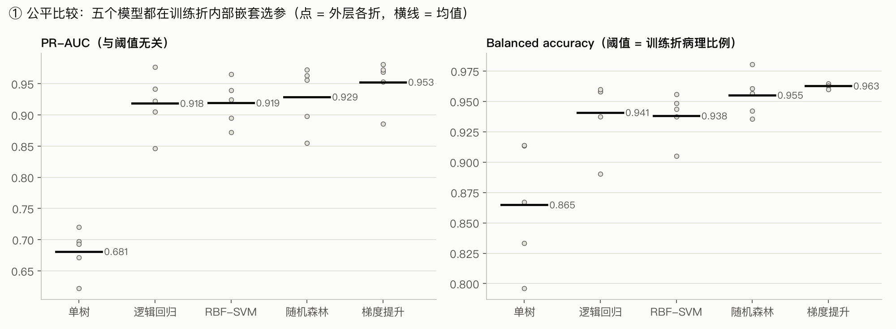

| 模型 | 各折选出的参数 | PR-AUC | balanced acc（阈值 = 病理比例） | log-loss |
|---|---|---|---|---|
| 单树 | 深度 2–4 | 0.681 | 0.865 | 0.264 |
| 逻辑回归 | C=1（4/5 折） | 0.918 | 0.941 | 0.075 |
| RBF-SVM | C 取 10–100，γ=0.01 | 0.919 | 0.938 | 0.080 |
| 随机森林 | max_features=10（4/5 折） | 0.929 | 0.955 | 0.063 |
| 梯度提升 | 树桩，166–427 轮 | 0.953 | 0.963 | 0.058 |

这 5 折里，梯度提升对随机森林的 PR-AUC 5 折全胜；随机森林对逻辑回归只胜 2/5 折。我一开始据此写了“梯度提升稳定第一、随机森林没赢逻辑回归”。

> **我的追问 6**：怎么严格比完之后，随机森林也没明显赢过逻辑回归？

用第四篇 ② 里的 25 折（按录音分组 5 折 × 5 次重复，参数固定：随机森林 max_features=4，梯度提升树桩 220 轮）重新做逐折配对：

| 25 折逐折配对 | PR-AUC | balanced acc | ROC-AUC |
|---|---|---|---|
| 随机森林 − 逻辑回归 | +0.017，胜 16/25 | +0.020，胜 17/25 | +0.005，胜 20/25 |
| 梯度提升 − 逻辑回归 | +0.023，胜 16/25 | +0.021，胜 16/25 | +0.002，胜 16/25 |
| 梯度提升 − 随机森林 | +0.006，胜 **14/25** | +0.001，胜 **13/25** | −0.003，胜 **12/25** |

- **随机森林其实小幅赢了逻辑回归**，只是差距（约 0.02）比折与折之间的波动（约 0.05）小得多，5 折分辨不出来。log-loss 还给随机森林选了 PR-AUC 较低的 max_features=10。25 折里 ROC-AUC 胜 80%，和教师参考里的 88% 一致。
- **“梯度提升稳定第一”是我说过头了**：那个 5/5 依赖于随机森林被选成了 max_features=10；改用 max_features=4、用 25 折来比，两者打平。
- **证据强度要打折扣**：这 25 折是同一批录音反复切分得到的，彼此不独立，“16/25”的证据比字面上看起来弱；所用的固定参数也参考过前面的结果，有轻微的挑选成分。所以准确的说法是：**多数折更好，幅度小，方向一致，但证据不算强。**
- **差距为什么小**：逻辑回归本身已经很强（PR-AUC 0.91–0.92）；而随机森林有一部分能力花在了记住每个录音的细节上（见 7.2：按行评价时它虚高 0.049，逻辑回归只虚高 0.020），这部分优势换成新录音就没了。这一点是根据虚高幅度做的推断。

**一个被我撤回的推断**：我曾猜测“CTG 的信号可以相加，但每个特征是阈值型的”，并事先写好预测：给逻辑回归加上非线性特征，效果应该接近梯度提升。结果样条逻辑回归的 PR-AUC 是 0.816，分箱逻辑回归是 0.655，**都比普通逻辑回归（0.918）还差**。可能的原因（未验证）是：两种做法都按分位数切分特征，而病理片段几乎都挤在分布的尾部，分位数切分恰恰把尾部压扁了。所以这两次检验既没有支持、也没有否定那个推断。我把它撤回，只保留唯一的证据：嵌套选参 5 折都选了树桩。我也没有继续换别的做法去试，因为一直试到有一种成功为止，结论就不可信了。

### 7.2 ② 评价协议：只换协议，模型设置全部固定

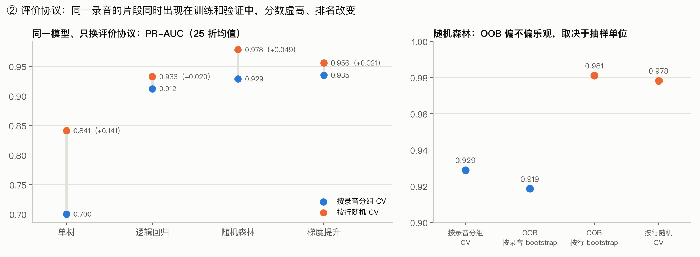

| PR-AUC（5 折 × 5 次重复） | 按录音分组 | 按行随机 | 虚高 |
|---|---|---|---|
| 单树（深度 4） | 0.700 | 0.841 | **+0.141** |
| 逻辑回归 | 0.912 | 0.933 | +0.020 |
| 随机森林 | 0.929 | 0.978 | **+0.049** |
| 梯度提升 | 0.935 | 0.956 | +0.021 |

- 会记细节的模型（深树、随机森林）虚高最多。单树的 ROC-AUC 从 0.82 虚高到 0.93，和教师参考吻合。
- **排名被改了**：按录音分组时梯度提升第一，按行随机时随机森林第一。用错协议，会选错模型。
- **OOB**：按行 bootstrap 的 OOB 是 0.981，接近按行随机交叉验证的 0.978；按录音 bootstrap 的 OOB 是 0.919，接近按录音分组交叉验证的 0.929。**OOB 偏乐观，问题在抽样单位，不在 OOB 这个方法本身。**

### 7.3 ③ 阈值与校准

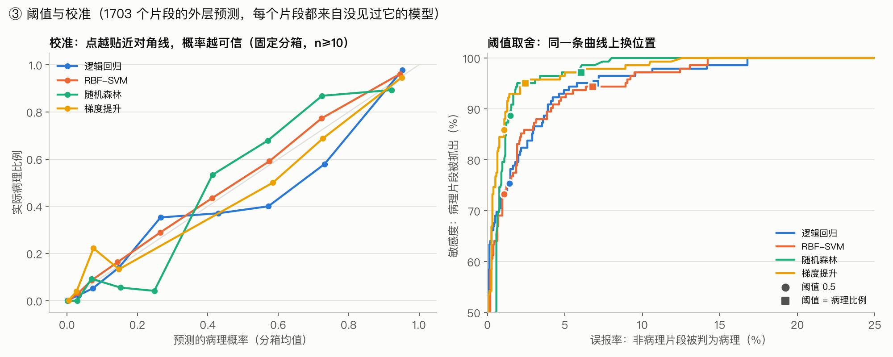

**校准**：四个模型的平均预测（0.082–0.086）都和实际病理比例（0.083）一致。分箱看，梯度提升和校准后的 SVM 最贴近对角线；随机森林在中高段偏保守（预测 0.4–0.7 时，实际比例是 0.53–0.87）；逻辑回归在中段偏自信（预测 0.57 时实际 0.40）。中间几个分箱样本少，噪声较大。

> **我的追问 7**：为什么用病理比例作阈值就等于“1 次漏判 ≈ 11 次误报”？那阈值到底该怎么定？

**推导**：设某片段的病理概率是可靠的 p，漏判代价为 C漏，误报代价为 C误。判为病理的期望代价是 (1 − p)·C误，判为非病理是 p·C漏。当 p > 1/(1 + r) 时判为病理更划算，其中 r = C漏 / C误。
- 阈值 0.5 对应 r = 1：漏判和误报一样贵，也就是让普通准确率最大。
- 阈值 0.083 对应 r = (1 − 0.083)/0.083 ≈ **11**。
- balanced accuracy = 1 − ½(漏判数/142 + 误报数/1561)：漏判一次下降 1/(2×142)，误报一次下降 1/(2×1561)，两者之比正好是 1561/142 ≈ 11。所以 r ≈ 11 就是本数据两类数量之比，它取决于病理比例，**不是临床判断**；换一家医院，病理比例变了，这个隐含的 r 也会变。

**不同代价比下的漏判 / 误报**（外层预测汇总，共 142 个病理、1561 个非病理；阈值完全由 r 算出，不看标签）：

| r | 阈值 | 梯度提升 | 随机森林 | 逻辑回归 |
|---|---|---|---|---|
| 1 | 0.50 | 20 / 17 | 16 / 23 | 35 / 22 |
| 3 | 0.25 | 14 / 20 | 7 / 40 | 19 / 51 |
| 5 | 0.17 | 11 / 22 | 5 / 64 | 11 / 70 |
| 11 | 0.083 | 7 / 38 | 4 / 92 | 7 / 109 |
| 20 | 0.048 | 6 / 47 | 0 / 126 | 5 / 141 |
| 50 | 0.020 | 3 / 124 | 0 / 200 | 3 / 220 |

按“总代价 = r × 漏判数 + 误报数”来算：r = 5 和 11 时梯度提升最低（例如 r = 11 时，梯度提升 115，随机森林 136，逻辑回归 186）；r = 20 和 50 时随机森林最低（r = 20 时，126 对 167）；逻辑回归在每一个 r 下都不是最优。

我的理解是：**选哪个模型和定什么阈值必须一起决定，不能只凭 PR-AUC 这一个数**，因为 PR-AUC 概括的是整条曲线，而实际使用时只会落在曲线上的某一个点。但要说清楚：这个交叉点只取决于很少的几个片段（比如 r = 20 时，0 个漏判对 6 个漏判），而且随机森林的校准不太好，所以这只是对这份开发数据的描述，不是可靠的规律，需要外部数据来确认。

**阈值该怎么定**：
1. 先定代价比 r，或者定一个约束条件。这是临床上的价值判断：漏判一个病理 CTG，相当于多少次不必要的复查或干预？
2. 确认概率可靠（必要时在训练数据内部做校准），再用 t = 1/(1 + r)。
3. 如果用约束条件（比如敏感度 ≥ 95%），阈值只能在开发数据内部确定。
4. 在打开测试集之前写定 r 或约束条件，报告整张取舍表，而不是一个数字。本作业把 r ≈ 11（balanced accuracy 的口径）作为分析约定。

### 7.4 ④ 特征重要性

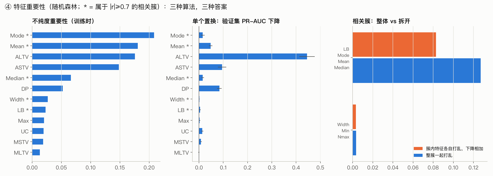

相关簇（|r| ≥ 0.7）：{LB, Mode, Mean, Median}，{Width, Min, Nmax}。模型在 train 上训练，在 validation 上做置换（评分用 PR-AUC，重复 30 次）。

| 随机森林 | 不纯度重要性（排名） | 置换后 PR-AUC 下降（排名） |
|---|---|---|
| Mode | 0.21（第 1） | 0.016（第 5） |
| Mean | 0.18（第 2） | 0.048（第 4） |
| ALTV | 0.18（第 3） | **0.445（第 1）** |
| ASTV | 0.15（第 4） | 0.096（第 2） |
| DP | 0.05（第 6） | 0.084（第 3） |

- **相关特征会互相替补**：单独打乱 Mode，PR-AUC 只降 0.016，因为 Mean 和 Median 补上了；把“位置”簇一起打乱，下降是 0.127，大于逐个打乱之和 0.083（梯度提升上是 0.183 对 0.064）。
- 随机森林和梯度提升的置换重要性前三名一致：ALTV、ASTV、DP。
- **ALTV 单独看很弱（单特征 AUC 0.57），在模型里却最关键**：它专门抓住“位置”簇漏掉的那批病理片段，也就是第一篇深度 2 分析里那 13 个“Mode > 106、ALTV > 68.5”的片段。它的重要性来自和其他特征配合时的作用。
- 保留意见：验证集只有 34 个病理片段、来自少数几个录音，置换的标准差只反映打乱的随机性。**重要性说明的是模型靠什么来预测，不是因果关系。**

---

## 8. 作业产出

### 8.1 Bagging 与 Boosting 对照表（结合本数据的证据）

| 方面 | Bagging（含随机森林） | Boosting |
|---|---|---|
| 训练方式 | 并行，各棵树互不依赖 | 顺序，后一棵依赖前一棵 |
| 每一轮用什么数据或权重 | 一份 bootstrap 样本；随机森林另外在每个节点随机挑部分特征 | AdaBoost 调整样本权重；梯度提升拟合负梯度 y − p |
| 基学习器 | 深树（偏差低、方差高） | 浅树或树桩（本数据嵌套选参 5 折都选了树桩） |
| 主要降低 | 方差：深树方差 0.0106 → 0.0031，偏差²不变 | 偏差：同样 100 个树桩，偏差² 0.056 → 0.017 |
| 对噪声和模型数的敏感性 | 加树不过拟合（log-loss 停在 0.064 附近的平台）；对标签噪声较稳健 | 轮数过多会过拟合（log-loss 0.072 → 0.197，而 PR-AUC 几乎不变）；AdaBoost 的权重会集中到少数录音上 |
| 关键超参数 | n_estimators、max_features（本数据 4–10 是平台） | learning_rate × 轮数、max_depth；轮数要在训练数据内部按录音分组来选 |

### 8.2 模型比较表（按录音分组，嵌套选参）

| 模型 | PR-AUC | balanced acc（阈值 = 病理比例） | 稳定性（方差 / 病理翻转率） | 解释成本 |
|---|---|---|---|---|
| 单树 | 0.681 | 0.865 | 0.009 / 0.68（深度 4） | 低：规则直接可读，但不稳定 |
| 逻辑回归 | 0.918 | 0.941 | — | 低：系数可读（需要标准化） |
| RBF-SVM | 0.919 | 0.938 | — | 高：需要标准化，还要额外校准 |
| 随机森林 | 0.929（25 折、max_features=4：比 LR +0.017） | 0.955 | **0.0012 / 0.12** | 中高：只能借助特征重要性 |
| 梯度提升 | 0.953（25 折：与随机森林打平） | 0.963 | 0.0033 / 0.38（默认设置） | 中高：同上，轮数还要调 |

（逻辑回归和 SVM 没有做重抽样稳定性实验，所以稳定性一栏留空。）

### 8.3 研究备忘录

在本数据和按录音分组的协议下，我不会只选一个模型，而是保留梯度提升（树桩，轮数在训练数据内部选）和随机森林（max_features=4）两个候选，逻辑回归作为基线。表现上，两者在 25 折分组交叉验证中打平，都在约三分之二的折上小幅优于逻辑回归（PR-AUC 约 +0.02），远优于单棵树。稳定性上，换一批训练录音时，随机森林的预测方差更小（0.0012 对 0.0033），病理片段的类别翻转也更少。解释成本上，两者都比逻辑回归难解释；置换重要性显示模型主要依赖 ALTV、ASTV、DP，但这只是预测上的依赖，不是因果。阈值上，选谁取决于漏判和误报的代价比，但交叉点只由少数几个片段决定。验证范围仅限本数据和本划分，测试集还没有打开，录音也不等于孕妇。如果在独立中心的数据上，集成模型和逻辑回归的差距消失，我会改用更容易解释的逻辑回归。

---

## 9. 过程中做错的地方与修正

| # | 一开始的错误或不严谨之处 | 怎么发现的 | 修正后 |
|---|---|---|---|
| 1 | 同时说“最佳深度定不下来”和“深度 4 最好”；拿差值去和折间标准差比 | 我发现两句话前后矛盾 | 改用逐折配对：深度 4–6 是平台，深度 4 只是代表；之后所有比较都用配对标尺 |
| 2 | 把深度 2 的方差凸起归因于 `Max ≤ 234` 小叶节点 | 我追问后核查 | 验证集里 0 个片段落在那里；真正原因是 ASTV 和 ALTV 争同一个切分位置 |
| 3 | 说“方差随深度单调上升” | 分层重抽样重跑后发现 | 深度 2 有凸起；改为“偏差²持续下降，方差占比约 1/10 → 2/5” |
| 4 | 说“按行重抽样几乎不改变训练数据”，并推广到所有树 | 第二篇的数据 | 只对浅树成立 |
| 5 | 用 σ² 相近来反驳“按行抽时 ρ 偏高” | 我坚持要加按录音抽的对照，两层设计实测 ρ | 我的假设成立：按行 0.23，按录音 0.17（深树） |
| 6 | 2-2 只用按行抽，和 2-1 的结论不一致 | 我指出矛盾 | 补跑两种抽样单位：在随机森林里差别基本消失 |
| 7 | 用 0.5 阈值算 balanced accuracy，导致三个假象（max_features=10 更好、树桩 bagging 变差、max_features=1 翻转更多） | 我指出“选 max_features=4 却推迟阈值问题”自相矛盾 | 改用病理比例阈值，三个假象都消失了 |
| 8 | 把 AdaBoost 的 `predict_proba` 当概率用 | 它把所有片段都判成了病理 | 认识到那只是压缩后的投票分数，先校准再比较 |
| 9 | 坚持让梯度提升用默认的 100 轮 | 我追问“明知过拟合为什么还要用默认” | 改为嵌套选参：5 折都选了树桩、约 200 轮 |
| 10 | 说“梯度提升稳定第一”“随机森林没赢逻辑回归” | 我追问后，用 25 折重新比较 | 梯度提升与随机森林打平，都小幅优于逻辑回归（但 25 折不独立，证据不算强） |
| 11 | 提出“信号可相加、阈值型”的推断，并预测非线性逻辑回归能追上梯度提升 | 两次事先写好预测的检验都没通过 | 撤回推断，没有继续换方法试 |
| 12 | 部分图表的柱状图纵轴截断，会夸大差别 | 自查 | 改成哑铃图 |
| 13 | 教师提供的 `scripts/demo_ensemble.py` 输出路径用了 `parents[4]`，会写到 `~/.tmp/ensemble/` 而不是项目文件夹 | 读代码时发现 | 本报告没有用这个脚本，所以没有修改它，只在这里记录 |

---

## 10. 证据边界与没有做的事

**可以说的**：在本数据、按录音分组的划分、事先声明的参数网格下，比较了各种集成机制的表现和对训练数据扰动的稳定性。

**不能说的**：
- 不能说哪个模型在临床上更好用：测试集没有打开，也没有外部队列。数据是 1980–1998 年的历史录音，录音也不一定对应孕妇个体。
- 特征重要性不是因果效应。
- 阈值和模型的交叉点只是本数据上的描述，漏判数很小，不确定性很大。
- 25 折配对的结果不独立，证据强度有限。

**没有做的事**：锁定测试集评估（留给老师安排的最后一步）；对测试集指标做 bootstrap 区间（工作单 G 的第二种用途）；对“梯度提升与随机森林的代价差”按录音做 bootstrap 区间；运行 XGBoost / LightGBM；外部验证；三分类（NSP）扩展。

---

## 附录：复现方式

环境：conda 环境 `svm-lab`（Python + scikit-learn 1.8.0；教师参考用的是 1.9.0，看趋势即可，不必核对最后几位小数）。在本讲目录（lessons/10-ensemble-bootstrap）下依次运行：

```bash
PY=python   # conda 环境 svm-lab
$PY src/part1_single_tree.py        # 第一篇：深度扫描、偏差-方差分解、根节点变化
$PY src/part1_depth2_check.py       # 第一篇补充：深度 2 方差凸起的来源
$PY src/part2_bagging.py            # 第二篇：2-1 平均能降什么、2-2 好而不同（两种抽样单位、两种阈值）
$PY src/part3_boosting.py           # 第三篇：3-1 并行 vs 顺序、AdaBoost 权重、3-2 模型数量曲线
$PY src/part3_rounds_check.py       # 第三篇补充：梯度提升的嵌套选参
$PY src/part4_fair_comparison.py    # 第四篇 ① 公平比较 + ③ 阈值与校准
$PY src/part4_protocol.py           # 第四篇 ② 评价协议与 OOB
$PY src/part4_importance.py         # 第四篇 ④ 特征重要性
$PY src/part4_followup.py           # 第四篇补充：25 折配对、样条逻辑回归、代价比阈值表
```

所有脚本只读 `data/ctg/student/`，随机种子固定为 1010。图和结果表保存在 `outputs/part1/` 到 `part4/`。分箱逻辑回归那一次检验是在命令行里直接运行的，没有写进脚本，结果见 7.1。
