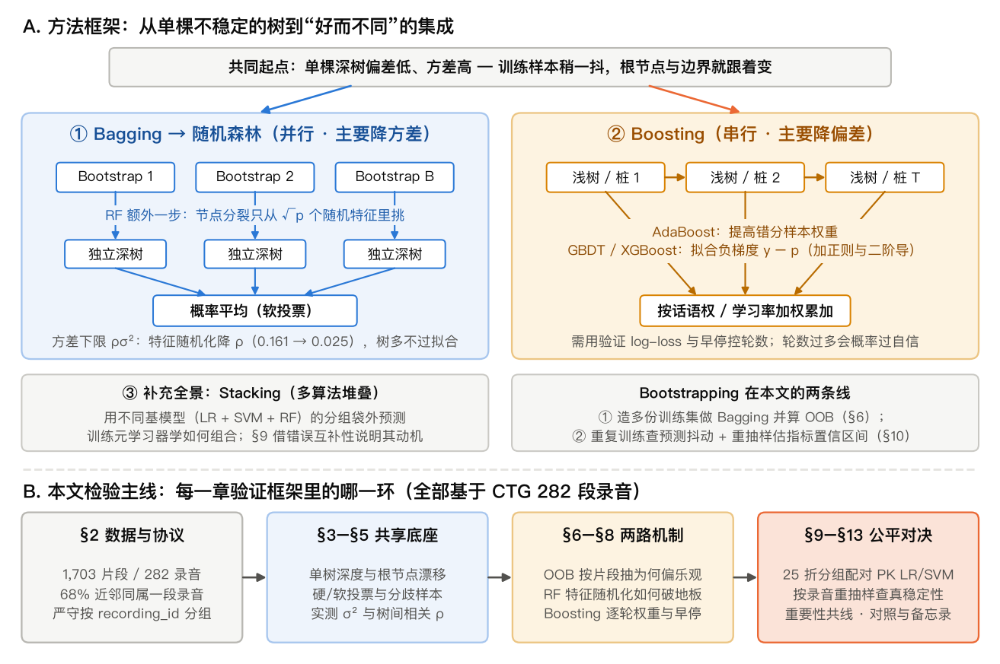
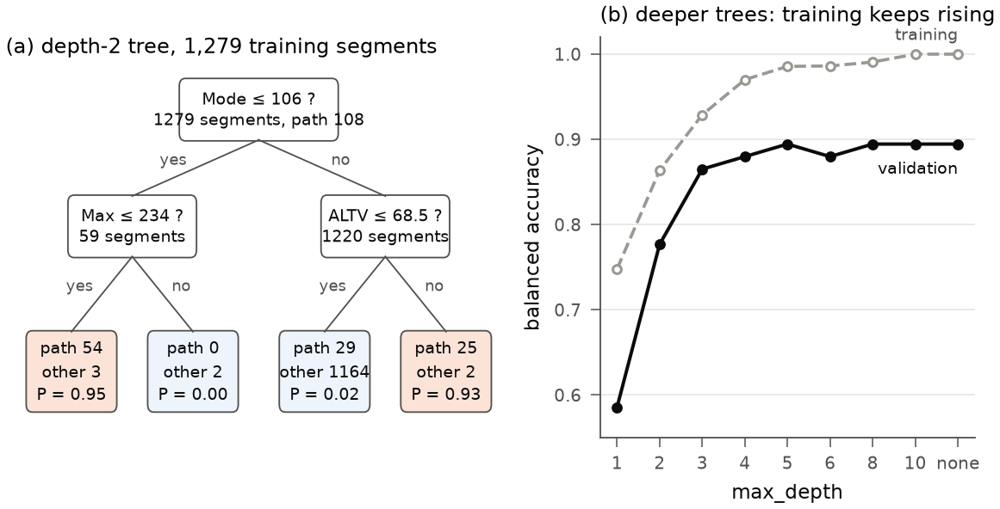
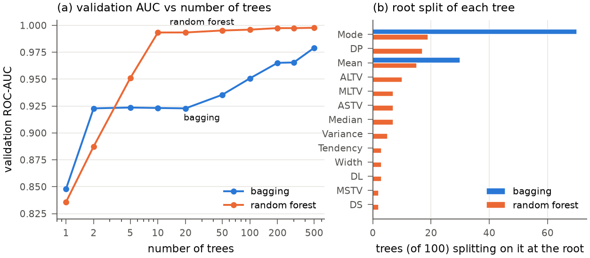
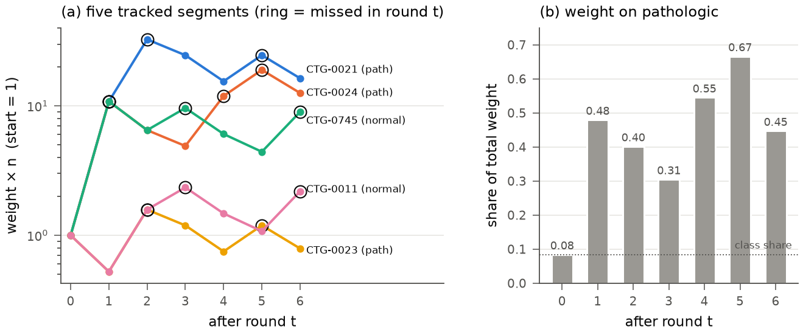
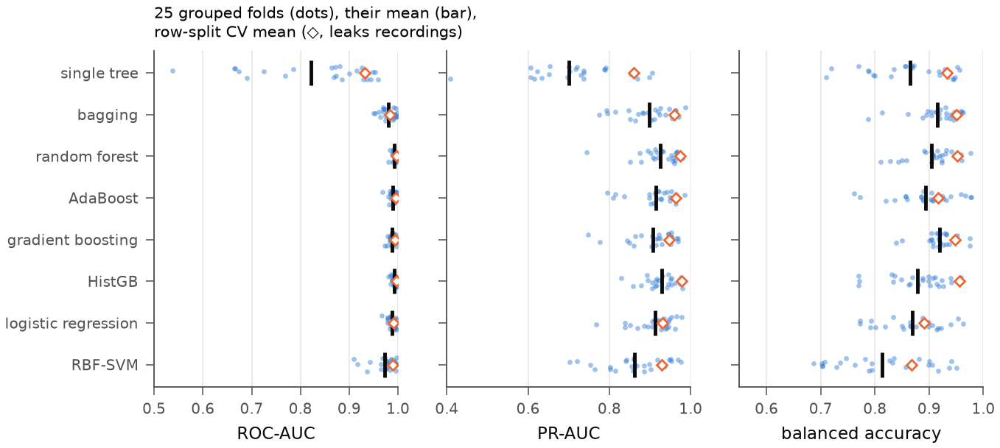
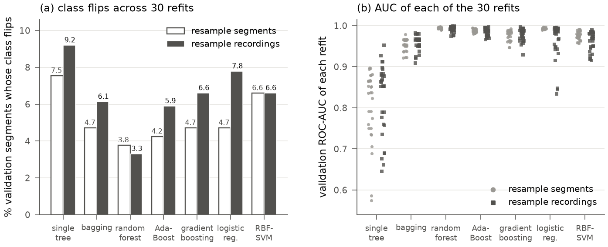
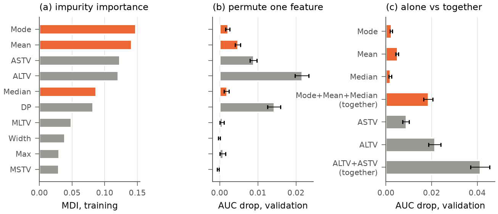

# 一、研究问题、方法框架与检验主线

这一讲要回答一个很具体的问题：在同一份数据和同一验证协议下，把多棵决策树组合起来，到底能不能比单棵树和逻辑回归、SVM 更准、更稳？如果有效，收益从哪来；如果无效，卡在哪里？

集成方法按“怎么制造模型之间的差异”以及“怎么把预测合起来”，主线可以分为两路：**Bagging（含随机森林）** 并行抽样造多份训练集，各自长出深树再平均，主要压低方差；**Boosting（AdaBoost、梯度提升及其工程改进 XGBoost / LightGBM）** 串行训练，后一棵专门去修前一轮的错分样本或残差，主要压低偏差。完整图谱里还有第三类 **Stacking**——用不同算法（如逻辑回归、SVM、随机森林）的分组袋外预测喂给第二层元学习器来学权重，本次不单独做实验，只在第九节对比误差互补时说明它的动机。贯穿两条主线的还有 **Bootstrapping** 的两种用法：一是做 Bagging 重抽样与袋外（OOB）估计，二是评估训练扰动稳定性和指标区间。

周志华《机器学习》第 8 章把三类方法的共同前提概括为个体学习器要“好而不同”，林轩田在《機器學習技法》里则称作 *diversity + democracy*。在结合公开课与技术博客梳理框架时（例如 B 站专栏《「五分钟机器学习」集成学习——Ensemble Learning》），科普文章也常沿 Bagging、Boosting、Stacking 三条线搭建直觉：认为随机森林通过随机采样让每棵树“看问题的角度不同”、抗噪更稳，而 AdaBoost 通过加重难样本、按分类器权重加权投票，在复杂任务上天花板更高但也更容易向离群点过拟合。不过，入门科普有时会省略机制边界（比如将特征随机抽样一并归入一般 Bagging，或泛泛预设 Boosting 必胜过随机森林）。下文沿着图 1 的检验主线，结合林轩田、李沐、李宏毅、StatQuest、刘建平 Pinard 等讲解里的核心命题，在 CTG 胎心监护数据上用可复现数字逐一验证与修正这些直觉。

{width=16.0cm}

沿着图 1 的主线，第 2 节先交待为什么选胎心监护（CTG）数据以及“按录音分组”这个硬约束；第 3 到第 5 节从单棵树的不稳定出发，手算投票并把方差公式 $\rho\sigma^2 + (1-\rho)\sigma^2/B$ 在 CTG 上直接量出来；第 6 到第 8 节分别拆解 OOB 为什么会偏乐观、随机森林为什么靠特征随机化拉开和 Bagging 的差距，以及 Boosting 逐轮纠偏的代价；第 9 到第 13 节在同一分组协议下把集成和逻辑回归、RBF-SVM 放到一起配对比较，并用按录音重抽样检验稳定性与特征重要性边界，最后落到对照表和研究备忘录。

正文只读取课程包 `student/` 下的训练集与验证集（Python 3.12.16，scikit-learn 1.8.0，模型参数与 `demo_ensemble.py` 一致），测试集标签未读。

# 二、数据与协议：一行是片段，独立的是录音

课件给了 WDBC 和 CTG 两套数据，我选了方案 B 的 CTG：一来 PPT 里的示例树和翻转率都基于 WDBC，换一套数据能逼自己把每一步从头算一遍；二来 WDBC 上逻辑回归和 SVM 的验证 AUC 已经顶到 1.000，Bagging 和随机森林也几乎没有差别，拉不开对比空间；三来 CTG 里同一段录音会切成好几个片段，刚好用来检验不独立样本会带来什么坑。

数据来自 UCI Cardiotocography，由 SisPorto 软件从胎心监护信号自动提取 21 个连续特征（胎心率基线 LB、每秒加速/胎动/宫缩/各类减速次数、短时与长时变异、直方图统计量等），标签为三位产科专家共识判读的病理型（`pathologic = 1`，把正常与可疑合并为 0）。

这里最容易踩错的门槛是：**一行是一个信号片段，不是一位孕妇。** 开发集（训练 + 验证）共 1,703 个片段，来自 282 段录音，每段录音中位数切成 4 段、最多 33 段。把 21 个特征标准化后，给每个片段找欧氏距离最近的邻居，68% 的情况下这个最近邻来自同一段录音。如果按行随机切分，同一段录音的“兄弟片段”会同时出现在训练集和验证集里，模型靠认出熟悉录音就能拿高分。因此划分与交叉验证都必须严格按 `recording_id` 分组。

| 集合 | 片段数 | 录音数 | 病理片段 | 含病理片段的录音 |
|---|---:|---:|---:|---:|
| 训练 | 1,279 | 209 | 108（8.4%） | 29 |
| 验证 | 424 | 73 | 34（8.0%） | 12 |

Table: 表 1　CTG 训练集与验证集组成（按 `recording_id` 分组划分，seed 1010）

表 1 最后一列决定了后面很多波动的根源：验证集的 34 个病理片段只来自 12 段录音，其中 `REC-327` 一段就占了 6 个。验证集上“多对几个片段”，很多时候只是多对了某一段录音。

`sample_id` 和 `recording_id` 都不能进特征；标签是专家对这段信号图的判读，不是胎儿真实结局或未来风险概率。因为阳性只占 8%，验证集全猜“非病理”的 accuracy 就有 390 / 424 = 0.920，但平衡准确率只有 0.500，所以下文主要看 ROC-AUC、PR-AUC 和平衡准确率（敏感度与特异度的均值）。

# 三、单棵树怎么预测，又为什么不稳

## 3.1 示例树读数、Gini 切分与尺度无关性

先回答工作单 A.1：在课件第 5 页的 WDBC 示例树上，一个 `worst perimeter = 120`、`mean concave points = 0.08` 的样本，先在根节点因 `120 > 105.95` 走右支，再因 `0.08 > 0.05` 落到最右下角叶节点（良 3 · 恶 112），预测恶性概率为 112 / 115 ≈ 0.974（课件标为 0.97）。叶节点给出的概率，就是落入该叶子的训练样本中阳性所占的比例。

换到 CTG 训练集，我也拟合了一棵 `max_depth = 2` 的树（图 2(a)），拿验证集三个片段按节点规则走一遍：

```
CTG-1682（REC-327，病理）：Mode = 91 ≤ 106 → 左；Max = 193 ≤ 234 → 叶节点（病理 54 / 其余 3）
                            P(病理) = 54 / 57 = 0.947，判病理 ✓
CTG-0297（REC-100，病理）：Mode = 148 > 106 → 右；ALTV = 78 > 68.5 → 叶节点（病理 25 / 其余 2）
                            P(病理) = 25 / 27 = 0.926，判病理 ✓
CTG-0002（REC-002，正常）：Mode = 141 > 106 → 右；ALTV = 0 ≤ 68.5 → 叶节点（病理 29 / 其余 1164）
                            P(病理) = 29 / 1193 = 0.024，判非病理 ✓
```

{width=15.5cm}

树在每个节点枚举所有特征和候选阈值，挑能使子节点加权 Gini 不纯度（$\mathrm{Gini} = 1 - \sum p_k^2$，随机抽两例不同类的概率）下降最多的一刀。手算根节点这一刀：

```
根节点：p = 108 / 1279 = 0.0844，Gini = 1 − 0.0844² − 0.9156² = 0.1546
按 Mode ≤ 106 切开：
  左  59 个（病理 54）：Gini = 1 − (54/59)² − (5/59)² = 0.1551
  右 1220 个（病理 54）：Gini = 1 − (54/1220)² − (1166/1220)² = 0.0846
  加权子不纯度 = (59 × 0.1551 + 1220 × 0.0846) / 1279 = 0.0879，下降 0.0668
```

有意思的是左边那 59 个样本的 Gini（0.1551）几乎和根节点一样高——这一刀的收益主要在于把一半病理样本从 1,220 个大组里抽走，使大组立刻变纯。

因为切分只看特征值的大小次序（`≤ 阈值`），单调缩放不影响树的分裂。我把 `AC`、`FM`、`UC`、`DL`、`DS`、`DP` 六个“每秒次数”同时乘以 3,600 换成“每小时次数”，单棵树、随机森林、梯度提升在验证集上的预测分数最大差异全部为 `0`；而未标准化的逻辑回归有 9 个片段改判（平衡准确率从 0.845 跳到 0.948，因为原本 `0.001` 量级的每秒计数受 L2 正则压制，放大后惩罚变轻），未标准化 RBF-SVM 有 11 个改判。把两者放进 `StandardScaler` 流水线后，换单位前后的预测完全一致。

## 3.2 深度对照与重抽样漂移

实验前我预测验证表现在 `max_depth` = 3 到 4 见顶，再深会因为过拟合掉下来。实际跑出来只有一半对：

| max_depth | 叶节点数 | 训练平衡准确率 | 验证平衡准确率 | 验证 ROC-AUC |
|---|---:|---:|---:|---:|
| 1 | 2 | 0.748 | 0.586 | 0.586 |
| 2 | 4 | 0.864 | 0.777 | 0.776 |
| 3 | 7 | 0.929 | 0.865 | 0.866 |
| 4 | 11 | 0.970 | 0.880 | 0.865 |
| 5 | 13 | 0.986 | 0.894 | 0.880 |
| 8 | 19 | 0.991 | 0.894 | 0.938 |
| 不限 | 21 | 1.000 | 0.894 | 0.894 |

Table: 表 2　单棵树的深度对照（训练集拟合，验证集评价）

训练平衡准确率一路升到 1.000，但验证集并没有掉头向下，而是在 0.880–0.894 横住了（图 2(b)）。CTG 的病理片段按录音聚成团，不限深度的树长到第 9 层、21 个叶节点就把训练集完全分干净了。至于验证 AUC 在 0.865、0.880、0.938、0.894 之间跳，是因为整棵树最多只能吐出 21 个不同的叶概率，排序颗粒太粗。

单棵树更致命的问题是**不稳**。对训练集做 30 次 bootstrap 重抽样并各拟合一棵深度 2 的树（表 3）：因为 `Mode` 和 `Mean` 相关系数高达 0.90，样本微调就会让根节点在两者间来回切换；算上第二层，30 棵树竟出现了 15 种不同结构，致使 8.0% 的验证片段至少被改判过一次。到深度 4 时更夸张，第十节会看到单树在 30 次重抽样间的验证 AUC 能从 0.575 掉到 0.90 以下。单棵深树偏差低、方差高，这正是后面集成要解决的痛点。

| 根节点特征 | 次数（前 10 次） | 次数（30 次） | 阈值范围 |
|---|---:|---:|---|
| Mode | 7 | 21 | 106.0 到 108.5 |
| Mean | 3 | 9 | 102.5 到 107.5 |

Table: 表 3　30 次 bootstrap 重抽样后深度 2 树的根节点漂移

# 四、多棵树怎么投票

先把工作单 B 的 4 个示例样本算清（表 4）：样本 B 的三棵树类别是 `0, 1, 1`（硬投票判 1，错），但判 1 的两棵树概率只是勉强过线（0.60、0.65），判 0 的那棵很确定（0.20），概率均值 0.483，软投票判 0 反而对了。`RandomForestClassifier` 默认采用软投票（先平均各树概率，再按 0.5 判类）。

| 样本 | 真值 | 三棵树类别 | 硬投票 | 三个概率 | 概率均值 | 软投票 |
|---|---:|---|---:|---|---:|---:|
| A | 1 | 1, 1, 0 | 1 ✓ | .80, .70, .45 | 0.650 | 1 ✓ |
| B | 0 | 0, 1, 1 | 1 ✗ | .20, .60, .65 | 0.483 | 0 ✓ |
| C | 1 | 0, 1, 1 | 1 ✓ | .35, .75, .80 | 0.633 | 1 ✓ |
| D | 0 | 0, 0, 1 | 0 ✓ | .15, .25, .70 | 0.367 | 0 ✓ |

Table: 表 4　工作单硬投票与软投票手算

在 CTG 训练集上做 5 份 bootstrap，各训一棵小树（`max_depth = 4, min_samples_leaf = 10`），到 424 个验证片段上看效果：97.9% 的片段五棵树投出了完全一样的票，硬、软投票只在 `REC-339` 的 2 个病理片段上分叉。例如 `CTG-1879`（真值 1）在五棵树上的概率是 `1.000, 0.333, 0.438, 0.286, 0.714`，硬投票 2:3 判错成 0，均值 0.554 靠软投票救了回来。另一方面，五棵树里运气最好的一棵单树平衡准确率达到 0.941，高于软投票的 0.880，但软投票的排序 AUC（0.954）超过了五棵里任何一棵（单树最高 0.941）——事先不知道哪棵树会走运，如果按验证集挑出那一棵，就会把验证集变成选择依据。这五棵树在近 98% 的片段上说同一句话，要想让投票真正省掉方差，光靠几份 bootstrap 树之间的“民主投票”（democracy）还不够，还得先制造真正的“多样性”（diversity，林轩田《機器學習技法》语）——让树之间彼此“错得更不一样”。

# 五、平均为什么能降方差：把 $\rho$ 和 $\sigma^2$ 量出来

*The Elements of Statistical Learning*（§15.2 式 15.1）给出了 $B$ 个同分布、两两相关为 $\rho$、方差为 $\sigma^2$ 的预测取平均后的方差：

$$\mathrm{Var}\left(\frac{1}{B}\sum_{b=1}^{B} T_b\right) = \rho\sigma^2 + \frac{1-\rho}{B}\sigma^2$$

不用推导也能直接读出三个推论：第一，随着树数 $B$ 增大，第二项趋于 0，但方差最多降到地板 $\rho\sigma^2$；第二，如果基模型总犯同样的错（$\rho \to 1$），平均后还是 $\sigma^2$，投票白忙；第三，平均只压方差、不改偏差，所以 Bagging 适合低偏差高方差的深树，而逻辑回归本身方差很小、重抽样后系数几乎不变（$\rho$ 极高），Bagging 几乎没有收益——李沐在 B 站《实用机器学习》（5.2 Bagging）与李宏毅在 *Ensemble* 一讲里都用“决策树不稳定、线性回归稳定”解释过为什么 Bagging 专治高方差的复杂学习器。

为了在 CTG 上实测这两个数，我沿用稳定性实验的那 30 份 bootstrap 训练集，每份换一个算法种子训 100 棵树的 Bagging 或随机森林，记录每棵树对 424 个验证片段的概率（构成 `30 × 100 × 424` 数组），按验证片段分别分解出跨训练集与树随机性的总单树方差 $\sigma^2$、组间共同波动地板 $\rho\sigma^2$ 与相关系数 $\rho = \rho\sigma^2 / \sigma^2$，并把 100 棵树切成互不重叠的 $B$ 棵小森林实测平均后的方差。

{width=16.0cm}

| 模型 | 单树方差 $\sigma^2$ | 树间相关 $\rho$ | 地板 $\rho\sigma^2$ | B = 1 | B = 10 | B = 100 | 验证 AUC |
|---|---:|---:|---:|---:|---:|---:|---:|
| bagging（21 特征全给） | 0.0127 | 0.161 | 0.00204 | 0.0127 | 0.00316 | 0.00215 | 0.951 |
| 随机森林（每次 4 个） | 0.0266 | 0.025 | 0.00066 | 0.0266 | 0.00326 | 0.00092 | 0.996 |

Table: 表 5　在 CTG 验证集上量出的 $\sigma^2$、$\rho$ 以及不同树数平均后的实测方差

跑之前我猜随机森林里的单棵树也比 Bagging 更稳，结果正相反：每次分裂只看 4 个随机特征，让随机森林的单棵树方差 $\sigma^2$ 比 Bagging 大了一倍多（0.0266 对 0.0127）；但它的 $\rho$ 只有 0.025，降到 Bagging（0.161）的六分之一。图 3(a) 里两条曲线在 $B \approx 10$ 附近交叉：树很少时随机森林更抖，过了 10 棵以后，Bagging 被它的地板 0.00204 死死托住，随机森林一路降到 0.00092，验证 AUC 也从 0.951 跃升到 0.996。此外，若直接算同一森林里各棵树验证残差（$p - y$）的平均两两相关，Bagging 是 0.62，随机森林是 0.41，方向一致。

图 3(b) 展示了 `max_features` 的边界代价：把候选特征压到 1，虽然 $\rho$ 降到最低的 0.014、验证 AUC 仍有 0.996，但单棵树被过度削弱，34 个病理片段的预测概率中位数从 `max_features = 4` 时的 0.76 跌到 0.51，一半样本过不了 0.5 门槛，默认阈值下的平衡准确率从 0.896 掉到 0.749。降 $\rho$ 不能无限度牺牲单树质量，按录音分组的五折 CV 也在默认的 $\lfloor\sqrt{21}\rfloor = 4$ 处表现最好。

# 六、Bootstrap 抽样与 OOB 在分组数据上的陷阱

工作单从 `[1, 2, 3, 4, 5]` 有放回抽 5 次得到 `[2, 2, 5, 1, 2]`：2 重复了 3 次，1 和 5 各出现 1 次，没被抽到的 3 和 4 是这棵树的袋外（OOB）样本，不同样本占比 3/5 = 0.60。理论上每条样本一次都不被抽中的概率为 $(1 - 1/n)^n$，样本量大时不同样本占比期望趋于 $1 - 1/e \approx 0.632$（OOB 约 36.8%——刘建平 Pinard 的《Bagging 与随机森林算法原理小结》给出过 $(1 - 1/m)^m \to 1/e$ 的极限推导，StatQuest 的《Random Forests》视频则用“大约三分之一的数据进不了 bootstrap 袋子”来帮助建立直觉）。模拟 1,000 次（表 6）可见这是平均规律而非固定比例，样本量小时单次抽样甚至可以在 0.2 到 1.0 之间波动。Bagging 就是靠这样造出 100 份互不干扰的训练集，天然支持并行。

| n | 不同样本占比均值 | 标准差 | 最小 | 最大 | 理论值 |
|---:|---:|---:|---:|---:|---:|
| 5 | 0.675 | 0.144 | 0.2 | 1.0 | 0.672 |
| 1279 | 0.6321 | 0.0088 | 0.604 | 0.663 | 0.6323 |

Table: 表 6　1,000 次有放回抽样中不同样本占比的模拟结果

每条训练记录只让“没抽到它”的树去预测，汇总起来就是 OOB 误差。但在 CTG 上，如果直接用 sklearn 的默认 OOB，结果会明显偏乐观（表 7）：

| 估计方式（300 棵树随机森林，仅用训练集） | accuracy | ROC-AUC | PR-AUC | 平衡准确率 | 敏感度 |
|---|---:|---:|---:|---:|---:|
| sklearn OOB（按片段抽样） | 0.990 | 0.995 | 0.975 | 0.956 | 0.917 |
| 按录音重抽样自算 OOB | 0.968 | 0.989 | 0.879 | 0.869 | 0.750 |
| 训练集内按录音分组五折 CV | 0.970 | 0.990 | 0.897 | 0.891 | 0.796 |
| 同一模型在验证集上 | 0.981 | 0.997 | 0.972 | 0.896 | 0.794 |

Table: 表 7　四种方式估计 300 棵树随机森林的表现

sklearn 默认 OOB 把敏感度估到 0.917，而实际验证集只有 0.794。我模拟了 1,000 次按片段的 bootstrap：当一个片段落在袋外时，它所在录音的其他片段有 94.6% 的概率还在袋内（最少一次也有 90.6%），整段录音完全落入袋外的只占 6.6%。换句话说，“没见过这个片段”的树其实早就见过它的兄弟片段。改成按 `recording_id` 抽样（抽中一段录音就带入它全部片段）后，OOB 敏感度立刻回落到 0.750，和分组 CV 对齐。因此 OOB 适合在单机上粗看树数什么时候收敛，却不能代替锁定测试集，在分组数据上更不能直接当成新录音的泛化估计——林轩田把 OOB 称作 Bagging 和随机森林的 *self-validation*（自己验证自己），但在 CTG 上，袋内的“自己”与袋外样本共享同一段录音，这种自证失去了独立性。

# 七、Bagging 与随机森林：特征随机化拉开的那一截

在 PPT 演示的 WDBC 数据上随机森林和 Bagging 几乎打平，我原本预期 CTG 上也差不多，实验结果却拉开了明显差距（表 8）：验证 ROC-AUC 从 0.951 提到 0.996，PR-AUC 从 0.895 提到 0.958。

| 模型 | 验证 AUC | PR-AUC | 平衡准确率 | 预测 SD 均值 | 类别翻转率 |
|---|---:|---:|---:|---:|---:|
| 单棵树（深度 4） | 0.865 | 0.725 | 0.880 | 0.028 | 7.5% |
| bagging（100 棵，全特征） | 0.951 | 0.895 | 0.896 | 0.015 | 4.7% |
| 随机森林（100 棵，sqrt 特征） | 0.996 | 0.958 | 0.896 | 0.016 | 3.8% |

Table: 表 8　单树、Bagging 与随机森林验证表现及 30 次重抽样稳定性。注：此处翻转率统一按 `predict()`（即 `p > 0.5`）统计，RF 为 16/424 = 3.8%；课程脚本 `demo_ensemble.py` 按 `p ≥ 0.5` 统计为 15/424 = 3.5%，差异来自 1 个恰好落在 0.50 边界上的片段

{width=15.5cm}

图 4(b) 把原因画得很直白：Bagging 的 100 棵树被最强的两个特征锁死了，70 棵拿 `Mode` 当根、30 棵拿 `Mean` 当根，树长得大同小异（$\rho = 0.161$）；随机森林则把根节点分散到了 13 个特征上，让 `DP`（延长减速）、`ALTV`、`ASTV` 都有机会打头阵。这直接决定了边界片段的命运：Bagging 给 3 个病理片段打出了 0.00 的概率（与 361 个正常片段并列垫底），例如 `REC-339` 的 `CTG-1881`（`Mode = 135, Mean = 109`）在所有 `Mode/Mean` 起头的树里都被送进“正常”叶；而随机森林里没有一个病理片段概率为 0（最低 0.10，给 `CTG-1881` 0.17）。为了排除实现差异，我把 `RandomForestClassifier` 设为 `max_features = None`，结果验证 AUC 刚好回到 0.951，证实收益完全来自特征随机化。这正好印证林轩田总结的“随机森林 = Bagging + 随机子空间的 C&RT 树”：像 B 站《「五分钟机器学习」集成学习》及其配套视频《随机森林：看我以弱博强》在入门讲解里会把样本抽样和特征抽样统算到 Bagging 流程中，但在 CTG 上把这两步拆开对比就能看清，真正把 AUC 从 0.951 拉到 0.996、救回 `CTG-1881` 这类边界病理片段的，并不是样本 bootstrap 本身，而是节点分裂时的特征随机化。

随树数增加，随机森林到 10 棵树验证 AUC 就达到 0.993，之后一路平稳延伸到 500 棵，OOB AUC 也从 100 棵起稳在 0.996 左右，没有出现过拟合；Bagging 加到 500 棵也只有 0.979，仍不如 10 棵树的随机森林。顺便注意到 Bagging 在 200 棵到 300 棵之间平衡准确率突然从 0.910 跌到 0.822——逐条排查发现，恰好是 `REC-327` 的全部 6 个病理片段概率从 200 棵时的 0.510–0.515 一起掉到了 300 棵时的 0.463–0.477，整段录音作为一个整体跨过 0.5 阈值线，再一次提醒验证集里的几个点不是独立样本。

# 八、Boosting：一轮一轮改错，以及它的代价

## 8.1 AdaBoost：让上一轮的树桩在新权重下变成“乱猜”

我手写了一个二分类树桩 AdaBoost（学习率 1），逐轮记录全部 1,279 个训练样本的权重，与 sklearn 的 `AdaBoostClassifier` 核对后，前 6 轮的 `estimator_errors_` 和 `estimator_weights_` 小数点后完全一致（StatQuest 的《AdaBoost, Clearly Explained》把这里的 $\alpha$ 形象地称作树桩的“话语权” *amount of say*，B 站《「五分钟机器学习」集成学习》及配套视频《Adaboost：前人栽树后人乘凉》也以这一“按样本困难度更新权重、依错误率赋投票权”的步骤串起全流程）。第 1 轮手算如下：

```
起始权重：每个样本 1 / 1279
第 1 个树桩：Mode ≤ 106 判病理，否则判非病理
  错分 59 个（Mode > 106 的病理片段 54 个 + Mode ≤ 106 的正常片段 5 个）
  加权错误率 ε = 59 / 1279 = 0.0461
  话语权 α = ln((1 − ε) / ε) = ln(0.9539 / 0.0461) = 3.029
  错分样本乘 e^α = 20.68 后整体归一化 → 错分者权重变为 10.84 倍，判对者变为 0.524 倍
```

（注：经典教科书、刘建平《集成学习之 Adaboost 算法原理小结》、StatQuest 以及上述 B 站专栏大多写作带 $\frac{1}{2}$ 系数的 $\alpha = \frac{1}{2}\ln\frac{1-\varepsilon}{\varepsilon} = 1.515$，并将错分乘 $e^{\alpha}$、判对乘 $e^{-\alpha}$；sklearn 默认不带 $\frac{1}{2}$，两种写法归一化后的样本权重完全等价。）

| 轮次 | 树桩分裂规则 | 未加权错分数 | 加权错误率 ε | α | 更新权重后该树桩错误率 |
|---:|---|---:|---:|---:|---:|
| 1 | Mode ≤ 106 | 59 | 0.046 | 3.03 | 0.500 |
| 2 | ASTV ≤ 60.5 | 267 | 0.166 | 1.62 | 0.500 |
| 3 | AC ≤ 0.0021 | 564 | 0.337 | 0.68 | 0.500 |
| 4 | DP ≤ 0.0015 | 79 | 0.205 | 1.35 | 0.500 |
| 5 | ALTV ≤ 68.5 | 85 | 0.314 | 0.78 | 0.500 |
| 6 | AC ≤ 0.0021 | 564 | 0.246 | 1.12 | 0.500 |

Table: 表 9　手写 AdaBoost 前 6 轮结果与更新权重后的错误率

表 9 最后一列很有意思：更新完权重后，刚用过的树桩在新分布下的加权错误率必然正好等于 `0.5`（因错分者总权重被拉成 $1/(2\varepsilon) \times \varepsilon = 0.5$）。这正是林轩田在 *Adaptive Boosting* 一讲中总结的 *make $g_t$ random-like*（课上用“老师引导几个小孩依次补充识别苹果的特征，专看前一个人看漏的例子”作比喻），也是李宏毅 *Ensemble* 一讲强调的“$f_1$ 在新权重下表现如同随机猜测”。这迫使下一轮的树桩只能去找别的切分角度来制造差异——Bagging 靠随机抽样与随机特征制造“不同”，AdaBoost 则靠改变样本权重刻意制造“不同”，也因此必须串行。

{width=16.0cm}

图 5(a) 里，`CTG-0021`（`Mode = 129` 的病理片段）前两轮连续错分，权重冲到 32.7 倍；图 5(b) 更直接：病理样本在数据里只占 8.4%，第 1 轮过后就分走了 48% 的权重，第 5 轮达到 67%，少数类不再是少数。第 3 轮选了 `AC ≤ 0.0021` 把 557 个正常片段判错，权重移过去后第 6 轮又得把它们拉回来。

## 8.2 梯度提升：牛顿步更新与追随噪声的样本

梯度提升不调权重，而是拟合当前对数损失对对数几率 $F$ 的负梯度 $y - p$（$p = 1 / (1 + e^{-F})$），StatQuest《Gradient Boost》将其称作“伪残差”（pseudo-residual）；刘建平的《梯度提升树（GBDT）原理小结》采用 $y \in \{-1, +1\}$ 记号将负梯度写成 $y / (1 + e^{yF})$，分别代入 $+1$ 和 $-1$ 换回 $0/1$ 标签后恰好就是 $y - p$。初始概率 $p_0 = 108/1279 = 0.0844$，$F_0 = \ln(0.0844/0.9156) = -2.383$，于是第一棵回归树拟合的伪残差在病理片段上为 `1 − 0.0844 = 0.916`、其余为 `−0.0844`。叶子输出值则是一步牛顿法 $\sum(y-p) / \sum p(1-p)$（StatQuest 第 4 集对此给出过二阶导数推导）：比如纯病理叶（24 个样本）算得 `0.9156 / (0.0844 × 0.9156) = 11.8426`，与 sklearn 第一棵树里存的值完全吻合（全部 7 个叶子均核对一致）。验证片段 `CTG-0008` 落入值为 9.687 的叶节点，乘学习率 0.1 得 $F_1 = -2.383 + 0.1 \times 9.687 = -1.415$，即 $p_1 = 0.195$，与 `staged_predict_proba` 一致；到第 100 轮升至 0.990。

但不是所有片段都能靠迭代修好。验证集里的病理片段 `CTG-0321` 到第 100 轮概率反而降到 0.001。去查它所在的 `REC-107` 录音，6 个片段标签交替出现（`0, 1, 0, 1, 1, 0`）：`CTG-0321` 标为病理但 `ALTV = 18`，而同录音另两段病理 `ALTV = 84`，两段正常却分别高达 `56` 和 `44`。在特征空间里 `CTG-0321` 更像正常片段，如果训练集也有类似标签与特征拧巴的点，Boosting 一轮轮加大权重或残差去追它，就容易过拟合噪声——这正印证了《「五分钟机器学习」集成学习》等专栏提到 Boosting 时的常见警示：它因持续死磕难分样本，对异常点与错标样本的敏感度远高于 Bagging。

## 8.3 学习率、轮数与 XGBoost / LightGBM

固定 `max_depth = 3`，比较四个学习率训练 500 轮（图 6、表 10）：

{width=15.5cm}

| learning_rate | 验证损失最低轮次 | 最低验证损失 | 第 500 轮验证损失 | 最低点验证 AUC | 第 500 轮验证 AUC |
|---:|---:|---:|---:|---:|---:|
| 0.05 | 143 | 0.077 | 0.102 | 0.988 | 0.988 |
| 0.1 | 74 | 0.080 | 0.146 | 0.987 | 0.989 |
| 0.3 | 21 | 0.088 | 0.232 | 0.963 | 0.987 |
| 1.0 | 2 | 0.149 | 0.639 | 0.951 | 0.855 |

Table: 表 10　梯度提升的学习率与轮数对照（损失指对数损失 log-loss）

过拟合先坏的是**概率校准**，而不是排序。学习率 0.1 时验证对数损失第 74 轮触底（0.080），到第 500 轮几乎翻倍（0.146），而验证 AUC 几乎稳在 0.987–0.989：多出的轮数把判对的概率推到 0.999，同时把少数判错的概率也推到 0.001，被 log-loss 狠狠罚分。学习率越小所需轮数大致成反比（0.05 需 143 轮，0.3 只需 21 轮），而 1.0 在第 2 轮后彻底失控。因此早停必须看验证 log-loss 而不是只盯 AUC；另外 sklearn 内置的 `early_stopping` 会按行随机留出 20% 样本做验证，虽然这次凑巧停在第 66 轮，但在 CTG 上原则上应按 `recording_id` 分组留出。

按资料对照工程实现：XGBoost 和 LightGBM 本质仍是梯度提升树，差别在于目标函数、速度和工程细节。博客（如刘建平《XGBoost 算法原理小结》）常把差异简记为“GBDT 只用一阶泰勒展开、XGBoost 用二阶”；结合 8.2 节的源码与叶子核对可以更精确地说，sklearn 在算叶子值时已经用到了一步二阶牛顿法，而 XGBoost 是连寻找分裂增益也全面使用二阶导数，并在损失里显式加入树复杂度正则项 $\gamma T + \frac{1}{2}\lambda\sum w_j^2$ 且自动学习缺失值流向；LightGBM 把连续特征分箱为直方图并采用按叶生长（leaf-wise），大数据上速度快得多。sklearn 受 LightGBM 启发实现了 `HistGradientBoostingClassifier`，我顺手在 CTG 上跑了它的默认设置：验证 AUC 0.992、PR-AUC 0.958，25 折分组 CV 为 0.992 ± 0.004，和普通 GBDT、随机森林处在同一梯队（在 1,703 行小表上速度差不明显）。

# 九、公平比较：在同一分组协议下对照简单基线

按预先写定的协议比较 7 个模型：全部采用 `demo_ensemble.py` 的预设参数不调参；逻辑回归和 RBF-SVM 在每一折的训练集内单独拟合 `StandardScaler`；SVM 用 `decision_function` 算 AUC；全部用默认阈值判定类别。先看固定的 train/validation 划分（表 11），再在开发集（282 段录音）上做 5 次不同随机种子的 5 折按录音分组 CV（共 25 折，表 12 与图 7），并计算同折内的配对差（表 13）。

| 模型 | 验证 AUC | 验证 PR-AUC | 验证平衡准确率 | 敏感度 | 特异度 | FN | FP |
|---|---:|---:|---:|---:|---:|---:|---:|
| 单棵树 | 0.865 | 0.725 | 0.880 | 0.765 | 0.995 | 8 | 2 |
| bagging | 0.951 | 0.895 | 0.896 | 0.794 | 0.997 | 7 | 1 |
| 随机森林 | 0.996 | 0.958 | 0.896 | 0.794 | 0.997 | 7 | 1 |
| AdaBoost | 0.981 | 0.908 | 0.837 | 0.676 | 0.997 | 11 | 1 |
| 梯度提升 | 0.987 | 0.939 | 0.897 | 0.794 | 1.000 | 7 | 0 |
| 逻辑回归 | 0.994 | 0.923 | 0.921 | 0.853 | 0.990 | 5 | 4 |
| RBF-SVM | 0.982 | 0.893 | 0.778 | 0.559 | 0.997 | 15 | 1 |

Table: 表 11　固定验证集上的七模型比较（34 个病理片段，390 个其余片段）

| 模型 | ROC-AUC | PR-AUC | 平衡准确率 | 分组 / 按行 PR-AUC（seed 1010） |
|---|---:|---:|---:|---:|
| 单棵树 | 0.822 ± 0.139 | 0.700 ± 0.133 | 0.866 ± 0.075 | 0.737 / 0.860 |
| bagging | 0.980 ± 0.014 | 0.898 ± 0.060 | 0.915 ± 0.043 | 0.892 / 0.960 |
| 随机森林 | 0.993 ± 0.004 | 0.925 ± 0.052 | 0.905 ± 0.040 | 0.944 / 0.975 |
| AdaBoost | 0.990 ± 0.007 | 0.915 ± 0.051 | 0.894 ± 0.056 | 0.901 / 0.963 |
| 梯度提升 | 0.988 ± 0.006 | 0.908 ± 0.057 | 0.919 ± 0.030 | 0.939 / 0.946 |
| 逻辑回归 | 0.988 ± 0.007 | 0.912 ± 0.049 | 0.869 ± 0.055 | 0.923 / 0.931 |
| RBF-SVM | 0.973 ± 0.024 | 0.862 ± 0.076 | 0.813 ± 0.086 | 0.875 / 0.929 |

Table: 表 12　开发集按录音分组的 5 × 5 折 CV（均值 ± 折间标准差），最后一列对比单次 seed 1010 下分组与按行随机划分的 PR-AUC

{width=16.0cm}

| 配对差（25 折） | ROC-AUC | PR-AUC | 平衡准确率 |
|---|---|---|---|
| 随机森林 − 逻辑回归 | +0.005（SD 0.007），19 折为正 | +0.013（SD 0.056），16 折为正 | +0.036（SD 0.039），21 折为正 |
| 梯度提升 − 逻辑回归 | −0.000（SD 0.009），10 折为正 | −0.005（SD 0.077），12 折为正 | +0.050（SD 0.067），21 折为正 |
| 随机森林 − RBF-SVM | +0.020（SD 0.021），23 折为正 | +0.063（SD 0.064），20 折为正 | +0.092（SD 0.075），23 折为正 |
| 随机森林 − bagging | +0.013（SD 0.013），20 折为正 | +0.028（SD 0.048），21 折为正 | −0.010（SD 0.058），12 折为正 |

Table: 表 13　同一折内的配对差：均值、折间标准差及 25 折中胜出的折数

把这三张表合在一起看，随机森林虽然比单棵树和 Bagging 明显高出一截，但**并没有碾压逻辑回归**。25 折里随机森林在 ROC-AUC（19/25 折）和平衡准确率（21/25 折）上确实方向稳定地领先逻辑回归，可平均 AUC 只高 +0.005（折间 SD 0.007），PR-AUC 只高 +0.013（折间 SD 0.056，整整四倍于均值），差距小于折间波动。只跑 `seed 1010` 那一次五折时，PR-AUC 看似拉开了 0.021（0.944 对 0.923），换五个种子就缩回 0.013——每一折其实只有 5 到 10 段含病理的录音，单次划分的运气就能左右小数点后第二位。

还要把排序和阈值拆开看。梯度提升在 AUC（0.988）和 PR-AUC（0.908）上基本与逻辑回归（0.988 / 0.912）打平，平衡准确率却高了 +0.050，主要因为默认 0.5 阈值下树模型对少数类更敏感；RBF-SVM 全面落后则栽在默认边界的召回率偏低（验证敏感度只有 0.559）。回看前面《「五分钟机器学习」集成学习》里的常见看法——“Boosting 聚焦难样本，在复杂问题上天花板比随机森林更高”，CTG 上的实测却反了过来：随机森林（25 折 AUC 0.993、PR-AUC 0.925）稳稳略高出梯度提升（0.988 / 0.908）和 AdaBoost（0.990 / 0.915）一头。原因并不难解：在这个只有 282 段录音、组内相关性强且带有 `CTG-0321` 这类矛盾点的医学数据集上，Boosting“追难样本”的高上限很容易被小样本噪声放大抵消，反而是随机森林压低 $\rho$ 的抗噪稳健性占了上风——博客和公开课提供的是机制直觉，哪路方法在具体数据上更有效，终究要回到同一分组协议下实测。

有趣的是，验证集上逻辑回归和树模型犯错的位置并不重合：随机森林和梯度提升各漏 7 个病理片段，其中 6 个重叠（`REC-339`、`REC-205`、`REC-007`、`REC-214`、`REC-342` 和前面提到的 `CTG-0321`）；逻辑回归只漏 5 个，落在完全不同的 `REC-004`（3 段）和 `REC-100`（1 段）上，三者全漏的只有 `CTG-0321`。这就是前面提到 **Stacking** 的用武之地——如果把逻辑回归和随机森林在按录音分组下的袋外预测喂给第二层元学习器，理论上能互补掉一部分各自漏掉的录音；但验证集拢共只有 12 段含病理录音，样本太薄，再叠一层很容易在录音层面上过拟合，所以这里只留作动机观察。

图 7 的橙色菱形再次印证了分组的必要性：一旦改成按行随机划分，所有模型都被抬高，且越灵活的树模型“背出兄弟片段”的红利越大——单棵树 PR-AUC 从 0.737 飙到 0.860，Bagging 从 0.892 飙到 0.960，逻辑回归只从 0.923 提到 0.931。如果协议不按录音分组，就会得出“树集成远远甩开线性模型”的虚假结论。

选型上（结合课件第 14 页经验）：CTG 有明显非线性和阈值交互，不调参时随机森林的方向优势和排序稳定度最好且免标准化，因此**优先选随机森林**；但在 282 段录音这个样本量下，它相对逻辑回归的差距还没大到能忽略可解释性代价，所以**保留逻辑回归作基线对照**——若下游需要可直接解释的系数、校准好的概率，或者样本降到几十段录音的小医院场景，会改回逻辑回归。

# 十、稳定性与不确定性：按录音重抽样改写了结论

## 10.1 重复训练的预测抖动

课程脚本对训练集按片段做 30 次 bootstrap 重训，我把全部 7 个模型放进来跑，同时按 `recording_id` 又重做了一组 30 次录音级重抽样（抽中一段录音就带上它的全部片段）。实验前我觉得结构最简单的逻辑回归应该最稳。

{width=16.0cm}

| 模型 | 按片段：翻转率 | 按片段：AUC 最低 | 按录音：翻转率 | 按录音：病理片段翻转率 | 按录音：AUC 均值 ± SD | 按录音：AUC 最低 |
|---|---:|---:|---:|---:|---:|---:|
| 单棵树 | 7.5% | 0.575 | 9.2% | 76% | 0.824 ± 0.086 | 0.646 |
| bagging | 4.7% | 0.922 | 6.1% | 59% | 0.958 ± 0.018 | 0.909 |
| 随机森林 | 3.8% | 0.990 | 3.3% | 38% | 0.991 ± 0.007 | 0.975 |
| AdaBoost | 4.2% | 0.980 | 5.9% | 65% | 0.984 ± 0.009 | 0.967 |
| 梯度提升 | 4.7% | 0.947 | 6.6% | 68% | 0.979 ± 0.015 | 0.929 |
| 逻辑回归 | 4.7% | 0.989 | 7.8% | 74% | 0.962 ± 0.046 | 0.833 |
| RBF-SVM | 6.6% | 0.957 | 6.6% | 56% | 0.962 ± 0.023 | 0.916 |

Table: 表 14　全部 7 个模型在 30 次 bootstrap 重训下的预测稳定性（翻转率指 424 个验证片段中至少改判过一次的比例）

如果只看左半边的“按片段抽样”，逻辑回归（4.7%，最低 AUC 0.989）和 Bagging、梯度提升一样稳，似乎印证了我的直觉；但换成真正符合数据结构的“按录音抽样”后，结论彻底翻过来：**逻辑回归翻转率飙到 7.8%，最差一次 AUC 掉到 0.833**，反倒是随机森林稳在 3.3%（最差 AUC 仍有 0.975）。原因在于全局线性边界对高杠杆录音很敏感：按录音抽样一旦把某段含十几个极端片段的录音连续抽中两三遍，整个超平面就会被拽偏；随机森林每棵树只见各自的重抽样并做多树平均，单段录音的拉扯力被稀释了。按片段抽样把录音打散，掩盖了这层风险。

此外，整体翻转率只有个位数，很大程度是被占九成多的正常片段稀释了——专门看那 34 个病理片段，逻辑回归有 74% 发生过翻转，随机森林也有 38%。另外我也做了对照：固定训练数据只换随机森林的 10 个 `random_state`，翻转率降到 0.9%（平均预测 SD 0.009），说明森林的抖动主要来自训练样本，而不是它自己抽特征掷的骰子。

## 10.2 固定模型的指标区间与证据边界

测试集还没解锁，这里先在验证集上演示指标置信区间的计算边界：把训练集上拟合好的随机森林、逻辑回归和 Bagging 固定不动，对验证集做 2,000 次分层重抽样（按录音抽时，将含病理的 12 段录音与不含的 61 段分别有放回重抽，保证每次都有阳性），结果见表 15。

| 指标（验证集） | 点估计 | 按录音重抽样 95% 区间 | 按片段重抽样 95% 区间 |
|---|---:|---|---|
| 随机森林 PR-AUC | 0.958 | 0.897 到 0.994 | 0.908 到 0.995 |
| 逻辑回归 PR-AUC | 0.923 | 0.779 到 0.988 | 0.835 到 0.987 |
| 随机森林 − 逻辑回归，AUC | +0.002 | −0.003 到 0.011 | −0.003 到 0.007 |
| 随机森林 − 逻辑回归，PR-AUC | +0.035 | −0.023 到 0.156 | −0.019 到 0.099 |
| 随机森林 − 逻辑回归，平衡准确率 | −0.025 | −0.144 到 0.103 | −0.115 到 0.064 |
| 随机森林 − bagging，AUC | +0.045 | 0.002 到 0.089 | 0.000 到 0.104 |

Table: 表 15　固定模型在验证集上的 2,000 次 bootstrap 95% 置信区间（百分位法）

按录音抽样的区间普遍比按片段的宽（比如逻辑回归 PR-AUC 下限从 0.835 降到 0.779），再一次说明把片段当独立样本会低估不确定性。随机森林对 Bagging 的 AUC 差值区间（0.002 到 0.089）完全不跨 0，而随机森林对逻辑回归的三个指标差值区间全部跨 0。必须划清这三件事的边界：10.1 节回答的是“换一份同源训练集，模型预测会抖多少”；10.2 节的区间把已训练好的模型冻住，只回答“换一批同源验证录音，分数大概落在哪”，不包含重新训练或选模型的误差；至于**换一家医院、换监护设备或换时代的人群表现会怎样**，本课数据（1980–1998 年历史录音、文件数也未必严格对应不同孕妇）完全无法回答。

# 十一、特征重要性：模型用了什么，不是病因是什么

{width=16.0cm}

图 9(a) 和 (b) 给出两份不同的排序：训练不纯度重要性（MDI）前四是 `Mode`、`Mean`、`ASTV`、`ALTV`；验证置换重要性前三则是 `ALTV`、`DP`、`ASTV`，`Mode` 跌到第 6。

分歧主要来自两股力量。第一股是**共线性互相替补**：`Mode`、`Mean`、`Median` 两两相关 0.90 到 0.94，它们把胎心率中枢水平的 Gini 下降份额三等分了（各 0.09–0.15）；在验证集上只打乱其中任意一个时，树还能从另外两个拿到几乎等价的信息，AUC 只掉 0.002–0.005。把三个绑在一起同时打乱（图 9(c)），AUC 立刻掉 0.019，是单独打乱之和（0.009）的两倍多；`ALTV + ASTV` 联合打乱降 0.041，也高于单独之和（0.030）。如果不联合置换，单看图 9(b) 会误以为胎心率整体水平不重要。

第二股是 **MDI 对切分频次的偏好**：`DP`（每秒延长减速）在开发集里只有 7.5% 的片段非零，但病理片段里 47% 非零。训练时它只在少数分枝里充当关键一刀，累加的 Gini 下降排不到前列（第 6）；可验证集上一打乱它，预测就大滑坡（排第 2）。反过来 `Width` 排在 MDI 第 8，和 `Min` 一起打乱 AUC 却几乎不降，属于训练切得多但预测可替代的连续特征（Strobl et al. 2007 指出 Gini 重要性天然偏爱取值多、可反复切分的连续变量）。

还要牢记一条底线：**CTG 的标签本身就是产科专家看着这些监护特征判出来的。** `ALTV`、`DP`、`ASTV` 排在前面，说明模型准确学到了专家判读 CTG 图形的规则，绝不能写成“延长减速或变异异常导致胎儿病理结局”的因果结论。

# 十二、Bagging 与 Boosting 对照

| 维度 | Bagging（含随机森林） | Boosting（AdaBoost、梯度提升） |
|---|---|---|
| 训练方式 | 并行。各树互不依赖，可同时训练 | 顺序。每棵树依赖前序树的残差或权重 |
| 每轮数据 / 目标 | 一份 bootstrap 样本（约 63.2% 不同样本）；RF 每个节点再抽候选特征 | 同一份训练集。AdaBoost 放大错分样本权重；GBDT 拟合负梯度 $y - p$ |
| 基学习器 | 深树（不剪枝），偏差低、方差高 | 浅树或树桩，偏差高、方差低 |
| 主要作用 | 降方差（下限 $\rho\sigma^2$，RF 靠降 $\rho$ 破局：0.161 → 0.025） | 降偏差，逐轮消除系统性错误 |
| 噪声与轮数敏感性 | 较稳健；树多不会过拟合，只变慢（RF 10 到 500 棵 AUC 平稳） | 敏感；易追随错标/矛盾点（如 `CTG-0321`）；过多轮会概率过自信 |
| 关键超参数 | `n_estimators`、`max_features`、`min_samples_leaf` | `learning_rate × n_estimators`、`max_depth`、`subsample` |
| 在 CTG 上的实测 | RF 验证 AUC 0.996；按录音重抽样最稳（翻转率 3.3%） | GBDT 验证 AUC 0.987、平衡准确率最高之一；AdaBoost 敏感度偏低 |

Table: 表 16　Bagging 与 Boosting 核心机制及在 CTG 上的实测对照

把前两类放进前面图 1 的全貌里：Bagging 靠随机性让强而抖的深树“各错各的”再平均；Boosting 靠针对前一轮错误让弱而稳的浅树串行补课；Stacking 则是换不同算法家族并用袋外预测学组合。两条主线没有绝对高下，在 CTG 这批 282 段录音上，随机森林靠压低 $\rho$ 兼顾了排序表现与录音层面的稳健性。

# 十三、研究备忘录

在 CTG 数据与按 `recording_id` 分组协议下，我首选**随机森林**并**保留逻辑回归作对照**，不报唯一赢家。**表现上**，25 个分组折里随机森林 ROC-AUC 比逻辑回归高 0.005（SD 0.007，19 折占优），PR-AUC 高 0.013（SD 0.056），优势小于折间波动；验证集平衡准确率则是逻辑回归更高（0.921 对 0.896）。**稳定性上**，按录音重抽样 30 次后随机森林翻转率 3.3%（最差 AUC 0.975），逻辑回归升至 7.8%（最差 0.833）。**解释成本上**，逻辑回归系数可读且概率校准好，随机森林只有受共线替补影响的置换重要性。**验证范围上**，验证集仅 12 段病理录音，差值区间均跨 0，且 1980–1998 年历史录音未必对应独立孕妇，不能外推外院。若锁定测试集或外部验证中随机森林失去敏感度优势，将改用逻辑回归。特征重要性不是病因，测试排名也不是临床结论。

# 参考资料

1. 课程教学包（第 10 讲课件、`student-worksheet.md`、`data-ctg/README.md`、`scripts/demo_ensemble.py`）.
2. 周志华. 机器学习. 清华大学出版社, 2016. 第 8 章 集成学习（8.1 个体与集成，8.2 Boosting，8.3 Bagging 与随机森林）.
3. 林轩田. 機器學習技法（Machine Learning Techniques）. 台湾大学, 2015. Lecture 7 Blending and Bagging；Lecture 8 Adaptive Boosting；Lecture 10 Random Forest；Lecture 11 Gradient Boosted Decision Tree（课件 https://www.csie.ntu.edu.tw/~htlin/mooc/ ；B 站搬运 BV1ix411i7yp）.
4. 李宏毅. ML Lecture 22: Ensemble. 台湾大学 Machine Learning 2016 课程（https://www.youtube.com/watch?v=tH9FH1DH5n0 ）.
5. 李沐（跟李沐学AI）. 斯坦福 2021 秋季·实用机器学习（中文版）5.2 Bagging；5.3 Boosting. 哔哩哔哩, 2021（BV13g411N7xy ；BV1aM4y1P7z9）.
6. 五分钟机器学习（爱讲故事的某某某）. 「五分钟机器学习」集成学习——Ensemble Learning（含关联视频《随机森林：看我以弱博强》《Adaboost：前人栽树后人乘凉》）. 哔哩哔哩专栏, 2020-07-15（https://www.bilibili.com/opus/412213815564223304 ）.
7. 刘建平Pinard. 集成学习原理小结；Bagging 与随机森林算法原理小结；集成学习之 Adaboost 算法原理小结；梯度提升树（GBDT）原理小结；XGBoost 算法原理小结. 博客园, 2016–2019（https://www.cnblogs.com/pinard/p/6156009.html ；https://www.cnblogs.com/pinard/p/6140514.html ；https://www.cnblogs.com/pinard/p/10979808.html ）.
8. Josh Starmer. StatQuest: Random Forests Part 1；AdaBoost, Clearly Explained；Gradient Boost Part 3 & Part 4 (Classification). YouTube, 2018–2019（https://www.youtube.com/watch?v=LsK-xG1cLYA ；https://www.youtube.com/watch?v=jxuNLH5dXCs ）.
9. Ayres-de-Campos D, Bernardes J, Garrido A, et al. SisPorto 2.0: a program for automated analysis of cardiotocograms. *J Matern Fetal Med*, 2000, 9(5): 311–318. UCI Cardiotocography Dataset (`doi:10.24432/C51S4N`).
10. Hastie T, Tibshirani R, Friedman J. *The Elements of Statistical Learning* (2nd ed.). Springer, 2009. §15.2 Definition of Random Forests, Eq. (15.1).
11. Breiman L. Random forests. *Machine Learning*, 2001, 45(1): 5–32.
12. Strobl C, Boulesteix A-L, Zeileis A, Hothorn T. Bias in random forest variable importance measures: illustrations, sources and a solution. *BMC Bioinformatics*, 2007, 8: 25.
13. scikit-learn & XGBoost 官方文档：Ensembles (1.11)、Permutation Feature Importance (5.2, Multicollinear example)、Introduction to Boosted Trees (`xgboost.readthedocs.io`).

# 附：复现说明

实验运行于 conda `svm-lab` 环境（Python 3.12.16，pandas 3.1.1，scikit-learn 1.8.0，matplotlib 3.11.2），仅读取 `data-ctg/student/` 下的 `train.csv`（1,279 段）与 `validation.csv`（424 段），按 `recording_id` 分组（seed 1010），测试集未读取。七个对比模型超参数与 `scripts/demo_ensemble.py` 保持一致；表 8 与表 14 的按片段稳定性使用与课程脚本完全相同的 30 份 bootstrap 重抽样；手写 AdaBoost 权重与 `AdaBoostClassifier` 逐轮核对，梯度提升牛顿步叶子输出与 `GradientBoostingClassifier` 逐叶核对。
