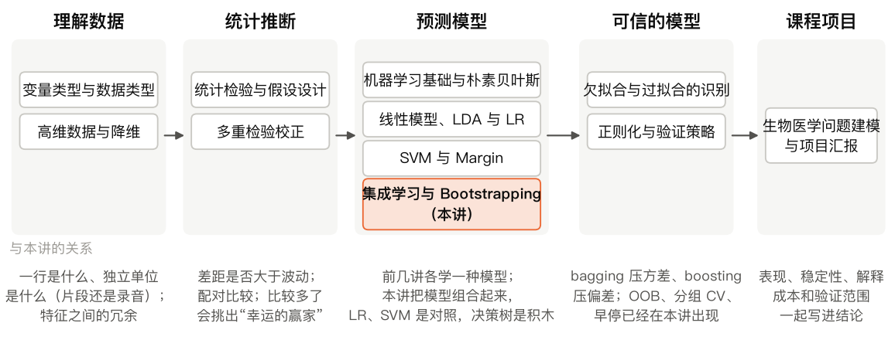
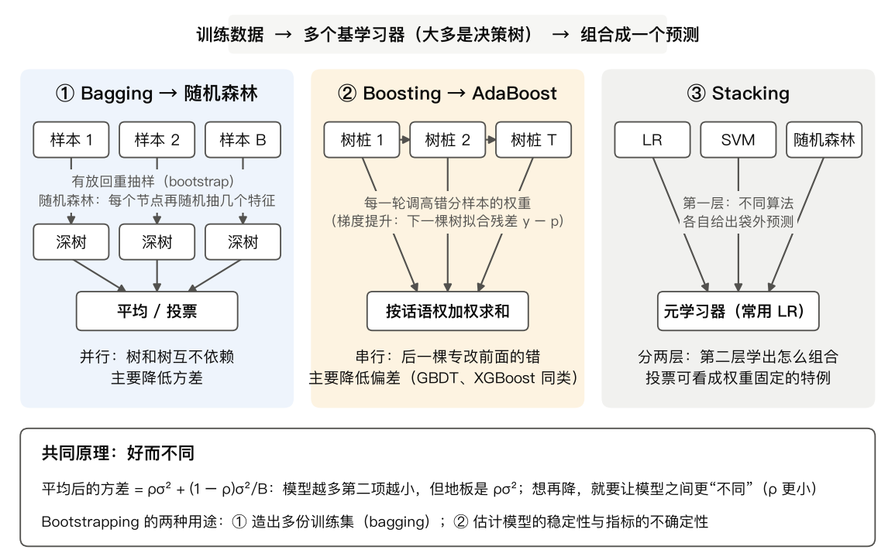
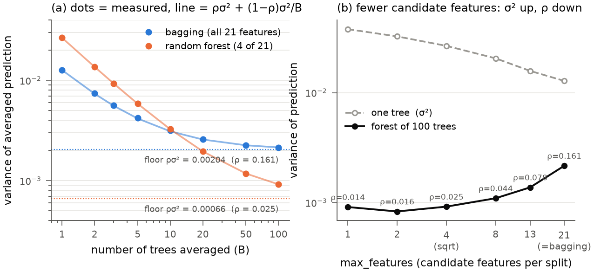
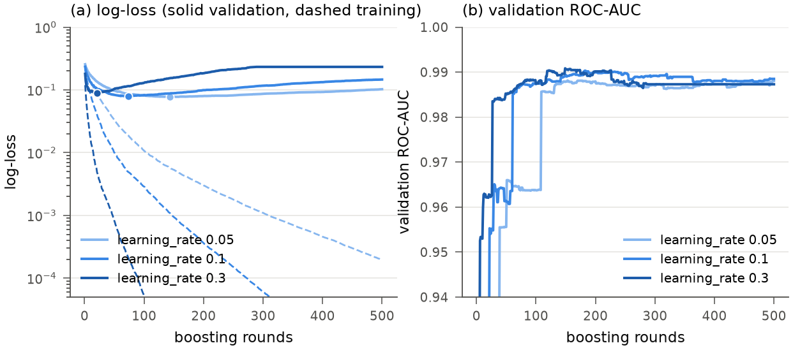

**先说结论。** 集成学习分三大类：bagging（代表是随机森林）、boosting（代表是 AdaBoost）和 stacking，共同的道理是“好而不同”。以前两类为例，集成有效，靠的是把许多棵“各错各的”树组合起来。平均能压低方差，压不低偏差，而且压到 ρσ² 就停住了，ρ 是树和树之间的相关。这个式子在我的数据上能直接量出来：bagging 的 100 棵树全用同一类特征做根节点，ρ = 0.161；随机森林每次分裂只让树看 4 个候选特征，单棵树反而更不稳（σ² 大了一倍），ρ 却降到 0.025，100 棵平均后的方差只有 bagging 的四成多，验证 AUC 从 0.951 升到 0.996。Boosting 走的是另一条路，一轮一轮修正前一轮的错误，主要降偏差，代价是轮数多了概率会变得过分自信。和逻辑回归放在同一个按录音分组的协议下比，随机森林的优势方向一致，但幅度小于折间波动。在这份数据上真正卡住结论的，是验证集里的 34 个病理片段只来自 12 段录音。

老师这一讲的问题是：多个弱模型怎样组合成更稳定的模型？集成什么时候有效，什么时候无效？在同一数据、同一协议下，它到底比简单模型好多少？下面先用两张图交代全局，一张是这一讲在整门课里的位置，一张是集成学习有哪几类，然后再沿着一条主线，用 CTG 数据把每一类方法讲清楚。

# 一、先看全局：这一讲在哪里，集成学习有哪几类

## 1.1 这一讲在课程里的位置

{width=15.5cm}

这门课大致走了五步：先理解数据（变量类型、高维与降维），再学统计推断（假设检验、多重检验校正），然后进入预测模型，从朴素贝叶斯、线性模型和逻辑回归到 SVM，接下来讲怎样识别和对抗欠拟合、过拟合，最后落到课程项目上。集成学习是“预测模型”这一段的最后一讲。前面几讲每次学一种模型，各有各的假设：朴素贝叶斯假设特征之间独立，逻辑回归假设对数几率是线性的，SVM 找离两类最远的那条边界。这一讲换了一个问题：不再去找一个更好的单个模型，而是把多个模型组合起来，让它们互相抵消彼此的不稳定。

我觉得它的重要性有三点。第一，在生物医学的表格数据上，随机森林和梯度提升树（XGBoost、LightGBM）是最常用的强模型，课件第 12 页也这么写；不懂它们，现在的临床预测文献基本读不下去。第二，它把前面几讲串了起来：决策树是集成的积木，逻辑回归和 SVM 是必须先跑的对照；“医学模型不能只看 accuracy”、“差距是否大于波动”、“比较多了会挑出幸运的赢家”这些前几讲的结论，在这次的模型比较里都要用上。第三，它直接引出后面两讲：bagging 压的是方差，boosting 压的是偏差，对应的正是过拟合和欠拟合；OOB、分组交叉验证、boosting 的早停，已经是验证策略和正则化的内容。这次在 CTG 上碰到的“按片段划分会偏乐观”，就是下一讲要讲的信息泄露的一个现成例子。

## 1.2 集成学习的三大类

{width=15.5cm}

集成学习的共同套路是：训练多个基学习器，再把它们的预测组合成一个。按“怎样让基学习器彼此不同”和“怎样组合”，可以分成三大类。

**① Bagging（Bootstrap Aggregating），代表是随机森林。** 对训练集做有放回重抽样（bootstrap），造出很多份略有不同的训练集，每份训练一棵深树，最后平均或投票。树和树互不依赖，可以并行训练。随机森林在 bagging 的基础上，让每个节点只从随机抽出的几个特征里选切分，树和树就更不一样。这一类主要降低方差。

**② Boosting，代表是 AdaBoost（Adaptive Boosting）。** 树一棵接一棵地训练，后一棵专门修正前面的错误：AdaBoost 调高错分样本的权重，梯度提升（GBDT）让新树去拟合残差 y − p，XGBoost 和 LightGBM 是梯度提升在工程和正则化上的改进。最后按每棵树的话语权加权求和。这一类主要降低偏差，只能串行。

**③ Stacking（模型堆叠）。** 分两层：第一层放几种不同的算法，比如逻辑回归、SVM、随机森林；第二层再训练一个元学习器（常用逻辑回归），拿第一层的预测当输入，学出该信谁、信多少。投票和平均可以看成元学习器权重固定的特例。这里有一个容易踩的坑：喂给元学习器的必须是第一层模型的袋外预测，也就是在它没见过的那一折上的预测，否则元学习器会特别信任最会“背答案”的那个模型；在 CTG 上，这一折还得按录音来切。工作单和作业包围绕前两类展开，所以 stacking 我只在这里介绍，并在第九节用数据说明它为什么可能有用，没有专门做实验。

三类方法背后是同一个道理，用周志华《机器学习》第 8 章的话说是个体学习器要“好而不同”：单个模型要够好，彼此之间又要错得不一样。课件第 8 页的方差公式把这句话写成了数：平均后的方差 = ρσ² + (1 − ρ)σ²/B，模型越多第二项越小，但地板是 ρσ²，想再往下降，就得让模型之间更“不同”。题目里的另一半 Bootstrapping，在这一讲有两种用途：一是给 bagging 造训练集，二是估计模型的稳定性和指标的不确定性。这两种用途后面分开讲。

## 1.3 这份作业怎么讲

后面的内容沿着图 2 往下走，用的都是同一份 CTG 数据。第二节交代数据：一行是一段信号片段，真正独立的单位是录音。第三到五节是三类方法共同的底座：一棵决策树怎么预测、为什么会摇摆，几棵树怎样投票，平均为什么能降方差，并在 CTG 上把 ρ 和 σ² 量出来。第六节讲 Bootstrapping 本身：有放回抽样改变了什么，OOB 为什么在 CTG 上偏乐观。第七节是第一类，从 bagging 到随机森林；第八节是第二类，从 AdaBoost 到梯度提升和 XGBoost。第九节把集成和逻辑回归、SVM 放进同一个协议里公平比较，也就是课堂练习，顺带说明 stacking 的动机；第十节是 Bootstrapping 的第二种用途，稳定性和不确定性；第十一节是特征重要性，也就是集成的“黑箱”问题。最后三节是 bagging 与 boosting 的对照表、研究备忘录，以及回到这一讲的核心问题。

贯穿全文的有两条线。一条是概念线“好而不同”：bagging 靠随机抽样制造不同，随机森林再加一层特征随机，boosting 靠专门针对上一轮的错误制造不同，stacking 靠换算法制造不同。另一条是数据线“CTG 里真正独立的是录音，不是片段”：bootstrap、OOB、交叉验证和区间估计，只要把片段当成独立样本，结果都会偏乐观。

工作单 A 到 H 我都做了，但没有按题号填。每个实验都先写了预测再运行，猜错的地方保留了下来。所有数字来自我自己写的实验脚本（Python 3.12.16，scikit-learn 1.8.0），只读 `student/` 下的训练集和验证集；模型和预设参数与课程的 `demo_ensemble.py` 一致，那个脚本的输出我也跑过并核对过。测试集的结果不放在这份作业里，等老师安排后再报告。

# 二、先搞清楚一行是什么

课件给了两套数据让我们自己挑。我选了方案 B，胎心监护（CTG）。一是 PPT 上决策树、深度表、翻转率和特征重要性的例子都来自方案 A 的 WDBC，换一套数据能逼自己把每一步重新算一遍；二是 WDBC 上逻辑回归和 SVM 的验证 AUC 已经顶到 1.000，集成和基线之间没有比较的余地，CTG 上能看到随机森林和 bagging 真正拉开差距；三是 CTG 一段录音被切成好几段，正好拿来想清楚“什么才算独立样本”。

CTG 数据来自 UCI 的 Cardiotocography：SisPorto 软件从胎心监护信号里自动提取 21 个特征，三位产科专家给出共识判读 NSP（正常、可疑、病理）。课程把病理型记为 `pathologic = 1`，正常和可疑合为 0。21 个特征包括胎心率基线 LB、每秒的加速 / 胎动 / 宫缩 / 各类减速次数、短时和长时变异（ASTV、MSTV、ALTV、MLTV），以及胎心率直方图的宽度、众数、均值、中位数、方差等。

最要紧的一点是：**一行是一段信号片段，不是一位孕妇。** 开发集（训练 + 验证）的 1703 个片段来自 282 段录音，一段录音中位数切成 4 段，最多 33 段。片段之间有多像？我把 21 个特征标准化后，给每个片段找欧氏距离最近的另一个片段，68% 的情况下这个“最像的邻居”来自同一段录音。所以划分必须按录音来，同一段录音的片段只能出现在一个集合里，交叉验证也要按录音分组，否则模型在验证时看到的其实是训练时见过的录音的“兄弟片段”。

| 集合 | 片段 | 录音 | 病理片段 | 含病理片段的录音 |
|---|---:|---:|---:|---:|
| 训练 | 1279 | 209 | 108（8.4%） | 29 |
| 验证 | 424 | 73 | 34（8.0%） | 12 |

Table: 表 1　训练集与验证集的组成（按 `recording_id` 分组划分，seed 1010）

表 1 最后一列是我后来才注意到、又反复回来看的一个数：验证集的 34 个病理片段只来自 12 段录音，其中 REC-327 一段就占了 6 个。这意味着验证集上“多判对一个病理片段”很可能是“多判对一段录音里的好几个片段”，它们不是 34 次独立的检验。后面第九、十节会用到这一点。

`sample_id` 和 `recording_id` 都不能做输入。前者只是编号；后者如果放进去，模型会去记“这段录音是病理的”，换一批录音就没用了。标签是专家对这段信号的判读，不是胎儿结局，也不是未来风险的概率。训练集用来拟合，验证集用来在预先定好的设置之间比较，测试集在协议写定后只揭示一次。

先算一个基线：验证集里全部判成“非病理”，accuracy = 390 / 424 = 0.920，可是一个病理片段都没找出来，平衡准确率（敏感度和特异度的平均）只有 0.5。阳性只占 8%，accuracy 没有意义，所以全文看 ROC-AUC、PR-AUC 和平衡准确率。

# 三、一棵树怎么预测，又为什么会摇摆

## 3.1 读一棵深度为 2 的树

{width=15.5cm}

树在每个节点问一个“某特征 ≤ 阈值吗”的问题，样本沿着回答一路走到叶节点，叶节点里训练样本的类别比例就是预测概率。拿验证集的三个片段手推：

```
CTG-1682（REC-327，病理）：Mode = 91 ≤ 106 → 左；Max = 193 ≤ 234 → 叶节点（病理 54 / 其余 3）
                            P(病理) = 54 / 57 = 0.947，判病理，判对
CTG-0297（REC-100，病理）：Mode = 148 > 106 → 右；ALTV = 78 > 68.5 → 叶节点（病理 25 / 其余 2）
                            P(病理) = 25 / 27 = 0.926，判病理，判对
CTG-0002（REC-002，正常）：Mode = 141 > 106 → 右；ALTV = 0 ≤ 68.5 → 叶节点（病理 29 / 其余 1164）
                            P(病理) = 29 / 1193 = 0.024，判非病理，判对
```

Mode 是胎心率直方图的众数，106 次/分以下差不多就是胎心长时间偏慢；ALTV 是长时变异异常的时间百分比。这两条规则读起来像临床经验，但树并不懂临床，它只是在找能把两类分得最“纯”的切法。

**Gini 不纯度怎么用来挑切分。** Gini = 1 − Σp²，等于随机抽两个样本、类别不同的概率，越小越纯。根节点手算：

```
根节点：p = 108 / 1279 = 0.0844
       Gini = 1 − 0.0844² − 0.9156² = 0.1546
按 Mode ≤ 106 切开：
  左  59 个（病理 54）：Gini = 1 − (54/59)² − (5/59)² = 0.1551
  右 1220 个（病理 54）：Gini = 1 − (54/1220)² − (1166/1220)² = 0.0846
  加权 = (59 × 0.1551 + 1220 × 0.0846) / 1279 = 0.0879
  下降 = 0.1546 − 0.0879 = 0.0668
```

这里有个反直觉的地方：左边那 59 个的 Gini（0.1551）几乎和根节点一样。这一刀的收益主要不在左边，而在于把一半病理片段从 1220 个的大组里拿走，让大组变纯。树在所有特征、所有候选阈值里挑加权 Gini 下降最多的那一刀，然后对两边重复。

**为什么树不需要标准化。** 切分只比较“≤ 阈值”的先后次序。我把 AC、FM、UC、DL、DS、DP 六个“每秒次数”全部换成“每小时次数”（乘 3600），单棵树、随机森林、梯度提升在验证集上的预测分数最大差都是 0。不标准化的逻辑回归有 9 个片段改判，平衡准确率从 0.845 变成 0.948；不标准化的 RBF-SVM 有 11 个改判。逻辑回归换单位后反而变好，这不说明“每小时”是更好的单位：每秒计数的数值在 0.001 量级，要很大的系数才用得上，L2 正则又惩罚大系数，等于把这几个特征压住了，换成每小时以后惩罚变轻。结果随单位变，本身就是问题，不能拿验证集去挑单位。两个都放进 StandardScaler 的 pipeline 后，换单位前后的预测完全相同。

## 3.2 树越深，训练越好，验证不一定

我运行前的预测：验证表现在深度 3 到 4 最好，再深就会掉，典型的过拟合曲线。

| max_depth | 叶节点数 | 训练平衡准确率 | 验证平衡准确率 | 验证 ROC-AUC |
|---|---:|---:|---:|---:|
| 1 | 2 | 0.748 | 0.586 | 0.586 |
| 2 | 4 | 0.864 | 0.777 | 0.776 |
| 3 | 7 | 0.929 | 0.865 | 0.866 |
| 4 | 11 | 0.970 | 0.880 | 0.865 |
| 5 | 13 | 0.986 | 0.894 | 0.880 |
| 8 | 19 | 0.991 | 0.894 | 0.938 |
| 不限 | 21 | 1.000 | 0.894 | 0.894 |

Table: 表 2　单棵树的深度对照（训练集拟合，验证集评价）

训练一路升到 1.000，这一半猜对了；验证没有掉下来，而是在 0.88 到 0.89 之间平着，这一半猜错了。不限深度的树只长到第 9 层、21 个叶节点就把训练集分干净了，CTG 的病理片段一团一团聚在少数录音里，树不需要切太碎。验证 AUC 跳来跳去（0.865、0.880、0.938、0.894），是因为一棵树只能给出叶节点数那么多种分数，21 个叶子就只有 21 种排序，AUC 对这种粗颗粒很敏感。所以单棵树的问题与其说是“越深越差”，不如说是下面这个：不稳。

## 3.3 换一份训练样本，树就变了

我原来以为根节点会很稳，Mode ≤ 106 在第一棵树上那么干净。对训练集做 30 次有放回重抽样，每次拟合一棵深度 2 的树：

| 根节点特征 | 次数（前 10 次） | 次数（30 次） | 阈值范围 |
|---|---:|---:|---|
| Mode | 7 | 21 | 106.0 到 108.5 |
| Mean | 3 | 9 | 102.5 到 107.5 |

Table: 表 3　30 次 bootstrap 重抽样后深度 2 树的根节点

30 棵树里根节点在 Mode 和 Mean 之间换来换去，把第二层也算上，一共出现了 15 种不同的结构。换的原因不难理解：Mode 和 Mean 的相关系数是 0.90，携带的信息几乎一样，训练数据稍微一变，“哪个下降多一点点”就翻转了，而根节点一换，下面所有的规则都跟着换。这 30 棵树在验证集上有 8.0% 的片段至少被判过一次不同的类别。

深一点的树更夸张。第十节会看到，同一批 30 份训练集上，深度 4 的单树让 7.5% 的验证片段改判，30 次的验证 AUC 从 0.58 到 0.90 都有。这就是课件第 6 页那句话在 CTG 上的样子：单棵深树偏差低、方差高，训练数据一抖，树和预测就跟着抖。集成要解决的就是这个问题。

# 四、几棵树一起投票

## 4.1 工作单的四个样本

| 样本 | 真值 | 三棵树的类别 | 硬投票 | 三个概率 | 概率均值 | 软投票 |
|---|---:|---|---:|---|---:|---:|
| A | 1 | 1, 1, 0 | 1 ✓ | .80, .70, .45 | 0.650 | 1 ✓ |
| B | 0 | 0, 1, 1 | 1 ✗ | .20, .60, .65 | 0.483 | 0 ✓ |
| C | 1 | 0, 1, 1 | 1 ✓ | .35, .75, .80 | 0.633 | 1 ✓ |
| D | 0 | 0, 0, 1 | 0 ✓ | .15, .25, .70 | 0.367 | 0 ✓ |

Table: 表 4　工作单的硬投票与软投票手算

样本 B 就是“多数票错了，但概率均值判对”的情况：两棵树投了 1，可它们只是勉强过线（0.60、0.65），而投 0 的那棵很确定（0.20）。硬投票只数人头，软投票还听了每棵树有多确定。sklearn 的随机森林用的是软投票，把各树的概率平均后再按 0.5 判类。

## 4.2 在自己的数据上找同样的情况

我预测在 CTG 上这种分歧会很常见。用训练集的 5 份 bootstrap 样本各拟合一棵小树（深度 4、每个叶子至少 10 个片段），在 424 个验证片段上看硬投票和软投票：

- 97.9% 的片段五棵树意见完全一致。
- 硬投票和软投票只在 2 个片段上不同，都是 REC-339 的病理片段：

```
CTG-1879（病理）：五棵树的概率 1.000, 0.333, 0.438, 0.286, 0.714
                  类别 1, 0, 0, 0, 1 → 硬投票 2 : 3，判 0，判错
                  概率均值 = (1.000 + 0.333 + 0.438 + 0.286 + 0.714) / 5 = 0.554，判 1，判对
```

这是样本 B 的镜像：三棵树勉强说“不是”，两棵树很确定说“是”，软投票听进去了那份确定。分歧这么少，是因为 CTG 的叶节点大多很纯，概率不是接近 0 就是接近 1，硬投票和软投票自然一致；真正有分歧的恰好是边界上的病理片段，而这正是最需要判对的那部分。

还有一个让我意外的结果：五棵树里最好的那棵，验证平衡准确率 0.941，比软投票（0.880）和硬投票（0.850）都高。但在排序上，软投票的 AUC 0.954 比五棵树里任何一棵都高（单树最高 0.941）。我的理解是，平均不保证胜过运气最好的那棵树，可事先根本不知道哪棵运气好；如果拿验证集挑出那棵，验证集就被用来做了选择，0.941 也就不能再当作对新数据的估计。

回到开头那句“好而不同”。林轩田在《机器学习技法》Blending and Bagging 一讲里的说法是 diversity + democracy，模型要足够不一样，多数才能纠正少数。这五棵树“好”是够的，“不同”却很有限，97.9% 的片段上它们说的是同一句话。投票能有多少收益，取决于有多少“不同”。下一节把“不同”量化。

# 五、平均为什么能降方差：把课件第 8 页的式子量出来

课件第 8 页给的式子：B 个同分布、两两相关系数为 ρ、方差为 σ² 的预测取平均，

$$\mathrm{Var}\left(\frac{1}{B}\sum_{b=1}^{B} T_b\right) = \rho\sigma^2 + \frac{1-\rho}{B}\sigma^2$$

不用推导，直接读出工作单的三个问题：

1. B 增大时第二项趋于 0，方差最低降到 ρσ²，不会到 0。
2. ρ 接近 1，也就是几个模型总犯同样的错，平均后还是 σ²，投票几乎没有用。
3. 平均作用在方差上，偏差（平均预测离真值多远）不变。所以 bagging 要用偏差低、方差高的深树；逻辑回归本来方差就小，重抽样后系数变化不大，ρ 很高，bagging 它几乎没有收益。李沐在 B 站《实用机器学习》5.2 Bagging 那一节的课件上写的是 bagging 主要对不稳定的学习器有用，例子正是“决策树不稳定，线性回归稳定”；李宏毅的 Ensemble 一讲也说 bagging 适合复杂、容易过拟合的模型，比如决策树。

这个式子是 *The Elements of Statistical Learning* 第 15.2 节的式 (15.1)，随机森林那一章就从它出发。书里说 bagging 后的树偏差和单棵树一样，“唯一的希望是降低方差”，而随机森林的做法是在每次分裂时只抽 m ≤ p 个候选变量，去压低树之间的相关。式子本身是代数，只要树同分布、两两相关相同就成立。我想知道的是 CTG 上 σ² 和 ρ 实际是多少，它们能不能解释后面随机森林和 bagging 的差距。

**怎么量。** 用 30 份 bootstrap 训练集（就是课程脚本里稳定性实验那 30 份），每份上训练 100 棵树的 bagging 或随机森林，每份换一个算法种子，记下每棵树对 424 个验证片段的概率，得到 30 × 100 × 424 的数组。对每个验证片段：

```
σ²  = 3000 个单树概率的方差                         （换训练集、换树的随机性，单棵树抖多少）
ρσ² = 各训练集上 100 棵树均值的方差 − 树内方差 / 100   （同一片森林里两棵树共同的那部分波动）
ρ   = ρσ² / σ²
```

再把 424 个片段平均。另外把 100 棵树切成若干组互不重叠的 B 棵小森林，直接量“B 棵树平均后跨训练集的方差”，和式子对照。

{width=15.5cm}

| | 单棵树方差 σ² | 树间相关 ρ | 地板 ρσ² | B = 1 | B = 10 | B = 100 | 验证 AUC |
|---|---:|---:|---:|---:|---:|---:|---:|
| bagging（21 个特征全给） | 0.0127 | 0.161 | 0.00204 | 0.0127 | 0.00316 | 0.00215 | 0.951 |
| 随机森林（每次 4 个） | 0.0266 | 0.025 | 0.00066 | 0.0266 | 0.00326 | 0.00092 | 0.996 |

Table: 表 5　在 CTG 验证片段上量出的 σ² 和 ρ，以及 B 棵树平均后实测的方差

运行前我的预测是：随机森林的树更稳，所以森林更稳。前一半错了。随机森林的单棵树方差是 bagging 的两倍多（0.0266 对 0.0127），每次只给 4 个特征，树当然更随意。可它的 ρ 只有 0.025，是 bagging 的六分之一。B = 1 时随机森林更抖，B = 10 时两者差不多，B 过了 10 以后 bagging 被它的地板 0.0020 托住，怎么加树都下不去，随机森林一路降到 0.0009。图 4(a) 上两条线在 B ≈ 10 处交叉，就是这个道理。

图 4(b) 把这个权衡摊开：候选特征越少，ρ 从 0.161 一路降到 0.014，σ² 从 0.013 升到 0.038。100 棵树平均后的方差在 max_features = 2 时最低。但方差最低不等于最好：max_features = 1 时验证 AUC 仍有 0.996，默认阈值下的平衡准确率却掉到 0.749，因为每棵树只能在一个随机特征上切，单树变弱，病理片段拿到的概率整体变低：34 个病理片段的概率中位数在 max_features = 4 时是 0.76，到 1 时只有 0.51，只剩 17 个过得了 0.5。排序还在，阈值却过不去了。分组五折 CV 的 AUC 和 PR-AUC 都在默认的 4 个特征（√21 取整）处最高。降 ρ 是有代价的，代价是单棵树变差。

还量了另一种“相关”：同一片森林里，各棵树在验证片段上的残差（概率减真值）两两相关的平均值，bagging 是 0.62，随机森林是 0.41。这更接近“树犯同样的错”的字面意思，方向和 ρ 一致。

# 六、Bootstrap 到底改变了什么

## 6.1 一次有放回抽样

课件第 9 页从 [1, 2, 3, 4, 5] 抽 5 次得到 [2, 2, 5, 1, 2]：2 被抽了 3 次，是重复样本；1 和 5 各一次；3 和 4 没被抽到，是这棵树的袋外（OOB）样本。不同样本占 3 / 5 = 0.6。

每条记录一次都没被抽中的概率是 (1 − 1/n)ⁿ，所以不同样本占比的期望是 1 − (1 − 1/n)ⁿ，n 很大时趋于 1 − 1/e ≈ 0.632，袋外约 36.8%。模拟 1000 次：

| n | 不同样本占比均值 | 标准差 | 最小 | 最大 | 理论值 |
|---:|---:|---:|---:|---:|---:|
| 5 | 0.675 | 0.144 | 0.2 | 1.0 | 0.672 |
| 1279 | 0.6321 | 0.0088 | 0.604 | 0.663 | 0.6323 |

Table: 表 6　1000 次有放回抽样的不同样本占比

刘建平的《Bagging 与随机森林算法原理小结》就是用 (1 − 1/m)ᵐ → 1/e 推出约 36.8% 的数据不会被采到；StatQuest 讲随机森林时说得更口语，大约三分之一的原始数据进不了 bootstrap 数据集。63.2% 是平均规律，不是每次固定。n = 5 时一次可能只抽到 1 个不同的记录（占比 0.2），也可能 5 个全抽到；n = 1279 时波动小得多，但每次仍在 60% 到 66% 之间变。

Bagging 就是用这个办法从一份训练集造出 100 份略有不同的训练集，每棵树用一份，树和树之间互不依赖，可以同时训练。

## 6.2 OOB：不留验证集也能估表现，但在 CTG 上偏乐观

OOB 的算法是：每条训练记录只让“没抽到它”的那些树来预测，汇总这些预测就得到 OOB 误差。我预测它和验证集结果差不多。用 300 棵树的随机森林，只用训练集：

| 估计方式 | accuracy | ROC-AUC | PR-AUC | 平衡准确率 | 敏感度 |
|---|---:|---:|---:|---:|---:|
| sklearn 的 OOB（按片段抽样） | 0.990 | 0.995 | 0.975 | 0.956 | 0.917 |
| 我自己按录音抽样的 OOB | 0.968 | 0.989 | 0.879 | 0.869 | 0.750 |
| 训练集内按录音分组五折 CV | 0.970 | 0.990 | 0.897 | 0.891 | 0.796 |
| 同一模型在验证集上 | 0.981 | 0.997 | 0.972 | 0.896 | 0.794 |

Table: 表 7　四种方式估计 300 棵树随机森林的表现

sklearn 的 OOB 敏感度 0.917，验证集上只有 0.794，按录音的两种估计在 0.75 到 0.80，OOB 明显偏乐观。原因在于 bootstrap 抽的是片段：我模拟了 1000 次，一个片段落在袋外时，它所在录音的其他片段有 94.6% 的概率在袋内（最少的一次也有 90.6%），整段录音全落在袋外的只占 6.6%。“没见过这个片段”的树，大多见过它的兄弟片段。我改成按录音抽样（抽中一段录音就把它的所有片段放进去），OOB 的敏感度立刻降到 0.750，和分组 CV 对上了。

AUC 被高估得不多（0.995 对 0.989），阈值类指标被高估得多：排序大体还对，但兄弟片段让模型对“见过的录音”判得特别有把握。林轩田把 OOB 误差叫做 bagging 和随机森林的 self-validation，自己验证自己。在 CTG 上，这个“自己”和验证对象共享录音，验证就打了折扣。所以 OOB 能代替验证集做的是粗调树数这类事（第七节的 OOB 曲线 100 棵以后就平了），不能代替锁定的测试集，在分组数据上也不能直接当作对新录音的估计。

# 七、Bagging 和随机森林：多出来的那一点随机性

课件第 10 页把单树、bagging、随机森林放在一张表里：bagging 比单树多了样本重抽样，随机森林又多了“每个节点只看随机抽的几个特征”。林轩田的课件把它写成一个等式：随机森林 = bagging + 随机子空间的 C&RT 树。PPT 上 WDBC 的例子里随机森林和 bagging 几乎没差别，我预测 CTG 上也差不多。

| 模型 | 验证 ROC-AUC | PR-AUC | 平衡准确率 | 预测 SD 均值 | 类别翻转率 |
|---|---:|---:|---:|---:|---:|
| 单棵树（深度 4） | 0.865 | 0.725 | 0.880 | 0.028 | 7.5% |
| bagging（100 棵，全特征） | 0.951 | 0.895 | 0.896 | 0.015 | 4.7% |
| 随机森林（100 棵，sqrt 特征） | 0.996 | 0.958 | 0.896 | 0.016 | 3.8% |

Table: 表 8　单树、bagging、随机森林在验证集上的表现，以及同一批 30 份 bootstrap 训练集重训后验证片段的预测标准差和类别翻转率

这个预测错得很彻底。AUC 从 0.951 到 0.996，PR-AUC 从 0.895 到 0.958。

{width=15.5cm}

图 5(b) 是我觉得最能说明问题的一张：bagging 的 100 棵树，根节点不是 Mode 就是 Mean（70 和 30），每棵树看到的是同一批最强的特征，重抽样只是让阈值挪一挪，树长得都差不多，这就是 ρ = 0.161 的来历。随机森林的根节点分散在 13 个特征上，DP（延长减速）、ALTV、ASTV 这些在 bagging 里从来轮不到当根节点的特征，在随机森林里各有一批树从它们出发。

差距具体落在哪些片段上？bagging 给 3 个病理片段的概率是 0，和 361 个正常片段并列在最底下，AUC 一下子就被拖下来了；随机森林没有一个病理片段的概率是 0，最低的也有 0.10。那 3 个片段，比如 REC-339 的 CTG-1881，Mode 是 135、Mean 是 109，都在根节点阈值“正常”的一侧，所有以 Mode / Mean 起头的 bagging 树都把它送进了“正常”的叶子；随机森林里从其他特征起头的树还能给它 0.17 的概率。

为了确认差别确实来自特征随机化而不是两个类的实现不同，我用 `RandomForestClassifier(max_features=None)`，也就是不限制候选特征，其他都不变，验证 AUC 是 0.951，和 bagging 一模一样。

**树多了会不会过拟合。** 图 5(a) 里随机森林 10 棵树时 AUC 就到 0.993，之后到 500 棵基本是平的，OOB AUC 从 100 棵起停在 0.996 左右，没有下降。bagging 加到 500 棵也只有 0.979，还不如 10 棵树的随机森林，这正是地板 ρσ² 的样子。树多只是平均得更充分、更慢，不会过拟合。

不过默认阈值下的平衡准确率有一段插曲：bagging 从 200 棵到 300 棵，平衡准确率从 0.910 掉到 0.822。我去查是哪些片段，发现是 REC-327 的 6 个病理片段，它们的概率在 200 棵树时都是 0.51 左右，300 棵时一起变成 0.47 左右，同时跨过了 0.5。一段录音，6 个片段，像一个人一样整体移动。这又回到第二节：片段不是独立的，验证集上平衡准确率的一个“台阶”可能就是一段录音。

# 八、Boosting：一轮一轮改错

Bagging 的树互不相干，boosting 的树是排着队来的，后一棵专门去修前一棵没做好的地方。

## 8.1 AdaBoost：错分的样本下一轮更重

我自己写了一个 AdaBoost（树桩、二分类、学习率 1），每轮记录全部 1279 个样本的权重，再和 sklearn 的 `AdaBoostClassifier` 对照，6 轮的加权错误率和每棵树的权重小数点后全部一致。第 1 轮手算：

StatQuest 讲 AdaBoost 时把它叫作“一片树桩组成的森林”，每个树桩有一个 amount of say，下面就叫“话语权”。

```
起始权重：每个样本 1/1279
第 1 个树桩：Mode ≤ 106 判病理，否则判非病理
  错分 59 个：Mode > 106 的病理片段 54 个，Mode ≤ 106 的正常片段 5 个
  加权错误率 ε = 59 / 1279 = 0.0461
  这棵树的话语权 α = ln((1 − ε) / ε) = ln(0.9539 / 0.0461) = ln(20.68) = 3.029
  错分样本的权重 × e^α = × 20.68，再整体归一化
  归一化后：错分样本的权重变成原来的 1/(2ε) = 10.84 倍，判对的变成 1/(2(1 − ε)) = 0.524 倍
```

刘建平的 AdaBoost 小结和 StatQuest 用的都是 α = ½ ln((1 − ε)/ε) = 1.515，错的乘 e^α、对的乘 e^−α；sklearn 用的是不带 ½ 的写法。两种写法归一化以后权重完全一样。

| 轮次 | 树桩 | 错分数 | 加权错误率 ε | α | 新权重下这个树桩的错误率 |
|---:|---|---:|---:|---:|---:|
| 1 | Mode ≤ 106 | 59 | 0.046 | 3.03 | 0.5 |
| 2 | ASTV ≤ 60.5 | 267 | 0.166 | 1.62 | 0.5 |
| 3 | AC ≤ 0.0021 | 564 | 0.337 | 0.68 | 0.5 |
| 4 | DP ≤ 0.0015 | 79 | 0.205 | 1.35 | 0.5 |
| 5 | ALTV ≤ 68.5 | 85 | 0.314 | 0.78 | 0.5 |
| 6 | AC ≤ 0.0021 | 564 | 0.246 | 1.12 | 0.5 |

Table: 表 9　前 6 轮 AdaBoost。错分数是未加权的个数，ε 是按当前权重算的

最后一列是我算完才注意到的：每一轮更新完权重，刚用过的那个树桩在新权重下的错误率都正好是 0.5。这是 1/(2ε) 那一步的直接结果，错分样本的总权重被拉到正好一半。林轩田在《机器学习技法》Adaptive Boosting 一讲里讲的就是这一点，课件上写的是 make g_t random-like：重新加权的目的，是让上一轮的树在新权重下表现得像乱猜，下一棵树就不会再学出一样的东西，于是自然地“不同”。李宏毅的 Ensemble 一讲也是同一句话：f₁ 在新权重下的表现是随机的。林轩田那一讲开头的比喻我很喜欢：老师教一班六岁小孩认苹果，Michael 说苹果是圆的，老师说只说圆会犯好几个错，还能说什么；Tina 说是红的，Joey 说也可能是绿的，Jessica 说顶上有梗。每个孩子只说一条简单规则（树桩），老师的作用是引导大家去关注前面的人搞错的那些例子（重新加权）。这和随机森林降 ρ 是同一个目标，手段不一样：一个靠随机，一个靠刻意针对。

{width=15.5cm}

图 6(a) 里 CTG-0021 是一个 Mode = 129 的病理片段，第 1 轮被错分，权重变成 10.8 倍，第 2 轮又错，到 32.7 倍。图 6(b) 更直观：病理片段本来只占 8.4%，第 1 轮之后它们分到了 48% 的权重，第 5 轮之后是 67%。少数类在 AdaBoost 眼里很快就不再是少数。第 3 轮和第 6 轮选了同一个树桩 AC ≤ 0.0021，那个树桩错分了 557 个正常片段，权重一移过去，下一轮又得把它们拉回来，AdaBoost 就在这样来回修正。

和 bagging 的区别也就清楚了：bagging 每一份 bootstrap 样本独立抽，和别的树的表现无关；AdaBoost 每一轮的权重取决于前面所有树错在哪，只能一棵接一棵地训。

## 8.2 梯度提升：新树拟合的是 y − p

梯度提升不改权重，而是让每棵新树去拟合当前损失的负梯度。二分类对数损失下，模型输出对数几率 F，p = 1 / (1 + e^−F)，对 F 求导后的负梯度正好是 y − p，StatQuest 把它叫“伪残差”，就是观测值减去预测概率。刘建平的 GBDT 小结里二分类用的是 y ∈ {−1, +1} 的写法，负梯度写成 y / (1 + e^{yF})。我对了一下：y = +1 时是 1 / (1 + e^F) = 1 − p，y = −1 时是 −1 / (1 + e^−F) = −p，换回 0/1 标签就是 y − p，两种写法是一回事。手算起点：

```
初值：p₀ = 108 / 1279 = 0.0844，F₀ = ln(0.0844 / 0.9156) = −2.383     （sklearn 的 init_ 给出同样的 0.0844）
第一棵树要拟合的“残差”：病理片段 1 − 0.0844 = 0.916；其他片段 0 − 0.0844 = −0.084
```

第一棵回归树的根节点又是 Mode ≤ 106。叶节点的值不是残差的平均，而是一步牛顿法：Σ(y − p) / Σp(1 − p)。拿全是病理片段的那个叶子（24 个）算：0.916 / (0.0844 × 0.916) = 1 / 0.0844 = 11.84，和 sklearn 树里存的值 11.8426 一致；其余 6 个叶子我也逐个对过。验证集的 CTG-0008（病理）落在值为 9.687 的叶子里，乘学习率 0.1：

```
F₁ = −2.383 + 0.1 × 9.687 = −1.415      p₁ = 1 / (1 + e^1.415) = 0.195
```

sklearn 的 `staged_predict_proba` 给出 0.195。这个片段往后一路上升，第 10 轮 0.52，第 100 轮 0.99。分母里的 p(1 − p) 是对数损失对 F 的二阶导，StatQuest 梯度提升第 4 集推导叶子输出值时得到的也是这个式子。刘建平的 XGBoost 小结说 GBDT 只做一阶泰勒展开、XGBoost 做二阶展开；严格说，sklearn 的实现在定叶子值时已经用了一步二阶，但选切分时看的仍然只是一阶的残差，XGBoost 是连选切分都用二阶信息。

并不是每个片段都被修好了。验证集的 CTG-0321 也是病理片段，第 100 轮的概率是 0.001，模型非常确定它不是病理。我去看它所在的 REC-107：6 个片段的标签是 0、1、0、1、1、0，交替出现，CTG-0321 的 ALTV 是 18，而同录音另外两个病理片段的 ALTV 是 84，两个正常片段是 56 和 44。从特征上看它更像正常片段。这种标签和特征对不上的点，boosting 在训练集上碰到会一轮轮加大力度去拟合，这就是课件说它“可能追随噪声”的意思。

## 8.3 学习率和轮数

我预测轮数太多会过拟合，验证 AUC 会掉。固定 max_depth = 3，学习率分别取 0.05、0.1、0.3、1.0，各训练 500 轮：

{width=15.5cm}

| learning_rate | 验证损失最低的轮数 | 最低验证损失 | 第 500 轮验证损失 | 最低点的验证 AUC | 第 500 轮验证 AUC |
|---:|---:|---:|---:|---:|---:|
| 0.05 | 143 | 0.077 | 0.102 | 0.988 | 0.988 |
| 0.1 | 74 | 0.080 | 0.146 | 0.987 | 0.989 |
| 0.3 | 21 | 0.088 | 0.232 | 0.963 | 0.987 |
| 1.0 | 2 | 0.149 | 0.639 | 0.951 | 0.855 |

Table: 表 10　梯度提升的学习率与轮数。损失指对数损失

过拟合确实发生了，但不在我以为的地方。训练损失一路降到 10⁻⁴ 以下，验证损失在学习率 0.1 时第 74 轮最低，到 500 轮翻了将近一倍；可验证 AUC 几乎不动，甚至略高。也就是说，多出来的几百轮没有把排序搞乱，而是让概率变得过分自信：判对的推到 0.999，判错的也推到 0.001，对数损失对后者惩罚极重。学习率越小，需要的轮数越多（0.05 要 143 轮，0.3 只要 21 轮），学习率 × 轮数大致是个固定的预算；学习率 1.0 时第 2 轮就到了最好，后面基本失控。

所以轮数要用验证集或 early stopping 来定，而且要看对数损失这种对概率敏感的指标，只看 AUC 会以为加多少轮都没事。sklearn 自带的 early stopping 会从训练集里随机留出 20% 的行做验证，在 CTG 上这又会把兄弟片段分到两边；这次它停在第 66 轮，和按录音分组的验证集给出的 74 轮差不多，算是运气好，原则上应该按录音留出。

## 8.4 XGBoost、LightGBM 和 sklearn 的梯度提升

课件说不要求运行，我查了资料。三者本质上都是梯度提升树，差别在工程和正则化上。XGBoost 在目标函数里加了树复杂度的正则项 γT + ½λΣw²（T 是叶子数，w 是叶子值），官方文档 Introduction to Boosted Trees 写得很直接：把损失做二阶泰勒展开，用来算每个叶子的最优值和每次分裂的增益，8.2 节那一步牛顿法就是这个思路的简化版；它还能自动学缺失值往哪边走。LightGBM 把连续特征先分箱成直方图，按叶子而不是按层生长，样本多时快很多。sklearn 的用户指南写明，0.21 版加入的 `HistGradientBoostingClassifier` 是受 LightGBM 启发写的。我顺手在 CTG 上跑了它的默认设置：验证 AUC 0.992、PR-AUC 0.958，25 折分组 CV 的 AUC 0.992 ± 0.004，和随机森林、普通梯度提升在同一档。在 1700 个片段、21 个特征的数据上，速度优势体现不出来。

# 九、公平比较：集成到底比简单模型好多少

课件第 4 页写 CTG 上“树集成在 PR-AUC、balanced accuracy 上优于 LR / SVM”，我运行前也是这么预期的，觉得会看到一个清楚的赢家。

**协议**（运行前写定）：七个模型用课程预设参数，不调参；逻辑回归和 RBF-SVM 的 StandardScaler 只在每折训练部分拟合，树模型不标准化；SVM 用 decision_function 算 AUC，不当概率；阈值全部用默认规则。先在固定划分上用训练集拟合、验证集评价；再在开发集（训练 + 验证，282 段录音）上做按录音分组的五折 CV，换 5 个随机种子重复，共 25 折，每一折所有模型用同样的划分。

| 模型 | 验证 AUC | 验证 PR-AUC | 验证平衡准确率 | 敏感度 | 特异度 | FN | FP |
|---|---:|---:|---:|---:|---:|---:|---:|
| 单棵树 | 0.865 | 0.725 | 0.880 | 0.765 | 0.995 | 8 | 2 |
| bagging | 0.951 | 0.895 | 0.896 | 0.794 | 0.997 | 7 | 1 |
| 随机森林 | 0.996 | 0.958 | 0.896 | 0.794 | 0.997 | 7 | 1 |
| AdaBoost | 0.981 | 0.908 | 0.837 | 0.676 | 0.997 | 11 | 1 |
| 梯度提升 | 0.987 | 0.939 | 0.897 | 0.794 | 1.000 | 7 | 0 |
| 逻辑回归 | 0.994 | 0.923 | 0.921 | 0.853 | 0.990 | 5 | 4 |
| RBF-SVM | 0.982 | 0.893 | 0.778 | 0.559 | 0.997 | 15 | 1 |

Table: 表 11　验证集上的比较（34 个病理片段，390 个其他片段）

单一验证集上，随机森林的 AUC 和 PR-AUC 最高，可平衡准确率最高的是逻辑回归，它多找出了 2 个病理片段，代价是多 3 个误报。我把漏掉的片段逐个列出来：随机森林和梯度提升各漏 7 个，其中 6 个相同，包括 REC-339 的片段和前面那个 CTG-0321；逻辑回归漏的 5 个几乎是另一批，REC-004 的 3 个片段、REC-100 的 1 个，再加 CTG-0321。三个模型都漏掉的只有 CTG-0321。线性模型和树模型错在不同的录音上，错误不完全相关，这正是课件第 7 页说的集成能起作用的前提，也是我后面不愿意只留一个模型的原因之一。这也正是开头说的 stacking 想利用的东西：如果让一个元学习器去学“什么情况下信逻辑回归、什么情况下信随机森林”，也许能把两边各自漏掉的录音补回来一些。不过验证集上能体现这种互补的只有几段录音，元学习器又必须用按录音切出来的袋外预测来训练，这次就不展开了。

| 模型 | ROC-AUC | PR-AUC | 平衡准确率 | 分组 / 按行，PR-AUC |
|---|---:|---:|---:|---:|
| 单棵树 | 0.822 ± 0.139 | 0.700 ± 0.133 | 0.866 ± 0.075 | 0.737 / 0.860 |
| bagging | 0.980 ± 0.014 | 0.898 ± 0.060 | 0.915 ± 0.043 | 0.892 / 0.960 |
| 随机森林 | 0.993 ± 0.004 | 0.925 ± 0.052 | 0.905 ± 0.040 | 0.944 / 0.975 |
| AdaBoost | 0.990 ± 0.007 | 0.915 ± 0.051 | 0.894 ± 0.056 | 0.901 / 0.963 |
| 梯度提升 | 0.988 ± 0.006 | 0.908 ± 0.057 | 0.919 ± 0.030 | 0.939 / 0.946 |
| 逻辑回归 | 0.988 ± 0.007 | 0.912 ± 0.049 | 0.869 ± 0.055 | 0.923 / 0.931 |
| RBF-SVM | 0.973 ± 0.024 | 0.862 ± 0.076 | 0.813 ± 0.086 | 0.875 / 0.929 |

Table: 表 12　开发集按录音分组的 5 × 5 折 CV，均值 ± 折间标准差。最后一列只用 seed 1010 的一次五折，对比按录音分组和不分组、按行随机划分的 PR-AUC

{width=15.5cm}

**差距是否大于折间波动。** 只看均值 ± 标准差还不够，每一折所有模型用的是同一批录音，应该看同一折里的配对差：

| 配对差（25 折） | ROC-AUC | PR-AUC | 平衡准确率 |
|---|---|---|---|
| 随机森林 − 逻辑回归 | +0.005（SD 0.007），19 折为正 | +0.013（SD 0.056），16 折为正 | +0.036（SD 0.039），21 折为正 |
| 梯度提升 − 逻辑回归 | −0.000（SD 0.009），10 折为正 | −0.005（SD 0.077），12 折为正 | +0.050（SD 0.067），21 折为正 |
| 随机森林 − RBF-SVM | +0.020（SD 0.021），23 折为正 | +0.063（SD 0.064），20 折为正 | +0.092（SD 0.075），23 折为正 |
| 随机森林 − bagging | +0.013（SD 0.013），20 折为正 | +0.028（SD 0.048），21 折为正 | −0.010（SD 0.058），12 折为正 |

Table: 表 13　同一折内的配对差：均值、标准差，以及 25 折中差值为正的折数

我从这张表读出四件事。

一、随机森林对逻辑回归，AUC 和平衡准确率的方向是稳定的，25 折里分别有 19 折和 21 折占优，但平均差距都小于折间标准差；PR-AUC 只高 0.013，标准差是它的四倍，基本分不出高低。如果只做一次五折（seed 1010），随机森林的 PR-AUC 是 0.944，逻辑回归 0.923，差 0.021，看起来像个结论；换 5 个种子重复后差距缩到 0.013。一次划分的运气就能贡献这么多。

二、梯度提升在排序上和逻辑回归没有差别，平衡准确率高 0.05，这主要是默认阈值下树模型对少数类更敏感，而不是排序能力更强。平衡准确率依赖阈值，AUC 和 PR-AUC 不依赖，两者不能混着说。

三、SVM 在每一项上都落后，默认参数下敏感度只有 0.56，它在这里吃亏主要在阈值，而不是排序。随机森林对 bagging 的 AUC 差距在 25 折里也是稳定的。

四、每一折的 26 到 34 个病理片段只来自 5 到 10 段录音，折间标准差大，根源就在这里。图 8 的橙色菱形和表 12 最后一列是按行随机划分的结果，同一个种子下所有模型都被抬高，单棵树的 AUC 从 0.866 升到 0.932。抬高的幅度不一样：单树的 PR-AUC 从 0.737 到 0.860，bagging 从 0.892 到 0.960，逻辑回归只从 0.923 到 0.931。越灵活的模型越能“记住”训练集里的兄弟片段，泄漏对它们的好处也越大。如果按行划分，会得出“集成大幅领先”的结论，而这个领先有一部分是泄漏给的。这和第六节 OOB 偏乐观是一回事。

**选型。** 对照课件第 14 页：CTG 是表格数据、21 个特征、有非线性和交互（Mode 偏低单独就能判病理，ALTV 高要和其他特征一起看），这是随机森林和梯度提升的主场；但它的样本单位是录音，有效样本量远小于 1703。我会优先考虑随机森林：不调参就在 AUC 和平衡准确率上方向一致地领先，对录音变化最稳（第十节），而且不用标准化。可如果下游要的是能解释的系数、校准好的概率，或者数据换到一家只有几十段录音的医院，我会回到逻辑回归，它在这份数据上的差距并没有大到值得放弃可解释性。

# 十、稳定性和不确定性不是一回事

课件第 16 页列了三件事：重复训练时预测变不变；固定一个已经训练好的模型，它的指标有多大的区间；换一家医院、一批人，表现会怎样。前两件本课数据能回答，第三件不能。

## 10.1 重复训练：预测抖多少

课程脚本对训练集按片段做 30 次 bootstrap，所有模型共用同一批训练集，看验证片段的类别是否翻转。我把七个模型都加了进去，又按录音做了一组 30 次 bootstrap（抽中一段录音就带上它的全部片段），因为在 CTG 上录音才是独立的单位。

我的预测：逻辑回归是线性模型，最简单，应该最稳。

{width=15.5cm}

| 模型 | 按片段：翻转率 | 按片段：AUC 最低 | 按录音：翻转率 | 按录音：病理片段翻转率 | 按录音：AUC 均值 ± SD | 按录音：AUC 最低 |
|---|---:|---:|---:|---:|---:|---:|
| 单棵树 | 7.5% | 0.575 | 9.2% | 76% | 0.824 ± 0.086 | 0.646 |
| bagging | 4.7% | 0.922 | 6.1% | 59% | 0.958 ± 0.018 | 0.909 |
| 随机森林 | 3.8% | 0.990 | 3.3% | 38% | 0.991 ± 0.007 | 0.975 |
| 梯度提升 | 4.7% | 0.947 | 6.6% | 68% | 0.979 ± 0.015 | 0.929 |
| 逻辑回归 | 4.7% | 0.989 | 7.8% | 74% | 0.962 ± 0.046 | 0.833 |

Table: 表 14　30 次 bootstrap 重训后的预测稳定性。翻转率指 424 个验证片段中至少被判过一次不同类别的比例

按片段重抽样时，逻辑回归和 bagging、梯度提升一样稳，30 次 AUC 最低也有 0.989，我的预测看起来是对的。换成按录音重抽样，结论变了：逻辑回归的翻转率从 4.7% 升到 7.8%，有一次 AUC 掉到 0.833，而随机森林的翻转率反而略降，最差一次 AUC 仍有 0.975。我的解释是，逻辑回归的系数会被几段特征很极端的录音拉着走，某次重抽样恰好把这样的录音抽了两三遍（一段录音带着十几个片段），整条决策边界就偏了；随机森林里每棵树只受自己那份样本影响，平均以后单段录音的分量被稀释。按片段抽样时，一段录音的片段被打散，这种“整段录音被重复”的情况很难出现，所以看不出来。

还有两个细节。一是 34 个病理片段里，随机森林有 38% 至少翻转过一次，逻辑回归是 74%：整体翻转率只有几个百分点，是因为 390 个正常片段大多离边界很远；真正摇摆的就是病理片段，也就是最要紧的那部分。二是我只换算法种子、训练数据固定，随机森林只有 0.9% 的片段翻转，预测 SD 0.009，比换训练数据时的 3.8% 和 0.016 小得多。森林的随机性主要来自数据，而不是它自己掷的骰子。

## 10.2 固定模型：指标有多大的区间

这一步本来是给测试集准备的，测试集还没打开，我先在验证集上演示。把训练集上拟合好的模型固定住，对验证集重抽样 2000 次：一种按片段抽，一种按录音抽（含病理片段的 12 段录音和不含的 61 段分别有放回地抽，保证每次都有病理片段）。

| 指标（验证集） | 点估计 | 按录音重抽样 95% 区间 | 按片段重抽样 95% 区间 |
|---|---:|---|---|
| 随机森林 PR-AUC | 0.958 | 0.897 到 0.994 | 0.908 到 0.995 |
| 逻辑回归 PR-AUC | 0.923 | 0.779 到 0.988 | 0.835 到 0.987 |
| 随机森林 − 逻辑回归，AUC | +0.002 | −0.003 到 0.011 | −0.003 到 0.007 |
| 随机森林 − 逻辑回归，PR-AUC | +0.035 | −0.023 到 0.156 | −0.019 到 0.099 |
| 随机森林 − 逻辑回归，平衡准确率 | −0.025 | −0.144 到 0.103 | −0.115 到 0.064 |
| 随机森林 − bagging，AUC | +0.045 | 0.002 到 0.089 | 0.000 到 0.104 |

Table: 表 15　固定模型在验证集上的 bootstrap 区间（2000 次，百分位法；差值为同一重抽样内的配对差）

随机森林对 bagging 的 AUC 差距，区间不跨 0；随机森林对逻辑回归，三个指标的区间都跨 0。按录音抽的区间普遍比按片段的宽，逻辑回归 PR-AUC 的下限从 0.835 降到 0.779。把片段当独立样本，会低估不确定性。

这个区间要说清楚它管什么：它把这两个已经训练好的模型当作固定的，只回答“换一批同样来源的验证录音，这两个数会落在哪”。重新训练模型带来的变化（10.1 节）它不包含，用验证集挑模型的乐观它不包含，换医院、换设备、换年代的变化它更不包含。数据说明里写着这是 1980 到 1998 年的历史录音，录音文件也不一定对应不同的孕妇，第三种不确定性本课的数据根本回答不了。

# 十一、特征重要性：模型用了什么，不是病因是什么

{width=15.5cm}

两种重要性的排名不一样。不纯度重要性的前几名是 Mode、Mean、ASTV、ALTV；置换重要性是 ALTV、DP、ASTV，Mode 排到第 6。

**Mode、Mean、Median 互相替补。** 三者两两相关 0.90 到 0.94。不纯度重要性把功劳分给了三个人，各 0.09 到 0.15；单独打乱任何一个，AUC 只降 0.002 到 0.005，因为另外两个还在，模型照样能用。三个一起打乱，AUC 降 0.019，是单独打乱之和（0.009）的两倍。如果只看图 10(b)，会以为“胎心率水平”对模型不重要，其实是它有三份备份。ALTV 和 ASTV 一起打乱降 0.041，也大于单独之和 0.030。

**DP 在两种重要性里差得最远**，不纯度第 6，置换第 2。DP 是每秒的延长减速次数，开发集里只有 7.5% 的片段不为 0，可病理片段里有 47% 不为 0。训练时它只在少数节点上被用到，累加的不纯度下降不多；可在验证集上一打乱，“有延长减速”这个标记被安到正常片段上、从病理片段上拿走，预测立刻变差。Width 正好相反，不纯度第 8，和 Min 一起打乱 AUC 也几乎不变：训练时被拿来切了不少刀，预测时可有可无。Strobl 等人 2007 年在 BMC Bioinformatics 上的文章专门讨论过不纯度重要性的偏差，结论是 Gini 重要性偏爱类别多的变量和连续变量。sklearn 文档有一个例子叫 Permutation Importance with Multicollinear or Correlated Features，说的正是 Mode、Mean、Median 这种情况：特征共线时，打乱其中一个对表现影响很小，因为模型能从相关特征拿到同样的信息。它给的办法是先按相关性把特征聚类，每类留一个，或者像我这样把一组一起打乱。

**为什么不能写成因果。** CTG 这里还有一层更直接的原因：标签本身就是专家看着胎心监护判出来的，专家判读时看的正是基线、变异和减速。ALTV、DP 排在前面，与其说是模型发现了病理的原因，不如说是模型学会了专家的判读规则。它说明“这个模型预测时依赖什么”，不说明“胎儿为什么出问题”。

# 十二、Bagging 与 Boosting 对照

| 方面 | Bagging（含随机森林） | Boosting（AdaBoost、梯度提升） |
|---|---|---|
| 训练方式 | 并行。每棵树互不依赖，可以同时训 | 顺序。下一棵树取决于前面所有树错在哪 |
| 每一轮用什么数据 | 一份 bootstrap 样本（约 63.2% 的不同记录）；随机森林每个节点再随机抽候选特征 | 同一份训练集。AdaBoost 提高错分样本的权重；梯度提升拟合当前损失的负梯度 y − p |
| 基学习器 | 深树，不剪枝。偏差低、方差高，正好让平均去压方差 | 浅树或树桩。单棵偏差高、方差低，靠逐轮叠加降偏差 |
| 主要降什么 | 方差。下限是 ρσ²，随机森林靠特征随机化压低 ρ（CTG 上 0.161 → 0.025） | 偏差。每一轮修正前面的系统性错误 |
| 对噪声和轮数 | 较稳健。树多不会过拟合，只是变慢（RF 10 棵到 500 棵 AUC 基本不变） | 敏感。会一轮轮追着难分的点和错标的点；轮数多了概率过分自信（学习率 0.1 时验证损失第 74 轮最低，500 轮翻倍） |
| 关键超参数 | n_estimators（几百棵足够）、max_features（CTG 上 sqrt 最好）、min_samples_leaf | learning_rate × n_estimators（用验证集或 early stopping 定轮数）、max_depth（常用 3 到 6）、subsample |
| 在 CTG 上的样子 | 随机森林 AUC 0.996，按录音重抽样最稳 | 梯度提升 AUC 0.987，平衡准确率最高之一；AdaBoost 敏感度偏低 |

Table: 表 16　Bagging 与 Boosting 对照

把开头的 stacking 也放进来，三类方法正好是图 2 的三列，目标都是一群“好而不同”的模型。Bagging 和随机森林用随机性制造“不同”，然后平均；boosting 用刻意针对上一轮错误的方式制造“不同”，然后加权相加；stacking 直接换不同的算法，再让元学习器学怎么组合。Bagging 的每个成员都很强但很抖，boosting 的每个成员都很弱但很稳，stacking 的成员本来就各有所长。

# 十三、研究备忘录

在这份 CTG 数据和按录音分组的协议下，我首选随机森林，同时保留逻辑回归作对照，不宣布唯一赢家。表现上，25 个分组折里随机森林的 AUC 比逻辑回归高 0.005，19 折占优，但小于折间标准差；PR-AUC 只高 0.013，标准差 0.056，分不出高低；单一验证集上平衡准确率最高的反而是逻辑回归。稳定性上，按录音重抽样训练 30 次，随机森林有 3.3% 的验证片段改判，逻辑回归 7.8%，最差一次 AUC 只有 0.83。解释成本上，逻辑回归有系数可读，随机森林只能看置换重要性，Mode、Mean、Median 还互相替补。验证范围上，34 个病理验证片段只来自 12 段录音，随机森林对逻辑回归的差值区间都跨 0，结论只限这批历史录音和这次划分。如果锁定测试集或外院数据上随机森林的敏感度不再领先，我会改用更简单、可校准的逻辑回归。特征重要性只说明模型依赖什么，不是病因。

# 十四、回到核心问题

**多个弱模型怎样组合成更稳定的模型。** 把它们平均。平均后的方差是 ρσ² + (1 − ρ)σ²/B，树越多第二项越小，但地板是 ρσ²。所以真正决定集成上限的不是树的数量，而是树和树之间有多不一样。CTG 上 bagging 的树全从 Mode 或 Mean 出发，ρ = 0.161，加到 500 棵 AUC 也只有 0.979；随机森林让每个节点只看 4 个随机特征，单棵树更差了，ρ 却降到 0.025，10 棵树就到 0.993。Boosting 换了一个思路：不靠平均掉随机误差，而是让每一棵新树去补前面的系统性错误，AdaBoost 用权重，梯度提升用负梯度 y − p。Stacking 再往前一步，把不同算法放在一起，让元学习器去学怎么组合。

**集成什么时候无效。** 一是 ρ 接近 1，模型总犯同样的错，比如 bagging 一个本来就稳定的逻辑回归，或者在只有一个强特征的数据上做全特征 bagging。二是错误不来自方差而来自数据本身：CTG-0321 这种和同录音标签交替、特征更像正常的片段，平均多少棵树都判不对，boosting 还会越拟合越偏。三是比较的对象本来就很强：在 CTG 上逻辑回归的 AUC 已经 0.988，集成多出来的 0.005 小于划分本身的波动。

**我原来想错的几件事。** 我以为随机森林的树更稳，其实是更不稳但更不相关；以为 OOB 和验证集差不多，其实在分组数据上偏乐观；以为 boosting 过拟合会让 AUC 掉，其实先坏的是概率；以为逻辑回归最简单所以最稳，按录音重抽样以后它反而最不稳之一；以为会有一个清楚的赢家，其实 25 折配对比较下随机森林对逻辑回归的优势只在方向上站得住。

**拿到一个新的表格数据任务，我会先问什么。** 一行是什么，独立的单位是什么，CTG 上一行是片段、单位是录音，划分、CV、OOB、bootstrap 区间都要按单位来。阳性有多少个独立来源，34 个病理片段来自 12 段录音，这个数比 1703 更能说明证据有多硬。基线有多强，先跑逻辑回归，集成要在同一折里的配对比较中证明自己。用什么指标，排序指标和阈值指标分开报，类别不平衡时加 PR-AUC。最后，标签是怎么来的，如果标签本身是人看着这些特征判出来的，特征重要性就更不能读成机制。

# 参考资料

除课程包里的课件、工作单、数据说明和 `demo_ensemble.py` 外，做作业时看过下面这些材料，正文里引用过的已注明。

1. 周志华. 机器学习. 清华大学出版社, 2016. 第 8 章 集成学习（8.1 个体与集成，8.2 Boosting，8.3 Bagging 与随机森林）.
2. 林轩田. 機器學習技法（Machine Learning Techniques）. 台湾大学, 2015. Lecture 7 Blending and Bagging；Lecture 8 Adaptive Boosting；Lecture 10 Random Forest；Lecture 11 Gradient Boosted Decision Tree. 课件 https://www.csie.ntu.edu.tw/~htlin/mooc/ ；B 站搬运 BV1ix411i7yp
3. 李宏毅. ML Lecture 22: Ensemble. 台湾大学 Machine Learning 2016 课程（视频 2017 年上传）. https://www.youtube.com/watch?v=tH9FH1DH5n0
4. 李沐（跟李沐学AI）. 斯坦福 2021 秋季·实用机器学习（中文版）5.2 Bagging；5.3 Boosting. 哔哩哔哩, 2021. BV13g411N7xy ；BV1aM4y1P7z9
5. 刘建平Pinard. 集成学习原理小结；Bagging 与随机森林算法原理小结；集成学习之 Adaboost 算法原理小结；梯度提升树（GBDT）原理小结；XGBoost 算法原理小结. 博客园, 2016–2019. https://www.cnblogs.com/pinard/p/6156009.html ；https://www.cnblogs.com/pinard/p/6140514.html ；https://www.cnblogs.com/pinard/p/10979808.html
6. Josh Starmer. StatQuest: Random Forests Part 1；AdaBoost, Clearly Explained；Gradient Boost Part 3 (of 4): Classification；Gradient Boost Part 4 (of 4): Classification Details. YouTube, 2018–2019. https://www.youtube.com/watch?v=LsK-xG1cLYA ；https://www.youtube.com/watch?v=jxuNLH5dXCs
7. Hastie T, Tibshirani R, Friedman J. The Elements of Statistical Learning, 2nd ed. Springer, 2009. §15.2 Definition of Random Forests, 式 (15.1). https://hastie.su.domains/ElemStatLearn/
8. Breiman L. Bagging predictors. Machine Learning, 1996, 24(2): 123–140. doi:10.1007/BF00058655
9. Breiman L. Random forests. Machine Learning, 2001, 45(1): 5–32. doi:10.1023/A:1010933404324
10. Chen T, Guestrin C. XGBoost: A scalable tree boosting system. Proceedings of KDD 2016: 785–794. doi:10.1145/2939672.2939785
11. XGBoost 文档. Introduction to Boosted Trees. https://xgboost.readthedocs.io/en/stable/tutorials/model.html
12. Ke G, Meng Q, Finley T, et al. LightGBM: A highly efficient gradient boosting decision tree. Advances in Neural Information Processing Systems 30 (NIPS 2017).
13. Strobl C, Boulesteix A-L, Zeileis A, Hothorn T. Bias in random forest variable importance measures: illustrations, sources and a solution. BMC Bioinformatics, 2007, 8: 25. doi:10.1186/1471-2105-8-25
14. scikit-learn 文档. Ensembles（1.11）；Permutation feature importance（5.2）；示例 Permutation Importance with Multicollinear or Correlated Features. https://scikit-learn.org/stable/modules/ensemble.html
15. Ayres-de Campos D, Bernardes J, Garrido A, et al. SisPorto 2.0: a program for automated analysis of cardiotocograms. J Matern Fetal Med, 2000, 9(5): 311–318.
16. Campos D, Bernardes J. Cardiotocography [Dataset]. UCI Machine Learning Repository, 2000. doi:10.24432/C51S4N

# 附：复现说明

环境为 conda 环境 svm-lab：Python 3.12.16，pandas 3.1.1，scikit-learn 1.8.0，matplotlib 3.11.2。数据为课程包 `data-ctg/student/` 下的 train.csv（1279 段）和 validation.csv（424 段），按 `recording_id` 分组划分，seed 1010；测试标签未读取。七个模型的参数与 `demo_ensemble.py` 相同；表 8 的稳定性实验与课程脚本使用同一批 30 份 bootstrap 训练集。方差分解（表 5）每份训练集换一个算法种子；AdaBoost 权重为手写实现，与 sklearn 的 estimator_errors_ 和 estimator_weights_ 逐位核对；梯度提升的叶节点值与 sklearn 树中存储的值逐个核对。所有表格和图 3 到图 10 由实验脚本和作图脚本生成，图 1、图 2 是自己画的示意图。
